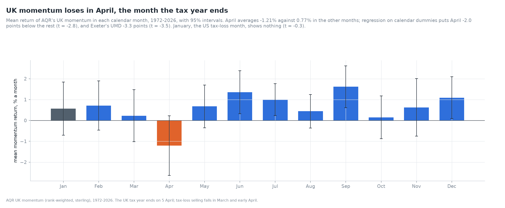
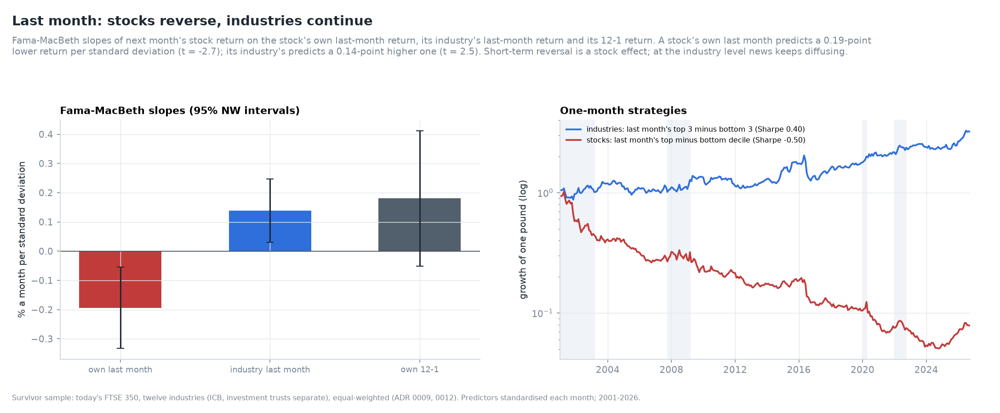
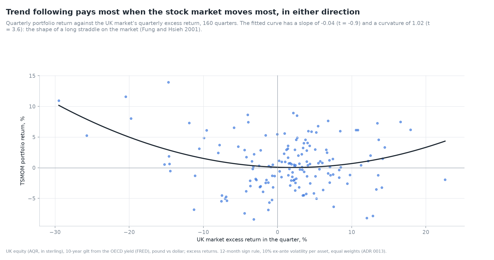

# uk-value-momentum

**Value and momentum in the UK stock market, 1972–2026.** A fifteen-day empirical study:
factors, momentum's anatomy, value's lost decade, crashes, risk or mispricing, trading costs
and UK stamp duty, the 2014 AIM stamp-duty natural experiment, short sellers, Brexit and the
gilt crisis, machine learning, and a final working paper.

[](https://github.com/elmarfarajov/uk-value-momentum/actions/workflows/ci.yml)


## Day 1 in numbers

| Factor (sterling) | Sample | Mean a year | Sharpe | 95% bootstrap interval | Newey-West *t* |
|---|---|---|---|---|---|
| Momentum (AQR, rank-weighted) | 1972–2026 | 7.2% | 0.49 | [0.22, 0.80] | 3.32 |
| UMD (AQR, Fama-French style) | 1987–2026 | 12.8% | 0.83 | [0.42, 1.33] | 4.51 |
| Value (AQR, rank-weighted) | 1981–2026 | 3.0% | 0.21 | [−0.14, 0.59] | 1.14 |
| HML (AQR) | 1988–2026 | 5.6% | 0.49 | [0.09, 0.94] | 2.33 |
| 50/50 value and momentum | 1981–2026 | | 0.86 | | |

* UK momentum clears a *t* of 3 in both constructions and both sources; UK value does not.
* Value and momentum correlate −0.61, so the mix's worst drawdown is 25%, against 70% for value
  alone.
* **AQR's UK factors are in US dollars** (undocumented). Everything here is converted to
  sterling ([ADR 0002](docs/adr/0002-aqr-in-dollars.md)).
* **Exeter's files are not its paper:** momentum averages 0.99% a month in the files against
  0.77% in Gregory et al. (2013).
* Free stock data is survivor data: today's FTSE 350 "beat" the market by 4.0% a year (corrected in v0.2.0).
* **Value is a premium once momentum is held constant:** its alpha rises from 2.2% (*t* = 0.8)
  to 7.6% (*t* = 3.5), and HML Devil's from 2.4% to 10.0% (*t* = 4.8).
* Momentum is a story about losers and small firms: small past losers earned 1.1% a year over
  cash for 36 years; momentum among small firms earned 14.8% (*t* = 5.2).
* Momentum and quality pay when the market falls (17.8% and 19.4% a year in down months).
* Value's Sharpe ratio is negative for every start year from 2004 to 2014.


Read the full note: [Fifty-four years of UK factors](docs/notes/fifty-four-years-of-uk-factors.md).
The note runs to about twenty pages, with 24 charts and 20 tables. All charts: [GALLERY.md](docs/GALLERY.md). Thirteen checks: [VALIDATION.md](docs/VALIDATION.md). Decisions: [docs/adr](docs/adr).

## Day 2: the anatomy of momentum

* **Short horizons pay, long ones give it back.** Held one month, 3- to 12-month signals earn 5-8% a
  year; held twelve months, about zero. Cohorts gain for three months and give back 14% over five
  years.
* **The skip month matters:** Sharpe 0.32 with it, 0.14 without; last month's losers beat last
  month's winners by 8.4% a year.
* **Residual momentum halves the risk:** Sharpe 0.49 against 0.28, drawdown 41% against 71%, market
  beta −0.08 against −0.54.
* **UK momentum loses in April, when the tax year ends:** 2.0 to 3.3 points below other months in
  all three survivorship-free series (Exeter *t* = −3.5); past losers rebound 3.6% in an average
  April. January shows nothing.
* **UMD pays after rising markets** (14.6% a year) and stalls after falling ones (1.8%).
* **Survivorship hides the short leg:** among today's FTSE 350 the losers *beat* the average stock;
  in Exeter's survivorship-free portfolios both legs earn.
* A data defect (Yahoo's monthly bars) was found and fixed; Day 1's survivorship figures are
  corrected ([Errata](docs/notes/fifty-four-years-of-uk-factors.md#errata-v020)).



Read the full note: [The anatomy of momentum](docs/notes/the-anatomy-of-momentum.md) - 22 charts,
19 tables.

## Day 3: industry momentum and sector rotation

* **UK stock momentum is stock-specific.** Industry-neutral momentum keeps the whole Sharpe ratio
  (0.32 vs 0.32, correlation 0.95) - the opposite of Moskowitz and Grinblatt's US finding.
* **Industry momentum lives at one month:** last month's top three industries beat the bottom
  three by 5.5% a year (*t* = 2.1); twelve-month industry momentum earns 1.9% (*t* = 0.6).
* **Last month, stocks reverse and industries continue:** Fama-MacBeth slopes of −0.19 (*t* = −2.7)
  on a stock's own last month and +0.14 (*t* = 2.5) on its industry's.
* **Real industries are distinct but no better than random groups for momentum** (39th percentile
  of 200 placebo groupings); no lead-lag network between industries.
* **Momentum is strongest among investment trusts** (Sharpe 0.50, *t* = 2.3).



Read the full note: [Industry momentum](docs/notes/industry-momentum.md) - 20 charts, 12 tables.

## Day 4: time-series momentum on UK assets

* **Trend following paid in UK equity, gilts and sterling:** Sharpe 0.21, 0.32 and 0.13; the
  volatility-scaled portfolio 0.36 (1973-2026), beating 99% of placebos with time-shifted signals.
* **A smile, not a beta:** quarterly returns against the UK market have curvature 1.02 (*t* = 3.6)
  and no linear exposure; gains in six of seven stress episodes (+27% in the dot-com bust, +21% in
  2022).
* **The one-month predictability of UK assets is an artefact** of the OECD gilt yield being a
  monthly average (autocorrelation 0.32); equity and sterling show none. The 12-1 rule is unaffected
  (Sharpe 0.38).
* **Factor momentum is stronger:** timing six UK factors by their own past return gives a Sharpe of
  0.88 (0.69 skipping the latest month), correlation 0.16 with asset trend following.
* **Among stocks, time-series momentum is cross-sectional momentum** plus a net market bet that
  earned little (alpha *t* = 0.1).



Read the full note: [Time-series momentum](docs/notes/time-series-momentum.md) - 12 charts, 14 tables.

## Data, honestly

No raw data is in this repository. AQR's, Exeter's and Yahoo's files are theirs to license.
`ukf data fetch` downloads them into `data/raw` (gitignored) and records each file's URL, time
and SHA-256 in a manifest ([ADR 0001](docs/adr/0001-two-sources-kept-local.md)).

| Source | What | Terms |
|---|---|---|
| [AQR data library](https://www.aqr.com/Insights/Datasets) | value, momentum, market, SMB, HML, HML Devil, UMD, QMJ for the UK and other markets | cite AQR Capital Management, LLC |
| [Exeter Xfi Centre](https://business-school.exeter.ac.uk/research/centres/xfi/famafrench/) | UK SMB, HML, UMD, market, risk-free rate, 1980–2016 | academic use; cite Gregory, Tharyan and Christidis (2013) |
| [FRED](https://fred.stlouisfed.org/) | UK three-month interbank rate, GBP/USD | public domain |
| Yahoo Finance and Wikipedia | today's FTSE 350 daily prices (sampled monthly) and ICB sectors; survivor sample, used comparatively | personal research use |

The tests and CI never need these files: `tests/conftest.py` writes synthetic data in each
source's own format. Validation checks that need the real data report SKIP without it.

## Usage

```bash
pip install -e ".[dev]"
ukf data fetch          # download everything into data/raw
ukf data list           # what is stored, with SHA-256
ukf stats               # summary statistics of every UK factor, in sterling
ukf validate --out docs/VALIDATION.md
ukf gallery             # redraw every chart in docs/images
```

## Layout

```
src/ukfactors/
  data/          store (manifest, hashes), aqr, exeter, fred, yahoo
  panel.py       one monthly panel in sterling (dollar-to-sterling conversion)
  stats.py       Newey-West, Lo (2002) Sharpe SE, stationary bootstrap, drawdowns
  analysis.py    alphas with NW errors, the value-momentum mix, portfolio grids, drawdown episodes, ACF
  survivorship.py  cleaning Yahoo's unit flips, 12-1 momentum, the survivorship bias
  momentum.py    J x K portfolios, event time, residual momentum, market states, seasonality, turnover
  sectors.py     ICB industries from free-text sector labels
  industry.py    industry portfolios, industry and industry-neutral momentum, Fama-MacBeth, lead-lag, placebo
  validation.py  twenty-three checks against independent methods and published numbers
  gallery/       every chart, registered so the gallery page and the images cannot drift
docs/notes/      one methodology note per day
docs/adr/        architecture decision records
```

## Related work

This project follows [meridian-investment-platform](https://github.com/elmarfarajov/meridian-investment-platform),
a portfolio management platform whose risk and attribution modules use factor models like
the ones measured here, and [private-markets-lab](https://github.com/elmarfarajov/private-markets-lab),
built alongside it.

## Roadmap

Fifteen days, one release each; see [ROADMAP.md](ROADMAP.md).

## Licence

Code: MIT. Data: see the table above. If you use this work, see [CITATION.cff](CITATION.cff).
