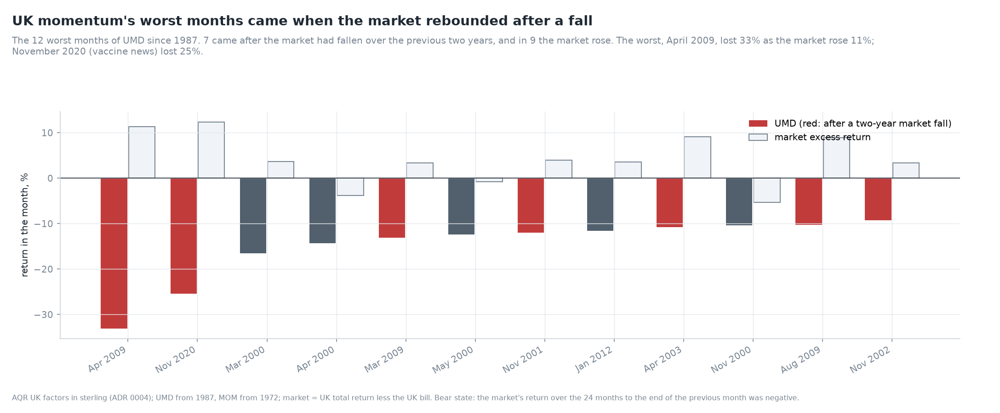
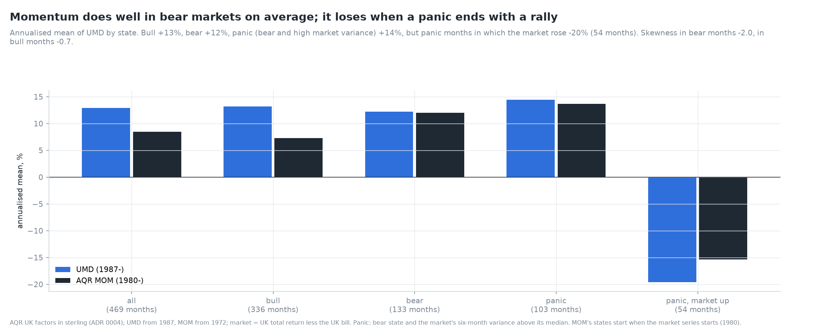
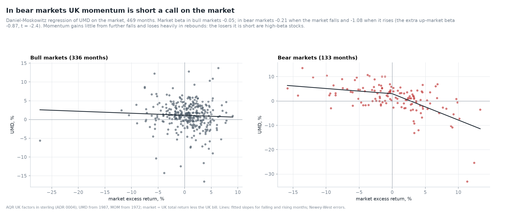
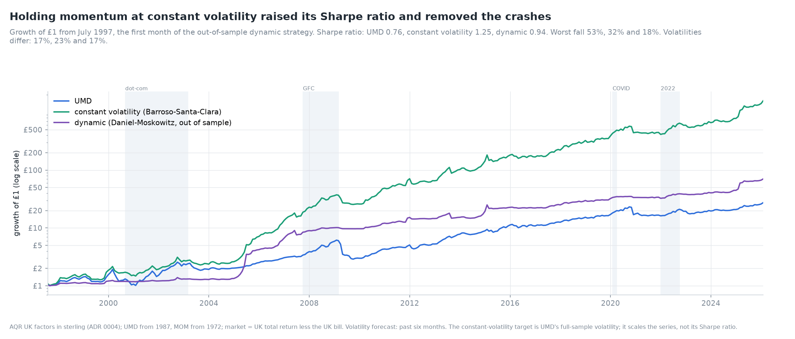
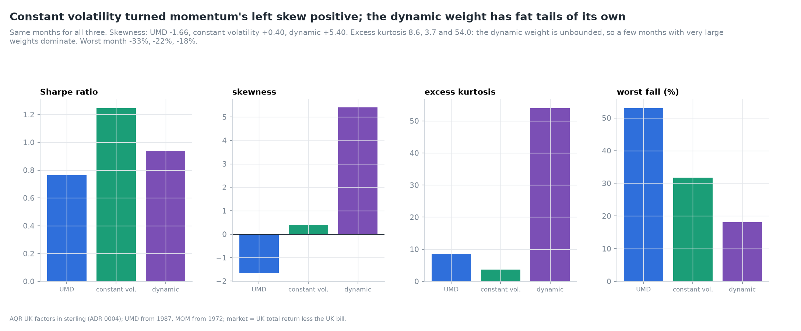
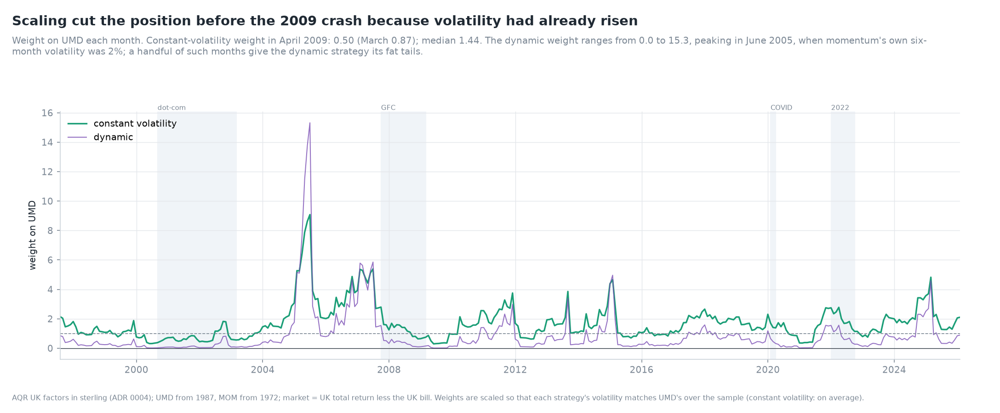
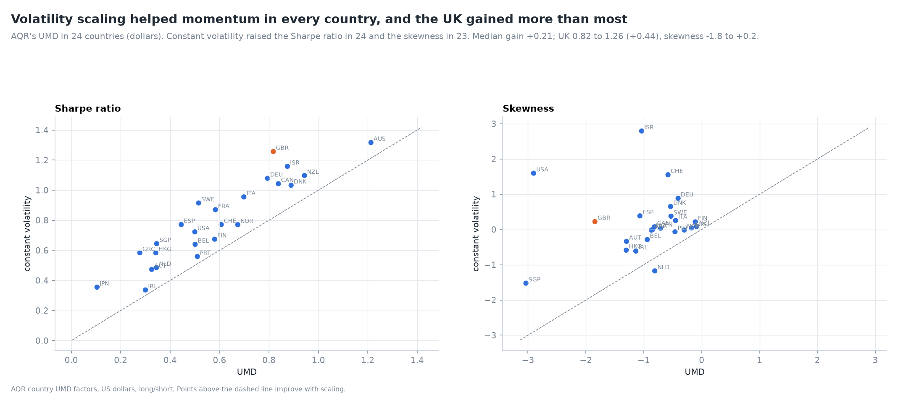
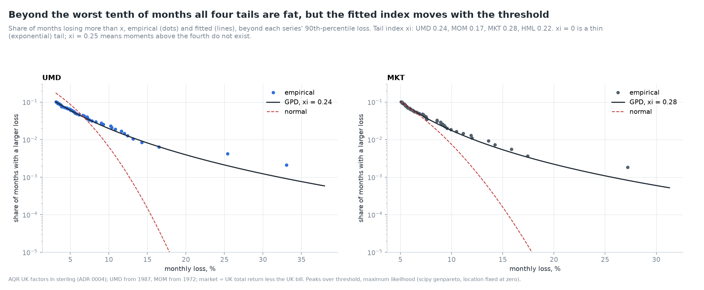
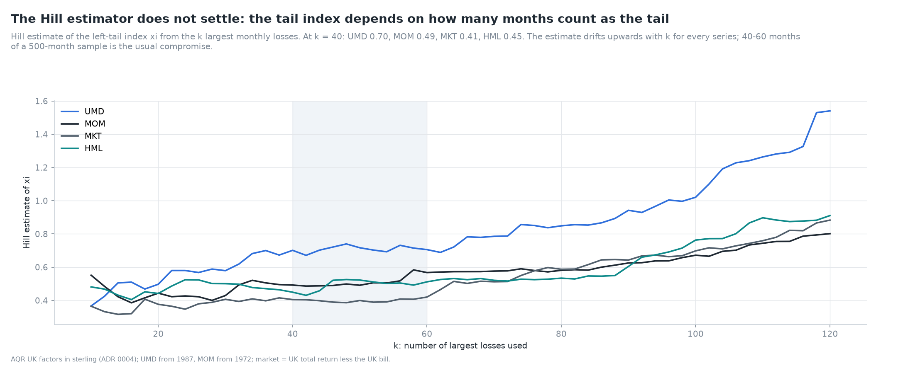
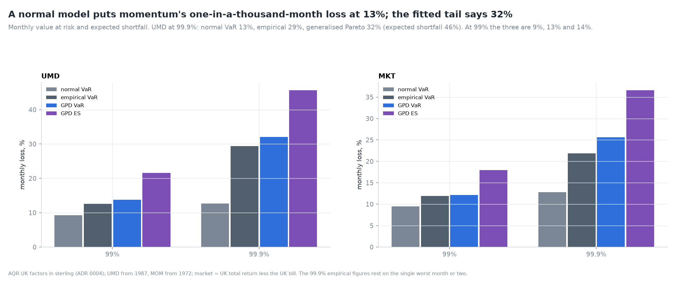

# Momentum crashes and tail risk in the UK

*Day 7 of 15 · uk-value-momentum v0.7.0*

## Summary

Momentum is the best-paid factor in the UK (Day 1) and the one with the worst crashes. This note
asks three questions of AQR's UK momentum factor (UMD, February 1987 to July 2026, in sterling):

- when the crashes happen (Daniel and Moskowitz 2016);
- whether holding momentum at constant risk avoids them (Barroso and Santa-Clara 2015);
- how fat the left tail is, measured with extreme value theory.

Findings:

1. **The crashes come when a falling market rebounds.** UMD's worst month, April 2009, lost 33%
   while the market rose 11%. Its second worst, November 2020 (the vaccine news), lost 25%. Of the
   12 worst months, 7 followed a two-year market fall, and in 9 the market rose.
2. **Momentum is short a call in bear markets.** After a two-year market fall, UMD's market beta is
   −0.21 when the market falls and −1.08 when it rises. The extra up-market beta is −0.87
   (*t* = −2.4). In bull markets the beta is −0.05 either way.
3. **Bear markets are not bad for momentum on average.** UMD earned 13% a year in bull markets,
   12% in bear markets and 14% in panic states (bear market plus high market variance). The losses
   are concentrated in panic months in which the market rose: −20% a year, over 54 months.
4. **Constant volatility raised the Sharpe ratio from 0.83 to 1.28** and turned the skewness from
   −1.71 to +0.24. The worst fall shrank from 53% to 32%, and the worst month from −33% to −22%.
   Capping the weight at two keeps the Sharpe ratio at 1.23.
5. **Daniel and Moskowitz's dynamic weight, forecast out of sample, also helps,** from 0.76 to 0.94
   over the same months. The weight is unbounded and reached 15 in June 2005, which gives the
   strategy an excess kurtosis of 54. The gain does not rest on those months: without May and
   June 2005 the Sharpe ratio is 1.04, and with the weight capped at two it is 1.22.
6. **Scaling helped momentum in all 24 of AQR's countries.** The median Sharpe ratio gain was
   +0.21, and the UK gained +0.44.
7. **The left tail is fat, but its index is poorly pinned down.** Beyond the worst tenth of months,
   a generalised Pareto fit gives a tail index of 0.24 for UMD, 0.28 for the market, 0.22 for HML
   and 0.17 for AQR's MOM. Moving the threshold to the worst 15% or 5% changes UMD's index to 0.36
   or 0.14. The Hill estimator drifts upward with the number of months used.
8. **A normal model understates momentum's extreme losses by more than half.** UMD's
   one-in-a-thousand-month loss is 13% under a normal model, 29% empirically and 32% from the
   fitted tail. The expected loss beyond it is 46%.

## 1. Data

| Series | Source | Months |
|---|---|---|
| UMD | AQR UK, Fama-French form (2x3, prior 12-1 months), sterling | Feb 1987 - Jul 2026 (475) |
| MOM | AQR UK "Value and Momentum Everywhere", rank-weighted | Jan 1972 - Jul 2026 (655) |
| HML | AQR UK | Jul 1988 - Jul 2026 (457) |
| Market | UK total return in sterling (Exeter, then AQR), less the UK bill | Oct 1980 - Jan 2026 (544) |
| UMD by country | AQR, 24 countries, dollars | mostly 1987 onwards |

**State definitions:**

- **Bear:** the market's cumulative return over the 24 months to the end of the previous month
  was negative.
- **Panic:** a bear month in which the market's variance over the previous six months is above
  its full-sample median.

Every state is known at the start of the month.

## 2. When momentum crashes

### 2.1 The worst months

**Table 1. UMD's ten worst months**

| Month | UMD | Market | Bear state |
|---|---:|---:|:---:|
| Apr 2009 | −33.0% | +11% | yes |
| Nov 2020 | −25.4% | +12% | yes |
| Mar 2000 | −16.5% | +4% | no |
| Apr 2000 | −14.3% | −4% | no |
| Mar 2009 | −13.1% | +3% | yes |
| May 2000 | −12.4% | −1% | no |
| Nov 2001 | −12.0% | +4% | yes |
| Jan 2012 | −11.6% | +3% | no |
| Apr 2003 | −10.8% | +9% | yes |
| Nov 2000 | −10.4% | −5% | no |

The 2009 and 2020 crashes are the textbook case. The market had fallen, the stocks that fell most
(momentum's short side) were the most cyclical and indebted, and they rebounded hardest when the
outlook turned. The 2000 losses are different: the market did not rebound. In March to May 2000
the technology stocks that momentum held long collapsed at the end of the dot-com bubble.

### 2.2 Returns by state

**Table 2. UMD and MOM by market state (annualised)**

| State | Months | UMD mean | UMD vol. | UMD skew | MOM mean |
|---|---:|---:|---:|---:|---:|
| All | 469 | +12.9% | 15.4% | −1.73 | +8.5% |
| Bull | 336 | +13.2% | 12.6% | −0.68 | +7.3% |
| Bear | 133 | +12.3% | 21.0% | −2.05 | +12.0% |
| Panic | 103 | +14.5% | 21.3% | −1.85 | +13.7% |
| Panic, market up | 54 | −19.6% | 22.4% | −2.33 | −15.3% |

In the UK, bear and panic states did not lower momentum's average return, unlike Daniel and
Moskowitz's US result. They raised its volatility and its left skew. The loss is all in the panic
months in which the market rose. Panic months in which the market fell were strongly positive:
momentum is short the losers, and the losers kept falling. That is the option payoff in Section 2.3.

### 2.3 The short call

Daniel and Moskowitz regress the momentum return on the market, letting the beta differ in bear
markets and, within them, between rising and falling months:

    R_UMD = a + a_B B + (b_0 + b_B B + b_BU B U) R_m + e,

where B is the bear indicator and U is one when the market rose in the month.

**Table 3. Daniel-Moskowitz regression, monthly (Newey-West *t*)**

| | UMD (469 months) | *t* | MOM (520 months) | *t* |
|---|---:|---:|---:|---:|
| Alpha (monthly) | 1.1% | 5.2 | 0.6% | 2.7 |
| Bear | 1.9% | 2.9 | 1.8% | 3.1 |
| Market beta, b_0 | −0.05 | −0.7 | 0.01 | 0.1 |
| Bear × market, b_B | −0.16 | −1.2 | −0.24 | −1.6 |
| Bear × up × market, b_BU | −0.87 | −2.4 | −0.63 | −2.3 |
| R² | 0.19 | | 0.12 | |

In a bear market, a month in which the market rises 10% costs UMD about 11 points
(−0.05 − 0.16 − 0.87 = −1.08). A month in which it falls 10% gains about 2 points. The payoff is
that of a short call on the market. Its premium is the positive bear-state intercept: 1.9% a
month.

## 3. Scaling

### 3.1 Two rules

- **Constant volatility** (Barroso and Santa-Clara 2015): hold σ*/σ̂_t of UMD, where σ̂_t is
  UMD's own volatility over the previous six months. The target σ* is UMD's full-sample volatility.
  It only scales the whole series, so it changes no Sharpe ratio, skewness or kurtosis.
- **Dynamic** (Daniel and Moskowitz 2016): hold μ̂_t / σ̂²_t. The mean forecast μ̂_t comes from a
  regression of UMD on B_{t−1} × σ²_m (the bear indicator times the market's recent variance),
  estimated on data up to month t − 1 only. The variance forecast is UMD's six-month variance.
  The first ten years are used to start the regression, so the strategy begins in July 1997. The
  series is scaled ex post to UMD's volatility.

Barroso and Santa-Clara forecast volatility from 126 days of daily returns. AQR's UK factors are
monthly, so six monthly returns stand in for them (ADR 0017). Six observations make a noisy
forecast, so the weight can become large when a quiet half-year happens by chance.

### 3.2 Results

**Table 4. UMD and scaled UMD, July 1997 to July 2026 (343 months)**

| Strategy | Mean | Vol. | Sharpe | Skew | Excess kurt. | Worst month | Worst fall |
|---|---:|---:|---:|---:|---:|---:|---:|
| UMD | 13.2% | 17.3% | 0.76 | −1.66 | 8.6 | −33.0% | −53% |
| Constant volatility | 28.6% | 22.9% | 1.25 | +0.40 | 3.7 | −21.7% | −32% |
| Constant volatility, weight ≤ 2 | 22.6% | 18.9% | 1.20 | −0.21 | 2.3 | −21.7% | −32% |
| Dynamic | 16.3% | 17.3% | 0.94 | +5.40 | 54.0 | −18.1% | −18% |
| Dynamic, weight ≤ 2 | 10.7% | 8.8% | 1.22 | +0.51 | 7.0 | −13.1% | −14% |

Over the full sample (469 months) constant volatility raises the Sharpe ratio from 0.83 to 1.28,
or to 1.23 with the weight capped at two. For AQR's longer MOM series (from 1972) the gain is
smaller, from 0.50 to 0.65 (0.70 capped). The constant-volatility strategy has a higher volatility
than its target (23% against 17%). The average weight is 1.7, because a forecast that is often too
low raises the weight more than a forecast that is too high lowers it.

The constant-volatility weight was 0.50 in April 2009, against a median of 1.44. UMD's volatility
had risen through the autumn of 2008, so the rule had already halved the position when the crash
came. The dynamic weight peaked at 15.3 in June 2005, when UMD's six-month volatility was 2%. That
month and May 2005 earned +58% and +24% on the scaled strategy, which explains its kurtosis. They
are not the source of its gain: without them the Sharpe ratio is 1.04.

### 3.3 Other countries

**Table 5. Constant-volatility scaling of AQR's UMD by country (dollars)**

| | Sharpe: UMD | Sharpe: scaled | Skew: UMD | Skew: scaled |
|---|---:|---:|---:|---:|
| United Kingdom | 0.82 | 1.26 | −1.84 | +0.22 |
| United States (from 1927) | 0.50 | 0.72 | −2.90 | +1.60 |
| Germany | 0.79 | 1.08 | −0.41 | +0.88 |
| Japan | 0.10 | 0.36 | −0.71 | +0.03 |
| Europe | 0.88 | 1.39 | −1.49 | −0.20 |
| **24 countries** | **raised in 24** | **median +0.21** | | **raised in 23** |

The improvement is universal. It is not specific to the UK or to the sample period.

## 4. The tail

### 4.1 Peaks over threshold

Extreme value theory says that, for a wide class of distributions, the losses beyond a high
threshold u follow a generalised Pareto distribution (GPD):

    P(L − u > y | L > u) = (1 + ξ y / β)^(−1/ξ).

The shape ξ is the tail index:

- ξ = 0 is an exponential (thin) tail, as for the normal;
- ξ > 0 is a power-law tail, in which moments of order 1/ξ and above do not exist.

The GPD is fitted by maximum likelihood to the losses beyond each series' 90th-percentile loss.

**Table 6. Generalised Pareto fits, monthly losses**

| Series | Months | Threshold u | Exceedances | ξ | β | ξ at 85% | ξ at 95% |
|---|---:|---:|---:|---:|---:|---:|---:|
| UMD | 475 | 3.1% | 48 | 0.24 | 0.035 | 0.36 | 0.14 |
| MOM | 655 | 3.7% | 66 | 0.17 | 0.031 | 0.20 | −0.06 |
| Market | 544 | 5.0% | 55 | 0.28 | 0.022 | 0.07 | 0.15 |
| HML | 457 | 2.8% | 46 | 0.22 | 0.019 | 0.33 | 0.05 |

At the 90% threshold every tail is fat, with ξ between 0.17 and 0.28: about the tail of a Student
t with four to six degrees of freedom. The estimates are not stable. With 25 to 70 exceedances, one
crash more or less in the tail moves ξ by 0.1 to 0.2. The momentum and market tails cannot be
ranked with confidence.

### 4.2 Hill estimator

**Table 7. Hill estimates of ξ by number of largest losses k**

| Series | k = 20 | k = 40 | k = 60 | k = 100 |
|---|---:|---:|---:|---:|
| UMD | 0.50 | 0.70 | 0.71 | 1.02 |
| MOM | 0.44 | 0.49 | 0.57 | 0.67 |
| Market | 0.38 | 0.41 | 0.42 | 0.70 |
| HML | 0.44 | 0.45 | 0.51 | 0.76 |

The Hill estimator assumes an exact power law and has no location or scale. On monthly factor
returns, many of which are small losses near zero, it rises steadily with k and gives higher
values than the GPD. UMD's estimate is the highest at every k, which agrees with its two extreme
months. The GPD, which allows a scale, is the more reliable of the two here.

### 4.3 Value at risk

**Table 8. Monthly VaR and expected shortfall (losses)**

| Series | Level | Normal VaR | Empirical VaR | GPD VaR | Normal ES | Empirical ES | GPD ES |
|---|---:|---:|---:|---:|---:|---:|---:|
| UMD | 99% | 9.3% | 12.6% | 13.7% | 10.8% | 20.5% | 21.6% |
| UMD | 99.9% | 12.7% | 29.4% | 32.1% | 13.9% | 33.0% | 45.7% |
| Market | 99% | 9.5% | 11.9% | 12.2% | 11.0% | 16.7% | 17.9% |
| Market | 99.9% | 12.8% | 21.9% | 25.6% | 14.0% | 27.2% | 36.6% |
| HML | 99.9% | 9.6% | 14.1% | 18.2% | 10.6% | 15.6% | 25.1% |

At 99% the normal model is 25-35% too low. At 99.9% it is less than half the fitted and
empirical figures for momentum. The 99.9% empirical numbers rest on the one or two worst months
in 40 years, so the GPD is the only way to say anything about losses rarer than those. Its answer
depends on ξ, and Section 4.1 showed how uncertain ξ is.

## 5. Limits

- **Monthly volatility forecasts** (ADR 0017). With daily data, Barroso and Santa-Clara's forecast
  is much less noisy. Here the constant-volatility weight exceeded two in 29% of months.
- **One crash dominates** each tail estimate. The UK has two momentum crashes of more than 25% in
  40 years.
- **The dynamic strategy's mean forecast is linear in one variable.** Daniel and Moskowitz also
  use a GARCH variance forecast. Here, six monthly returns stand in for it.
- **No transaction costs.** Constant-volatility scaling trades more when volatility changes
  quickly. Day 9 costs the strategies.
- **Factor returns only.** The stock-level composition of the losers in 2009 is not examined
  here.

## References

- Barroso, P. and Santa-Clara, P. (2015). Momentum has its moments. *Journal of Financial
  Economics* 116, 111-120.
- Daniel, K. and Moskowitz, T. (2016). Momentum crashes. *Journal of Financial Economics* 122,
  221-247.
- Grundy, B. and Martin, J. S. (2001). Understanding the nature of the risks and the source of the
  rewards to momentum investing. *Review of Financial Studies* 14, 29-78.
- Hill, B. (1975). A simple general approach to inference about the tail of a distribution.
  *Annals of Statistics* 3, 1163-1174.
- McNeil, A., Frey, R. and Embrechts, P. (2015). *Quantitative Risk Management*, revised edition.
  Princeton University Press.
- Moreira, A. and Muir, T. (2017). Volatility-managed portfolios. *Journal of Finance* 72,
  1611-1644.
