# Industry momentum and sector rotation in the UK: is momentum a bet on industries or on stocks?

*Day 3 of 15 · uk-value-momentum v0.3.0 · data downloaded 18-25 October 2026*

## Summary

Moskowitz and Grinblatt (1999) argued that much of US stock momentum is industry momentum. Stocks
in industries that did well over the past year keep doing well, and stock momentum weakens once
industry momentum is removed. This note asks the same question of the UK. It builds twelve
industry portfolios from today's FTSE 350 (the survivor sample of ADR 0009) and runs industry
momentum at every horizon. It then splits stock momentum into its industry and industry-neutral
parts, tests them against each other with spanning regressions and Fama-MacBeth cross-sections,
and checks the result against 200 random groupings of the same stocks.

The main findings:

1. **UK stock momentum is stock-specific.** Ranking each stock against its own industry gives
   industry-neutral momentum with a Sharpe ratio of 0.32, the same as raw stock momentum's 0.32.
   The two correlate 0.95. This is the opposite of Moskowitz and Grinblatt's US finding.
2. **Twelve-month industry momentum is weak.** The top three minus the bottom three industries on
   the 12-1 signal earns 1.9% a year (Sharpe 0.12, *t* = 0.6). Ranking stocks on their industry's
   12-1 return earns 3.3% (Sharpe 0.16).
3. **Industry momentum lives at one month.** Ranking industries on last month's return earns 5.5%
   a year held one month (*t* = 2.1, Sharpe 0.40) and 4.0% held three months (*t* = 2.4). It fades
   by twelve months.
4. **Last month: stocks reverse, industries continue.** In Fama-MacBeth regressions a stock's own
   last-month return predicts a lower return next month (−0.19 points per standard deviation,
   *t* = −2.7). Its industry's last-month return predicts a higher one (+0.14, *t* = 2.5).
   Short-term reversal is a stock effect; at the industry level news keeps diffusing.
5. **The industry's 12-1 return adds nothing over the stock's own.** With both in the regression,
   the stock's own 12-1 return carries 0.20 points a month per standard deviation (*t* = 1.8) and
   its industry's −0.01 (*t* = −0.2).
6. **Spanning runs the opposite way to the US.** Stock momentum keeps an alpha of 5.5% a year over
   industry momentum (*t* = 1.2); industry momentum's alpha over stock momentum is −1.5%
   (*t* = −0.6). Stock momentum on industry-neutral momentum leaves an alpha of 0.3%.
7. **Real industries are distinct, but their momentum is not special.** Real industries' returns are
   far more dispersed than random groups' (3.60% a month against 2.44%, above all 200 random draws).
   Yet twelve-month industry momentum's Sharpe ratio sits at the 39th percentile of the random
   groupings.
8. **No lead-lag network.** Of 144 lagged cross-industry correlations, 10 exceed their 95% band,
   against about 7 expected by chance.
9. **After falling markets, one-month industry momentum does the opposite of stock momentum.** It
   earns 11.1% a year after a 24-month market fall and 3.9% after a rise. Stock momentum earns
   11.5% after a rise and −7.1% after a fall.
10. **The April loss follows the twelve-month signal.** Twelve-month industry momentum loses 1.35%
    in an average April and industry-neutral stock momentum 1.34%. One-month industry momentum
    averages +0.07%.
11. **Momentum is strongest among investment trusts.** Stock momentum within investment trusts has a
    Sharpe ratio of 0.50 (*t* = 2.3) with 13.5% volatility. Among operating companies it is 0.33.
    Trust momentum keeps an alpha of 4.2% a year (*t* = 1.8) over company momentum.
12. **One-month industry momentum trades heavily.** It replaces 68% of its long leg each month, so it
    breaks even at a round-trip cost of 0.34%, below UK stamp duty unless implemented with
    exchange-traded funds.

A bug was caught on the way. The first run put four industries in the long leg and three in the
short leg (ADR 0012); the corrected one-month result is stronger. Four new validation checks bring
the suite to 23, all passing.

## 1. The question

Momentum could be a bet on industries or on stocks. If industries move in long waves, with sectors
coming into and out of favour, a stock's past return is partly its industry's, and momentum would
be a disguised sector rotation. Moskowitz and Grinblatt (1999) found this in the US: an
industry-momentum strategy earned most of the momentum premium, and stock momentum measured within
industries was much weaker.

The answer matters for three reasons:

- **Understanding.** If momentum is industry-driven, its source is something that moves whole
  sectors, such as macro news or flows. If it is stock-driven, the source is firm-specific news
  that diffuses slowly.
- **Implementation.** Industry momentum can be traded with sector ETFs, which in the UK carry no
  stamp duty. Stock momentum cannot.
- **Risk.** Industry bets are concentrated and correlated with the economy.

## 2. Literature

Moskowitz and Grinblatt (1999) documented US industry momentum and argued it explained much of
stock momentum. Grundy and Martin (2001) argued that industry momentum is concentrated in the most recent
month, and largely disappears once that month is skipped, which matches the UK evidence below.
Chordia and Shivakumar (2002) related momentum to business-cycle variables.

Hou (2007) showed that news diffuses slowly from large to small firms within an industry, and
Menzly and Ozbas (2010) that returns flow along supplier-customer links between industries. Both
are mechanisms for cross-industry lead-lag. Asness, Porter and Stevens (2000) and others separate
industry and within-industry components of value and momentum.

## 3. Data and design

**Table 1. The twelve groups (today's members with clean price histories).**

| Group | Members | Mean return 2001-2026 | Volatility |
|---|---|---|---|
| Investment Trusts | 65 | 8.6% | 14.5% |
| Industrials | 56 | 12.8% | 18.9% |
| Financials | 54 | 8.3% | 17.7% |
| Consumer Discretionary | 52 | 11.1% | 19.1% |
| Consumer Staples | 22 | 9.6% | 14.5% |
| Real Estate | 19 | 6.2% | 20.1% |
| Basic Materials | 15 | 16.7% | 24.4% |
| Health Care | 12 | 9.5% | 17.1% |
| Technology | 10 | 15.0% | 20.8% |
| Utilities | 9 | 4.5% | 13.4% |
| Energy | 8 | 6.7% | 25.3% |
| Telecommunications | 5 | 11.0% | 18.0% |

Industry returns are equal-weighted across members with a return that month, and need at least
three members (ADR 0012). Industry correlations average 0.52, ranging from 0.14 (Energy and
Telecommunications) to 0.88. The cross-section has 166 stocks in 2000 and 327 today. The
evaluation sample is January 2001 to September 2026, the months every strategy exists.

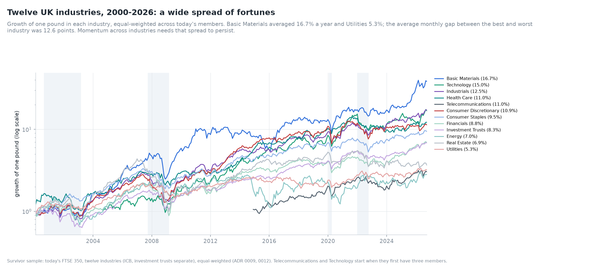

*Figure 1. Growth of one pound in each industry, 2000-2026.*

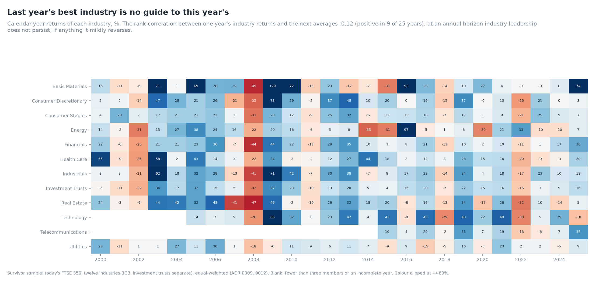

*Figure 2. Calendar-year returns of each industry.*

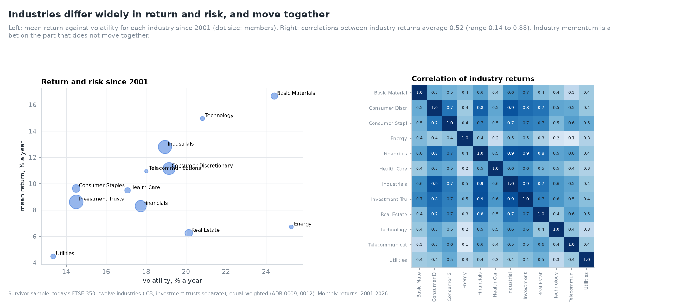

*Figure 3. Mean against volatility, and the correlation matrix.*

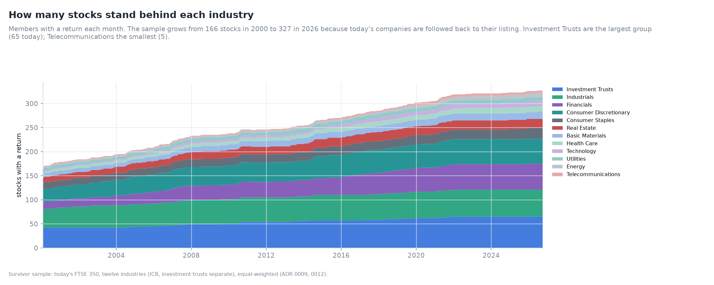

*Figure 4. Members per industry over time.*

The spread between industries is wide: the best and worst industry differ by 12.6 points in an
average month. Over 2000-2026 Basic Materials averaged 16.7% a year and Utilities 5.3%. At the
annual horizon leadership does not persist. The rank correlation between one year's industry
returns and the next averages −0.09, positive in 11 of 25 years.

## 4. Methods

**Industry momentum.** Each month the twelve industries are ranked on their formation return
(`J` months, skipping the latest month except for `J = 1`). The strategy buys the top three and
sells the bottom three, equally weighted, and holds them `K` months in overlapping cohorts (ADR 0010
conventions, ADR 0012 exact legs).

**Decomposition.** A stock's formation return *R*_i splits into its industry's mean *R̄*_g(i) and
an industry-neutral part *R*_i − *R̄*_g(i). Three stock-level strategies use the same decile legs:

- raw stock momentum, ranked on *R*_i;
- industry momentum at the stock level, ranked on *R̄*_g(i), so every member carries its
  industry's signal;
- industry-neutral momentum, ranked on *R*_i − *R̄*_g(i).

**Spanning.** The alpha of one strategy regressed on another, *s*_t = α + β *x*_t + ε_t, with
Newey-West errors. A significant alpha means *s* earns something *x* does not.

**Fama-MacBeth.** Each month next month's stock returns are regressed on cross-sectionally
standardised predictors:

$$
r_{i,t+1} = a_t + \sum_k b_{k,t}\,z_{k,i,t} + e_{i,t+1},
\qquad
\bar b_k = \frac1T\sum_t b_{k,t},
$$

with Newey-West *t*-statistics on the time series of slopes. Each slope is the return per standard
deviation of the predictor, holding the others fixed. Monthly slopes match OLS to 10⁻¹⁸ (validation).

**Lead-lag.** The correlation of industry *a*'s relative return in month *t* with industry *b*'s in
month *t* + 1, pairwise over the months both exist, against the band ±1.96/√*n*.

**Placebo.** The same stocks are shuffled into groups of the real sizes, and industry momentum and
the dispersion of group returns are recomputed, 200 times.

## 5. Results

### 5.1 Industry momentum by horizon

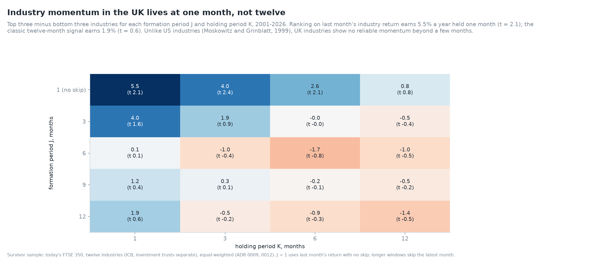

*Figure 5. The J × K grid of industry momentum.*

**Table 2. Industry momentum (top 3 minus bottom 3), % a year (NW *t*), 2001-2026.**

| J \ K | 1 | 3 | 6 | 12 |
|---|---|---|---|---|
| 1 (no skip) | **5.5 (2.11)** | **4.0 (2.42)** | **2.6 (2.12)** | 0.8 (0.77) |
| 3 | 4.0 (1.59) | 1.9 (0.94) | 0.0 (0.00) | −0.5 (−0.37) |
| 6 | 0.1 (0.05) | −1.0 (−0.43) | −1.7 (−0.79) | −1.0 (−0.55) |
| 12 | 1.9 (0.57) | −0.5 (−0.16) | −0.9 (−0.33) | −1.4 (−0.53) |

The only reliable industry momentum is at one month. Last month's best industries beat its worst by
5.5% a year over the next month, and the effect persists in overlapping cohorts held three and six
months (*t* = 2.4 and 2.1). Signals built from three months or more earn nothing. This is the
reverse of the stock-level grid of Day 2, where the one-month signal reverses and longer signals
pay.

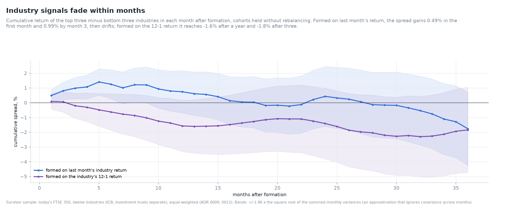

*Figure 6. Cumulative industry-momentum spread after formation.*

**Table 3. Event-time spread of industry momentum (cumulative, %).**

| Formation signal | 1 month | 3 | 6 | 12 | 24 | 36 |
|---|---|---|---|---|---|---|
| Last month | 0.49 | 0.99 | 1.26 | 0.75 | 0.43 | −1.76 |
| 12-1 | 0.09 | −0.20 | −0.62 | −1.57 | −1.41 | −1.84 |

The one-month signal builds for six months and then gives back what it earned. The twelve-month
signal never pays.

### 5.2 Last month: stocks reverse, industries continue

*Figure 7. Fama-MacBeth slopes on last month's returns, and the two one-month strategies.*

**Table 4. Fama-MacBeth regressions of next month's stock return (slopes in % a month per standard
deviation, NW *t* in brackets, 309 months).**

| Specification | Own last month | Industry last month | Own 12-1 | Industry 12-1 | Industry-neutral 12-1 |
|---|---|---|---|---|---|
| (1) | −0.194 (−2.74) | +0.139 (2.51) | 0.180 (1.53) | | |
| (2) | | | 0.199 (1.82) | −0.011 (−0.19) | |
| (3) | | | | 0.053 (0.75) | 0.189 (1.86) |

Specification (1) is the clearest result of the day. A stock that rose last month tends to fall the
next, and a stock whose industry rose tends to rise, holding the stock's own return fixed. The
reversal is a stock-level effect: bid-ask bounce, liquidity provision and overreaction to
firm-specific news (Lehmann, 1990; Jegadeesh, 1990). The continuation is an industry-level effect,
consistent with slow diffusion of sector news (Hou, 2007). A one-month stock strategy that ignores
the industry mixes the two and loses heavily (Sharpe −0.50). The industry strategy captures only
the continuation (Sharpe 0.40).

### 5.3 Industry out of stock momentum

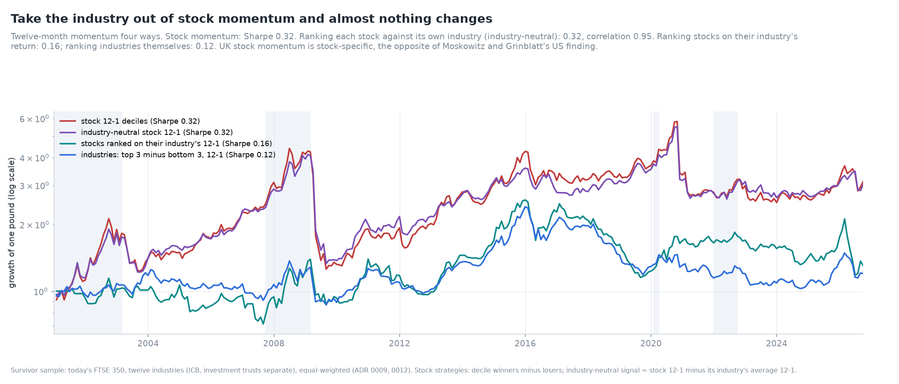

*Figure 8. Stock, industry-neutral and industry momentum.*

**Table 5. Twelve-month momentum four ways (2001-2026).**

| Strategy | Months | Mean | Volatility | Sharpe | NW *t* | Max drawdown | Market beta |
|---|---|---|---|---|---|---|---|
| Stock 12-1 deciles | 309 | 7.7% | 24.1% | 0.32 | 1.43 | 71% | −0.59 |
| Industry-neutral stock 12-1 | 309 | 7.0% | 21.5% | 0.32 | 1.47 | 68% | −0.57 |
| Stocks ranked on their industry's 12-1 | 289 | 3.3% | 20.7% | 0.16 | 0.73 | 55% | −0.14 |
| Industries: top 3 minus bottom 3 | 309 | 1.9% | 15.0% | 0.12 | 0.57 | 57% | −0.18 |

Taking the industry out of stock momentum changes almost nothing. Industry-neutral momentum keeps
the whole Sharpe ratio, correlates 0.95 with raw momentum, and has the same market exposure. The
industry part is small and earns little. In Moskowitz and Grinblatt's US sample, industry-neutral
momentum lost most of the premium.

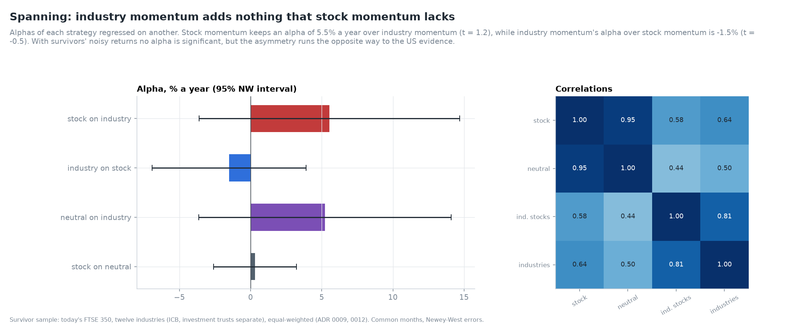

*Figure 9. Alphas of each momentum strategy on another, and correlations.*

**Table 6. Spanning regressions (alpha % a year, NW *t*).**

| Regression | Alpha | *t* | Slope | R² |
|---|---|---|---|---|
| Stock on industry | 5.5% | 1.19 | 1.02 | 0.41 |
| Industry on stock | −1.5% | −0.55 | 0.40 | 0.41 |
| Industry-neutral on industry | 5.2% | 1.15 | 0.71 | 0.25 |
| Stock on industry-neutral | 0.3% | 0.21 | 1.06 | 0.90 |

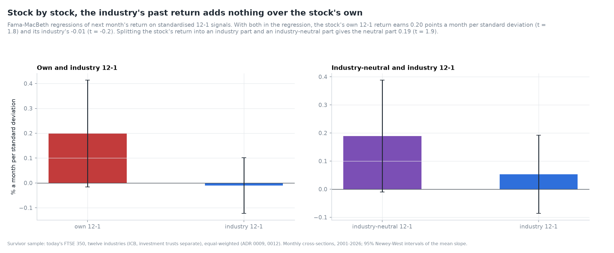

*Figure 10. Fama-MacBeth slopes on 12-1 signals.*

No alpha is significant with survivor data's noise, but every comparison points the same way.
Stock momentum contains industry momentum, not the reverse. Industry-neutral momentum explains raw
stock momentum almost completely (R² 0.90, alpha 0.3%).

### 5.4 Real industries against random groups

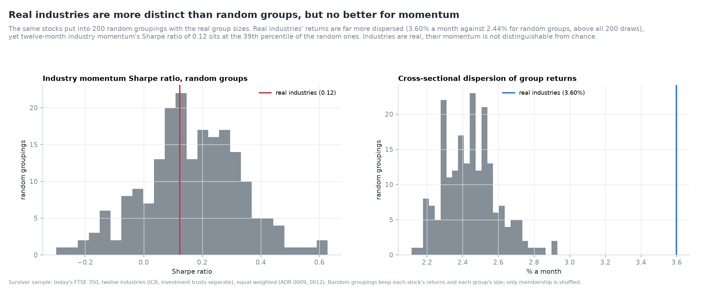

*Figure 11. Industry momentum and dispersion for 200 random groupings.*

**Table 7. Placebo groupings (200 draws, real group sizes).**

| Statistic | Real industries | Random groups: mean | Random groups: range | Percentile of real |
|---|---|---|---|---|
| Dispersion of group returns, % a month | 3.60 | 2.44 | 2.11-2.93 | above all 200 |
| 12-1 industry momentum Sharpe ratio | 0.12 | 0.17 | −0.33 to 0.60 | 39th |

Industries are real: their returns differ far more than random groups of the same size would. But
twelve-month momentum across them is no better than momentum across random groups. A random group
of 20 stocks inherits some momentum from its members, and real industries do not add to it.

### 5.5 Dispersion, lead-lag and rotation

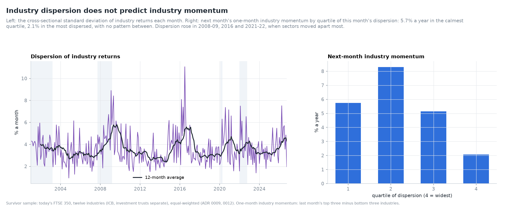

*Figure 12. Dispersion of industry returns, and next-month industry momentum by dispersion
quartile.*

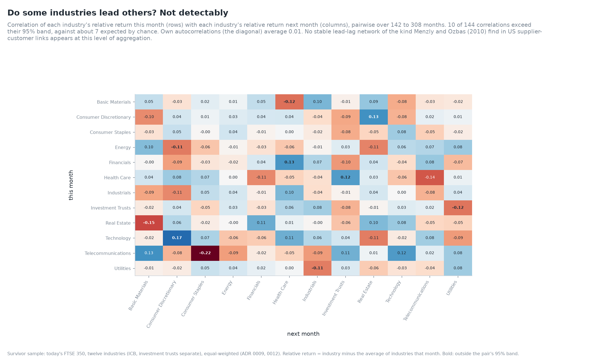

*Figure 13. Lagged cross-correlations of industry relative returns.*

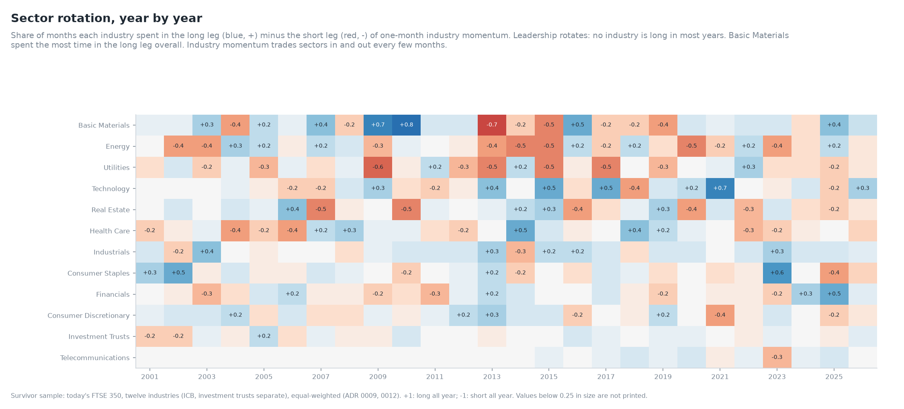

*Figure 14. The long and short legs of one-month industry momentum by year.*

**Table 8. Dispersion, lead-lag and persistence.**

| Statistic | Value |
|---|---|
| Next-month one-month industry momentum by dispersion quartile (low to high), % a year | 5.7, 8.3, 5.1, 2.1 |
| Lagged cross-correlations outside their 95% band | 10 of 144 (about 7 expected) |
| Mean own first-order autocorrelation of relative returns | 0.01 |
| Highest own autocorrelation | Real Estate 0.10, Utilities 0.08 |
| Most time in the long leg | Basic Materials (18% net), Technology (14%), Industrials (13%) |

Dispersion does not predict industry momentum: the most dispersed quartile pays least. The lead-lag
matrix shows about as many large correlations as chance would. At this level of aggregation there is
no stable network of leaders and followers. Industry-level autocorrelations are near zero on average,
yet the one-month strategy earns 5.5% a year. Its edge is in the ranking of industries against each
other in a given month, not in any industry's own persistence.

### 5.6 Market states, seasons and costs

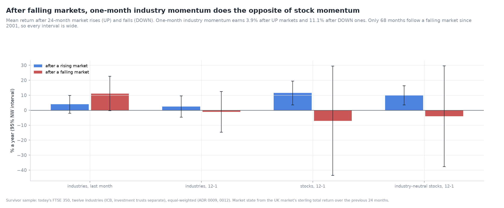

*Figure 15. Returns after rising and falling markets.*

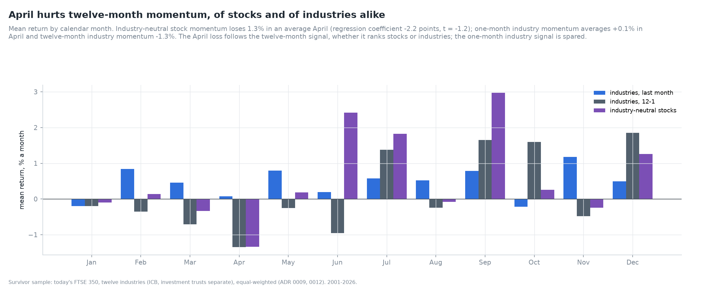

*Figure 16. Calendar-month means.*

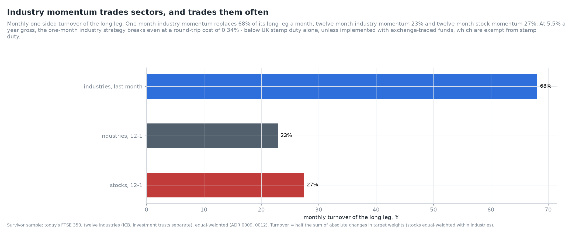

*Figure 17. Monthly turnover.*

**Table 9. Market states (% a year, NW *t*; 239 UP and 68 DOWN months).**

| Strategy | After UP markets | After DOWN markets | DOWN − UP |
|---|---|---|---|
| Industries, last month | 3.9 (1.29) | 11.1 (1.89) | +7.2 (1.20) |
| Industries, 12-1 | 2.5 (0.68) | −1.1 (−0.16) | −3.6 (−0.47) |
| Stocks, 12-1 | 11.5 (2.82) | −7.1 (−0.38) | −18.6 (−0.97) |
| Industry-neutral stocks, 12-1 | 9.9 (3.01) | −4.0 (−0.23) | −13.9 (−0.79) |

**Table 10. April and costs.**

| Strategy | Mean in April, % | April dummy, points (*t*) | Monthly turnover | Break-even round trip |
|---|---|---|---|---|
| Industries, last month | +0.07 | −0.49 (−0.46) | 68% | 0.34% |
| Industries, 12-1 | −1.35 | −1.69 (−1.62) | 23% | 0.35% |
| Industry-neutral stocks, 12-1 | −1.34 | −2.18 (−1.17) | – | – |
| Stocks, 12-1 | – | – | 27% | 1.17% (Day 2) |

One-month industry momentum is a different animal from twelve-month momentum. It earns more after
falling markets, when stock momentum suffers. It shows no April loss. Its correlation with twelve-month
stock momentum is 0.07. But it trades two-thirds of its long leg every month: at 0.5% stamp duty on
purchases, buying UK shares to implement it would cost more than it earns. Sector exchange-traded
funds, which are exempt from stamp duty, are the natural vehicle. Day 9 measures costs properly.

### 5.7 Momentum within industries, and investment trusts

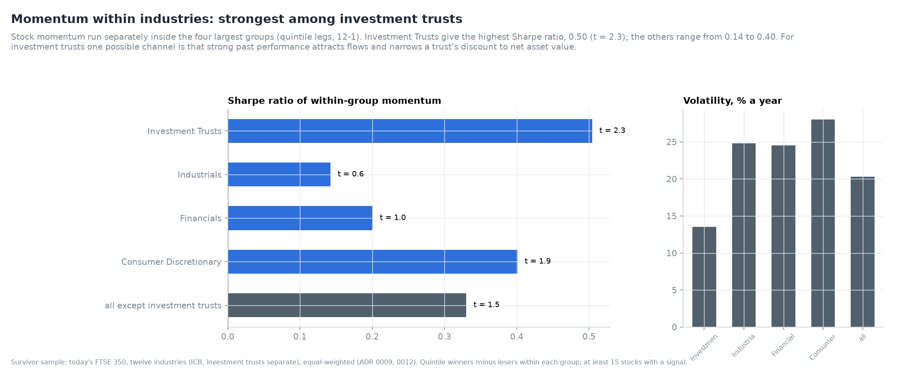

*Figure 18. Stock momentum within the four largest groups.*

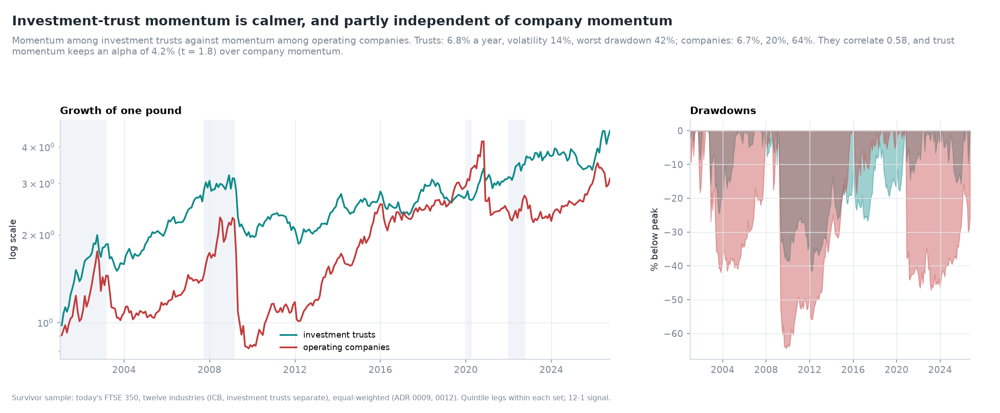

*Figure 19. Momentum among investment trusts and among operating companies.*

**Table 11. Stock momentum within groups (quintile legs, 12-1, 2001-2026).**

| Group | Mean | Volatility | Sharpe | NW *t* | Max drawdown |
|---|---|---|---|---|---|
| Investment Trusts | 6.8% | 13.5% | 0.50 | 2.34 | 42% |
| Consumer Discretionary | 11.2% | 28.0% | 0.40 | 1.89 | 71% |
| Financials (ex trusts) | 4.9% | 24.6% | 0.20 | 1.03 | 75% |
| Industrials | 3.5% | 24.8% | 0.14 | 0.62 | 81% |
| All except investment trusts | 6.7% | 20.3% | 0.33 | 1.51 | 64% |

Momentum among investment trusts is the strongest and steadiest of any group. It has half the
volatility of company momentum, a shallower drawdown and the only significant *t*-statistic. Trust
and company momentum correlate 0.58, and trust momentum keeps an alpha of 4.2% a year (*t* = 1.8)
over company momentum. Trusts' net asset values follow their holdings, but their share prices
trade at a discount that moves with sentiment and flows. One possible channel is that strong past
performance attracts buyers and narrows the discount. Testing that needs NAV and discount data,
which this project does not have.

### 5.8 Stability

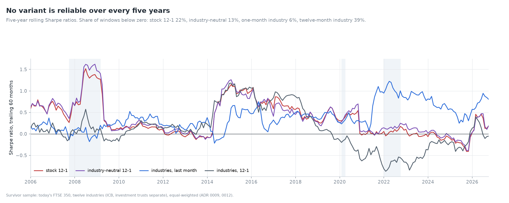

*Figure 20. Five-year rolling Sharpe ratios.*

**Table 12. Share of five-year windows with a negative Sharpe ratio.**

| Strategy | Negative windows |
|---|---|
| Industries, last month | 6% |
| Industry-neutral stocks, 12-1 | 13% |
| Stocks, 12-1 | 22% |
| Industries, 12-1 | 39% |

One-month industry momentum has been the steadiest variant, negative in only 6% of five-year
windows. Its weakest stretches were 2014-15 and 2016-17; twelve-month industry momentum was
negative in every five-year window from 2019 to 2025.

## 6. Robustness

* **Exact legs.** The first run's leg imbalance (four long, three short) understated one-month
  industry momentum. The corrected result is stronger and is the one reported (ADR 0012).
* **Leg size.** With two, three or four industries a leg, the one-month signal is the most
  profitable (4.5%, 5.5% and 3.1% a year); the 12-1 signal earns 2.0%, 1.9% and 0.9%.
* **Placebo.** Every twelve-month industry result is read against random groups of the same sizes.
* **Two levels.** The Fama-MacBeth cross-sections and the portfolio sorts agree: own returns matter
  at twelve months, industry returns at one month.

## 7. Limitations

1. **Survivor sample.** Levels are biased (ADR 0009). The industry-versus-stock comparison uses the
   same stocks for both and is less affected.
2. **Today's industries.** Each company carries today's ICB label for its whole history.
3. **Twelve groups.** Fewer, broader industries than the 20 to 48 used in US studies. Finer
   industries might show more industry momentum, but would leave three or fewer UK members in many.
4. **Equal weights.** Value weighting would tilt industries towards their largest members.
5. **No costs.** Break-even costs are first estimates; Day 9 models them.
6. **The trust channel is a hypothesis.** Discounts to NAV are not observed.

## 8. What comes next

Day 4 turns from cross-sectional to time-series momentum: trend following on the UK stock market,
gilts and sterling, the strategy managed futures funds run (Moskowitz, Ooi and Pedersen, 2012).

## References

* Asness, C. S., Porter, R. B. and Stevens, R. L. (2000). Predicting stock returns using
  industry-relative firm characteristics. Working paper, AQR Capital Management.
* Chordia, T. and Shivakumar, L. (2002). Momentum, business cycle, and time-varying expected
  returns. *Journal of Finance* 57(2), 985-1019.
* Fama, E. F. and MacBeth, J. D. (1973). Risk, return, and equilibrium: empirical tests. *Journal
  of Political Economy* 81(3), 607-636.
* Grundy, B. D. and Martin, J. S. (2001). Understanding the nature of the risks and the source of
  the rewards to momentum investing. *Review of Financial Studies* 14(1), 29-78.
* Hou, K. (2007). Industry information diffusion and the lead-lag effect in stock returns. *Review
  of Financial Studies* 20(4), 1113-1138.
* Jegadeesh, N. (1990). Evidence of predictable behavior of security returns. *Journal of Finance*
  45(3), 881-898.
* Jegadeesh, N. and Titman, S. (1993). Returns to buying winners and selling losers: implications
  for stock market efficiency. *Journal of Finance* 48(1), 65-91.
* Lehmann, B. N. (1990). Fads, martingales, and market efficiency. *Quarterly Journal of
  Economics* 105(1), 1-28.
* Menzly, L. and Ozbas, O. (2010). Market segmentation and cross-predictability of returns.
  *Journal of Finance* 65(4), 1555-1580.
* Moskowitz, T. J. and Grinblatt, M. (1999). Do industries explain momentum? *Journal of Finance*
  54(4), 1249-1290.
* Moskowitz, T. J., Ooi, Y. H. and Pedersen, L. H. (2012). Time series momentum. *Journal of
  Financial Economics* 104(2), 228-250.
* Newey, W. K. and West, K. D. (1987). A simple, positive semi-definite, heteroskedasticity and
  autocorrelation consistent covariance matrix. *Econometrica* 55(3), 703-708.
