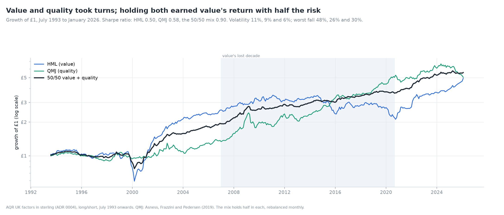
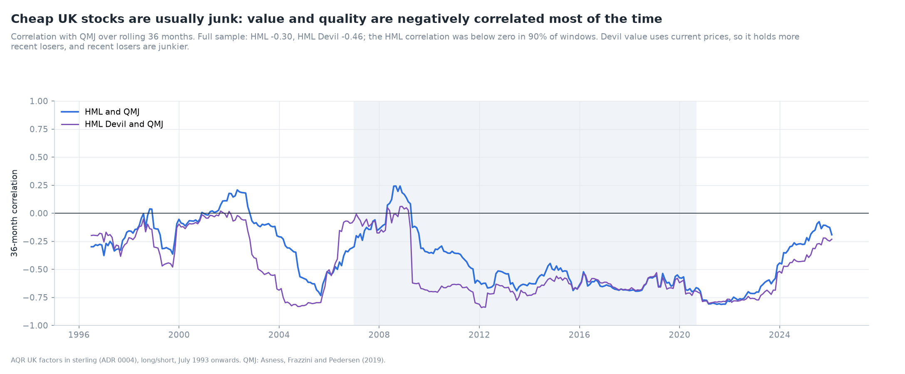
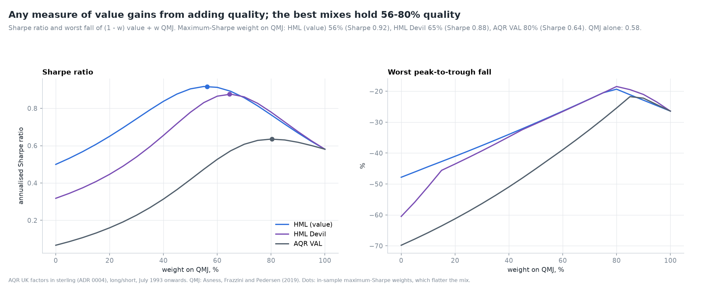
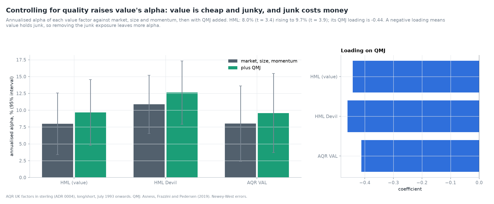
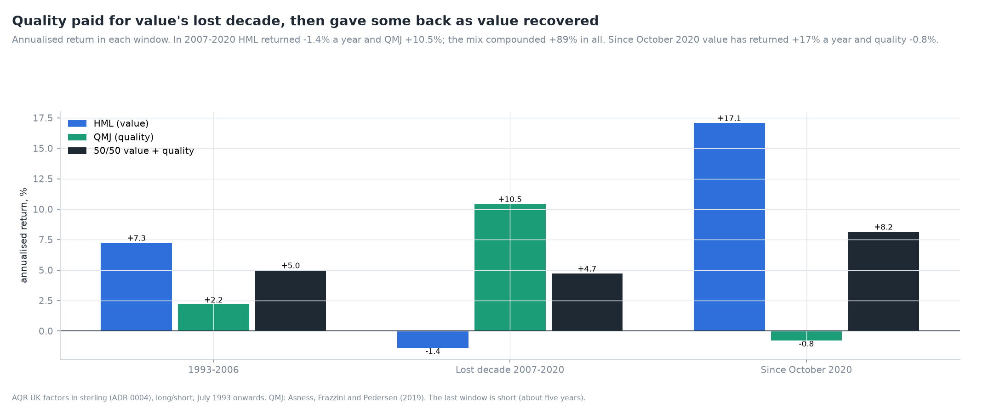
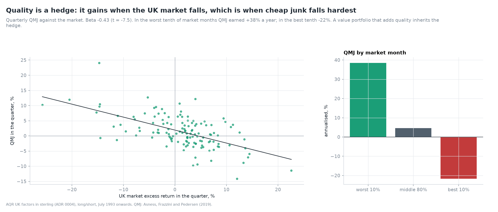
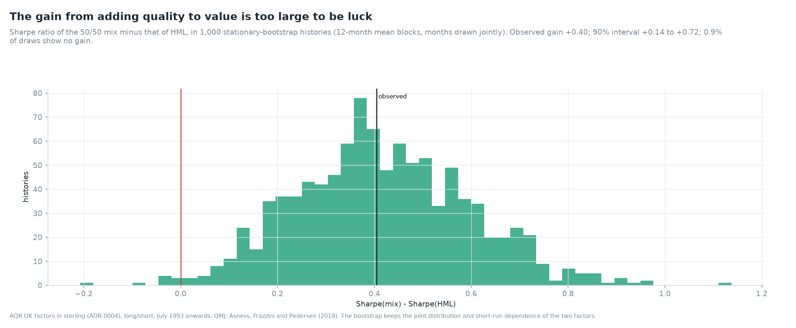
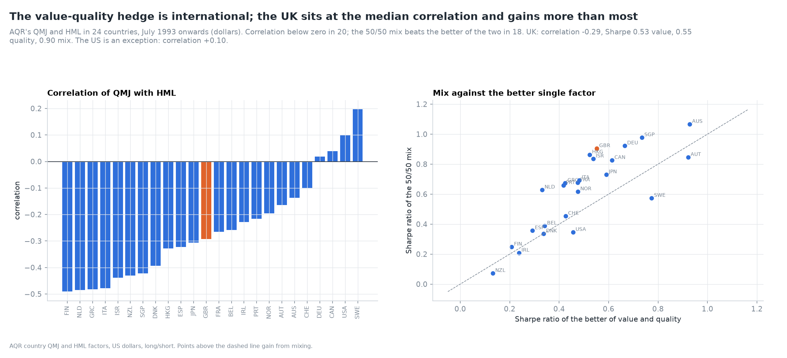
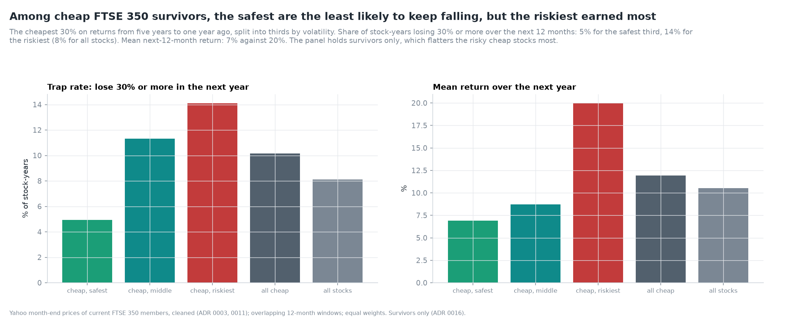
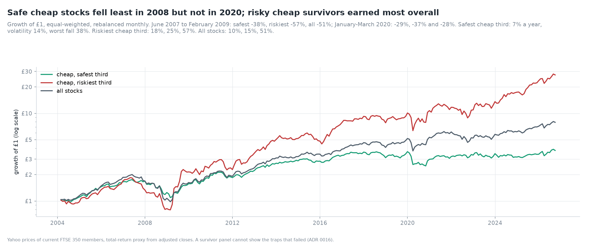

# Quality and value traps in the UK

*Day 6 of 15 · uk-value-momentum v0.6.0*

## Summary

A value trap is a stock that is cheap for a good reason. Its business is getting worse, and it
keeps getting cheaper. The standard defence is to buy cheap stocks only if they are also good
companies: profitable, growing, safe and paying out. Asness, Frazzini and Pedersen (2019) turn
that idea into a factor, quality minus junk (QMJ), which AQR publishes for the UK from July 1993.
This note asks whether quality separates cheap UK stocks from value traps. It works at two levels:
factor returns (AQR, July 1993 to January 2026, 391 months) and FTSE 350 stocks (Yahoo prices,
2004 to 2026).

Findings:

1. **Cheap UK stocks are usually junk.** HML's correlation with QMJ is −0.30 over the full sample
   and was below zero in 90% of rolling three-year windows. HML Devil, which uses current prices,
   is more negative (−0.46).
2. **Holding both halves the risk for the same return.** HML earned 5.5% a year at 11.0%
   volatility (Sharpe ratio 0.50), and QMJ earned 5.4% at 9.3% (0.58). The 50/50 mix earned 5.5% at
   6.0% volatility, a Sharpe ratio of 0.90.
3. **The gain is not luck.** In 1,000 block-bootstrap histories the mix beats HML by 0.40 in
   Sharpe ratio (90% interval 0.14 to 0.72). It fails to beat HML in 0.9% of them.
4. **Controlling for quality raises value's alpha.** Against market, size and momentum, HML's
   alpha is 8.0% a year (*t* = 3.4). With QMJ added it is 9.7% (*t* = 3.9), and the QMJ loading is
   −0.44. Value is cheap and junky, junk earns less, and so value's own premium is larger than its
   raw return shows. The same holds for HML Devil and for AQR's VAL.
5. **Quality paid for value's lost decade.** From January 2007 to September 2020, HML lost 1.4%
   a year and QMJ gained 10.5% a year. The mix compounded +89%. Since October 2020 the roles have
   reversed: value has earned 17% a year and quality −0.8%.
6. **Quality is a hedge.** QMJ's quarterly market beta is −0.43 (*t* = −7.5). In the worst tenth
   of market months it earned 38% a year annualised; in the best tenth, −22%.
7. **The hedge is international.** Across AQR's 24 countries, the QMJ-HML correlation is below zero
   in 20, and the 50/50 mix beats the better single factor in 18. The UK sits at the median
   correlation (−0.29 against a median of −0.28) and gains more than most (+0.35 in Sharpe ratio
   over the better single factor). The US is an exception: the correlation there is +0.10.
8. **At stock level, safety separates traps but not returns, and the data is biased.** Among the
   cheapest 30% of FTSE 350 survivors, the safest third lost 30% or more over the next year in 4.9%
   of stock-years and the riskiest third in 14.1%. The riskiest third still earned the most: 20%
   over the next year, against 7% for the safest. The sample holds today's survivors only, so the
   risky cheap stocks that failed are missing. That bias flatters exactly the risky cheap stocks
   (ADR 0016).

The answer to the day's question is yes at factor level, where AQR's data is free of survivorship
bias: quality and value hedge each other, and the combination is better than either. At stock
level, free data can show that safe cheap stocks fall less often, but it cannot measure the cost
of the traps that failed.

## 1. Data and definitions

**Factor returns.** AQR's UK factors (ADR 0004), converted to sterling, long/short:

- **HML**: book-to-market, Fama-French form, with book and price both updated once a year.
- **HML Devil**: book-to-market with the current price (Asness and Frazzini 2013).
- **VAL**: AQR's multi-measure value (book, earnings, cash flow, sales and so on).
- **QMJ**: long the highest-quality stocks, short the lowest. Quality averages four scores:
  profitability (gross profits, margins, return on equity and on assets, cash flow); growth (the
  five-year change in those measures); safety (low beta, low volatility, low leverage, low
  bankruptcy risk); and payout (net equity issuance, debt issuance, dividends). Each score is a
  rank. The factor is built within size groups, like HML.
- **MKT, SMB and UMD** from the same workbook.

AQR builds its UK series from Datastream before 1990 and Compustat afterwards, delisted companies
included. QMJ starts in July 1993 and the common sample ends in January 2026.

**Stock prices.** Yahoo month-end adjusted closes of the current FTSE 350 members, cleaned of unit
flips (ADR 0003, 0011), from 1999. They are used only in Section 6.

**Mix.** Half in value and half in QMJ, rebalanced monthly. Both legs are long/short and both
have volatility near 10%, so an equal-weight mix is a fair default. Weights chosen in sample appear
only in Section 3, labelled as such.

## 2. The hedge

### 2.1 Summary statistics

**Table 1. UK factors, July 1993 to January 2026 (391 months), sterling**

| Factor | Mean, % a year | Volatility, % | Sharpe ratio | *t* (Newey-West) | Worst fall, % |
|---|---:|---:|---:|---:|---:|
| Market (excess) | 4.8 | 13.4 | 0.36 | 2.0 | −52 |
| SMB | −2.4 | 11.7 | −0.20 | −1.0 | −66 |
| HML | 5.5 | 11.0 | 0.50 | 2.2 | −48 |
| HML Devil | 4.3 | 13.6 | 0.32 | 1.4 | −61 |
| VAL | 1.0 | 15.4 | 0.07 | 0.3 | −70 |
| UMD | 13.4 | 16.4 | 0.82 | 4.0 | −53 |
| QMJ | 5.4 | 9.3 | 0.58 | 2.9 | −26 |
| **50/50 HML + QMJ** | **5.5** | **6.0** | **0.90** | **4.0** | **−30** |

In this sample QMJ has the second-best Sharpe ratio among the single factors, after momentum, and
the shallowest worst fall. HML's *t*-statistic of 2.2 is only just significant. The mix's 4.0 is
as strong as momentum's.

### 2.2 Correlations

**Table 2. Correlations of monthly returns**

| | MKT | SMB | HML | HML Devil | VAL | UMD | QMJ |
|---|---:|---:|---:|---:|---:|---:|---:|
| MKT | 1.00 | 0.04 | 0.12 | 0.25 | 0.11 | −0.33 | −0.53 |
| SMB | | 1.00 | −0.20 | −0.09 | −0.17 | −0.10 | −0.32 |
| HML | | | 1.00 | 0.87 | 0.70 | −0.32 | −0.30 |
| HML Devil | | | | 1.00 | 0.75 | −0.64 | −0.46 |
| VAL | | | | | 1.00 | −0.53 | −0.31 |
| UMD | | | | | | 1.00 | 0.49 |
| QMJ | | | | | | | 1.00 |

QMJ is negatively correlated with every value measure. It is positively correlated with momentum
(0.49) and negatively with the market (−0.53) and with small stocks (−0.32). The pattern has a
plain reading. Cheap stocks are often cheap because their profits are falling, their leverage is
high or their prices are volatile, which are the junk side of each quality score. Recent losers,
which HML Devil holds more of, are junkier still: that is why HML Devil's correlation with QMJ is
more negative than HML's.

The correlation is not constant. It was near zero or positive around 2000-2002 and in 2008-2009.
In those episodes the market fell, so quality rallied, and value also did well in the recovery
from the dot-com bubble. In the decade from 2010 it sat between −0.5 and −0.8. Since 2023 it has
moved back towards zero as value recovered without quality falling much.

## 3. How much quality to hold

**Table 3. Mixes of value and QMJ (weight on QMJ)**

| Value measure | 0% | 25% | 50% | 75% | 100% | Maximum-Sharpe weight |
|---|---:|---:|---:|---:|---:|---:|
| HML: Sharpe | 0.50 | 0.70 | 0.90 | 0.81 | 0.58 | 56% (0.92) |
| HML: worst fall, % | −48 | −39 | −30 | −21 | −26 | |
| HML Devil: Sharpe | 0.32 | 0.49 | 0.78 | 0.83 | 0.58 | 65% (0.88) |
| VAL: Sharpe | 0.07 | 0.19 | 0.42 | 0.63 | 0.58 | 80% (0.64) |

Every value measure gains from adding quality, and the Sharpe-ratio curve is flat near its peak.
For HML, any weight from 45% to 70% gives a Sharpe ratio above 0.85. The best weights are
estimated in sample and so flatter the mix. The 50/50 rule needs no estimation and captures
nearly all of the gain for HML and HML Devil.

VAL is different. Its own Sharpe ratio is 0.07 in this sample, so the best mix is mostly
quality. VAL's poor record comes from the lost decade, when it lost 66% (Day 5).

## 4. What quality adds to value

### 4.1 Alpha controlling for quality

**Table 4. Value's alpha with and without QMJ (annualised, Newey-West *t*)**

| Value measure | Alpha: MKT, SMB, UMD | *t* | Alpha: plus QMJ | *t* | QMJ loading | *t* | R²: before, after |
|---|---:|---:|---:|---:|---:|---:|---:|
| HML | 8.0% | 3.4 | 9.7% | 3.9 | −0.44 | −3.9 | 0.16, 0.24 |
| HML Devil | 10.9% | 4.9 | 12.6% | 5.3 | −0.46 | −3.6 | 0.44, 0.49 |
| VAL | 8.0% | 2.8 | 9.6% | 3.2 | −0.41 | −3.4 | 0.33, 0.37 |

Adding QMJ raises every alpha by about 1.6 points. That is the result Asness, Frazzini and
Pedersen report for the US, and it answers the value-trap question directly. A value portfolio is
short quality: for every pound long cheap stocks, it holds about 44 pence of net exposure to junk.
Junk has a negative premium, so the exposure is a drag. Once the regression removes the drag, the
premium for cheapness alone is larger than HML's raw return shows.

The alphas against market, size and momentum are larger than the raw means. That is because value
is short momentum (loadings of −0.15 for HML and −0.45 for HML Devil in the regression with QMJ), and
momentum has a large premium.

### 4.2 QMJ's own alpha

**Table 5. QMJ on market, size, value and momentum (monthly coefficients)**

| | Coefficient | *t* |
|---|---:|---:|
| Alpha (annualised) | 5.4% | 3.9 |
| Market | −0.28 | −7.0 |
| SMB | −0.26 | −6.9 |
| HML | −0.20 | −3.9 |
| UMD | 0.14 | 3.2 |
| R² | 0.51 | |

QMJ's alpha of 5.4% a year equals its raw mean: its negative market and value loadings, which have
positive premia, offset its positive momentum loading. Half of QMJ's variance is explained by the
other four factors, but its alpha is not.

### 4.3 The lost decade

**Table 6. Before, during and after value's lost decade**

| Window | Months | HML, % a year | HML Devil | QMJ | 50/50 mix | Mix Sharpe |
|---|---:|---:|---:|---:|---:|---:|
| Jul 1993 - Dec 2006 | 162 | 7.3 | 6.8 | 2.2 | 5.0 | 0.72 |
| Jan 2007 - Sep 2020 | 165 | −1.4 | −4.1 | 10.5 | 4.7 | 0.96 |
| Oct 2020 - Jan 2026 | 64 | 17.1 | 16.1 | −0.8 | 8.2 | 1.52 |

Over the 165 months of value's lost decade, HML compounded −18% and QMJ +292%. The mix earned
+89%: an investor who held quality with value hardly noticed the lost decade. The windows also show
that quality is not a free lunch. From 1993 to 2006 it earned only 2.2% a year, and since October
2020 it has lost money while value earned 17% a year. In each window, the mix's Sharpe ratio was
at least as high as the better single factor's or close to it. The windows were chosen after the
fact (Day 5), so the table describes the episode rather than testing a rule.

### 4.4 Quality in market falls

**Table 7. Returns by market month (annualised means)**

| | Worst 10% of market months | Middle 80% | Best 10% | Quarterly market beta (*t*) |
|---|---:|---:|---:|---:|
| QMJ | +38% | +5% | −22% | −0.43 (−7.5) |
| HML | +1% | +5% | +14% | 0.03 (0.2) |
| 50/50 mix | +20% | +5% | −4% | −0.20 (−2.8) |

Quality is a flight-to-safety asset. When the market falls hard, investors sell volatile,
indebted and unprofitable companies, which are the short side of QMJ. Value has no market beta
overall in this sample, but it earns its premium in good months. The mix inherits QMJ's crash
behaviour: it earns 20% a year annualised in the worst tenth of months. This is the factor-level
form of the value-trap argument. The traps are the cheap stocks that collapse in a downturn, and
quality's short leg is where they sit.

## 5. How sure, and is it British?

### 5.1 Bootstrap

The Sharpe ratio of the mix minus that of HML is 0.40. A stationary bootstrap with 12-month mean
blocks resamples the two factors' months together, keeping their correlation and short-run
dependence. Over 1,000 histories the median gain is 0.40, the 90% interval is 0.14 to 0.72, and
0.9% of draws show no gain.

### 5.2 Other countries

**Table 8. AQR's QMJ and HML by country, July 1993 onwards (dollars)**

| Country | Corr. | Sharpe: HML | QMJ | Mix | Gain over better |
|---|---:|---:|---:|---:|---:|
| United Kingdom | −0.29 | 0.53 | 0.55 | 0.90 | +0.35 |
| United States | +0.10 | 0.06 | 0.46 | 0.35 | −0.11 |
| Japan | −0.31 | 0.59 | 0.27 | 0.73 | +0.14 |
| Germany | +0.02 | 0.66 | 0.67 | 0.92 | +0.26 |
| France | −0.26 | 0.34 | 0.48 | 0.68 | +0.20 |
| Sweden | +0.20 | 0.18 | 0.77 | 0.57 | −0.20 |
| Europe | −0.26 | 0.60 | 0.65 | 1.03 | +0.38 |
| Global ex US | −0.20 | 0.84 | 0.76 | 1.26 | +0.42 |
| **24 countries: median** | **−0.28** | | | | **+0.14** |

The UK's dollar figures differ slightly from Table 1's sterling figures because of the currency
conversion (ADR 0004). The correlation is negative in 20 of 24 countries, and the mix beats the
better single factor in 18. The four exceptions with positive correlation include the US and
Sweden, where QMJ alone beats the mix. In the US, value earned almost nothing in this window
(Sharpe ratio 0.06), so any weight on it was a drag.

## 6. Value traps at stock level

### 6.1 What can be done with free data

QMJ needs accounts: profits, growth, leverage and payout. The free UK data has prices only (ADR
0015). Two proxies are available from prices:

- **Cheapness.** The return from five years ago to one year ago (months *t*−60 to *t*−13). Long-term
  losers are cheap on book-to-market. De Bondt and Thaler (1985) found that they rebound, and Fama
  and French (1996) showed that HML captures the effect. The last twelve months are skipped so that
  the signal does not overlap momentum.
- **Safety.** Volatility over the past 36 months. Safety is one of QMJ's four parts, and low
  volatility is its price-based core.

Each month the cheapest 30% are split into thirds by volatility. Equal-weighted portfolios are held
for one month, and each stock-month's next-twelve-month return is recorded. A **trap** is a cheap
stock that loses 30% or more over the next year.

### 6.2 Results

**Table 9. Cheap FTSE 350 survivors by volatility, 2004-2026**

| Group | Past volatility, % | Next-year return, % | Trap rate, % | Stock-years |
|---|---:|---:|---:|---:|
| Cheap, safest third | 21 | 6.9 | 4.9 | 6,006 |
| Cheap, middle third | 31 | 8.7 | 11.3 | 6,075 |
| Cheap, riskiest third | 51 | 20.0 | 14.1 | 6,190 |
| All cheap | 34 | 11.9 | 10.2 | 18,271 |
| All stocks | 28 | 10.5 | 8.1 | 61,310 |

**Table 10. Monthly portfolios, February 2004 to September 2026**

| Group | Return, % a year | Volatility, % | Sharpe (total return) | Worst fall, % | Jun 2007 - Feb 2009 | Jan - Mar 2020 |
|---|---:|---:|---:|---:|---:|---:|
| Cheap, safest third | 6.8 | 13.5 | 0.50 | −38 | −38% | −29% |
| Cheap, riskiest third | 17.6 | 24.8 | 0.71 | −57 | −57% | −37% |
| All stocks | 10.3 | 15.0 | 0.68 | −51 | −51% | −28% |

The safest cheap stocks are traps a third as often as the riskiest (4.9% against 14.1%). They
also fell less in 2008-2009, though not in early 2020. In returns the order reverses: the riskiest
cheap stocks earned 17.6% a year, the most of any group, and the safest 6.8%.

### 6.3 Why the stock-level result cannot be trusted

The stock panel holds the companies in the FTSE 350 today. A cheap, volatile stock in 2008 is in
the panel only if it survived to 2026 and grew back into the index. Those that went bankrupt, were
taken over cheaply or fell into small caps are not. That selection does the most damage exactly
where traps live: among cheap, risky stocks. Day 1 measured survivorship bias for momentum on this
panel (ADR 0003). For cheap, risky stocks it should be larger still, because their failure rate is
highest. The 17.6% a year earned by the riskiest cheap third is therefore an upper bound, and the
true figure could be far lower. The trap rates are lower bounds for the same reason.

What survives the bias is the ranking of trap rates. Even among survivors, risky cheap stocks
lose 30% in a year three times as often as safe ones. Adding the failures back would widen that
gap, not close it.

## 7. Limits

- **One quality factor, built by AQR.** The note cannot split QMJ into its four parts
  (profitability, growth, safety, payout). Novy-Marx's gross profitability, for example, needs
  accounts.
- **No company accounts.** The stock-level test uses a price proxy for cheapness and one part of
  quality, on a survivor panel (ADR 0016).
- **In-sample weights** in Section 3 flatter the mix. The 50/50 rule does not.
- **Windows chosen after the fact** in Table 6 (from Day 5).
- **Costs are ignored.** QMJ and HML both trade, and QMJ's short leg holds small, volatile stocks
  that are expensive to short.

## References

- Asness, C., Frazzini, A. and Pedersen, L. H. (2019). Quality minus junk. *Review of Accounting
  Studies* 24, 34-112.
- Asness, C. and Frazzini, A. (2013). The devil in HML's details. *Journal of Portfolio Management*
  39(4), 49-68.
- De Bondt, W. and Thaler, R. (1985). Does the stock market overreact? *Journal of Finance* 40,
  793-805.
- Fama, E. and French, K. (1996). Multifactor explanations of asset pricing anomalies. *Journal of
  Finance* 51, 55-84.
- Novy-Marx, R. (2013). The other side of value: the gross profitability premium. *Journal of
  Financial Economics* 108, 1-28.
- Piotroski, J. (2000). Value investing: the use of historical financial statement information to
  separate winners from losers. *Journal of Accounting Research* 38, 1-41.
- AQR Capital Management, LLC. Quality Minus Junk: Factors, Monthly. Data set.
