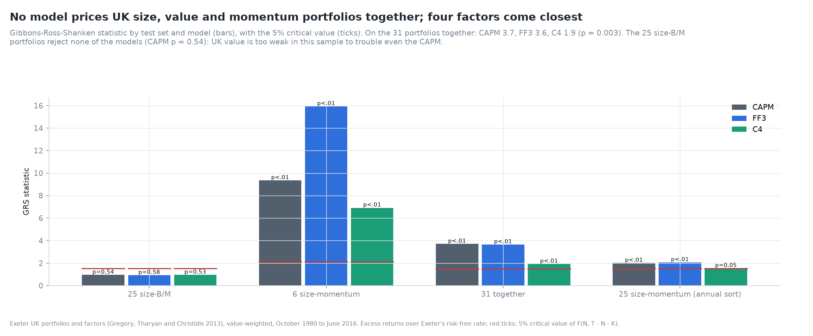
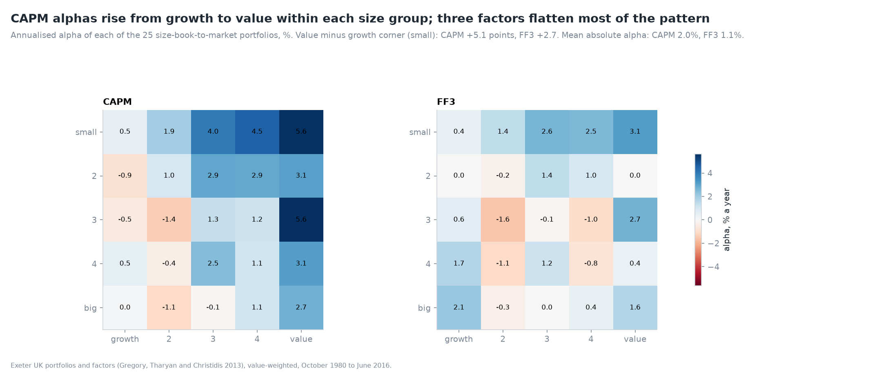
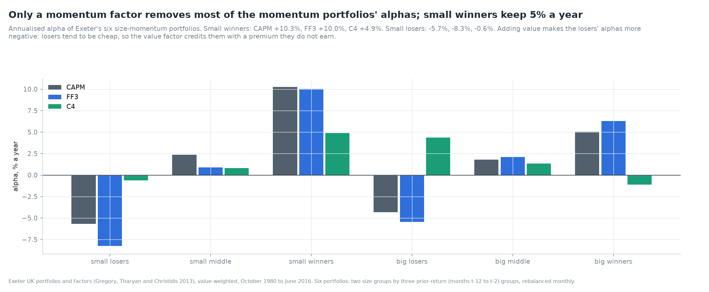
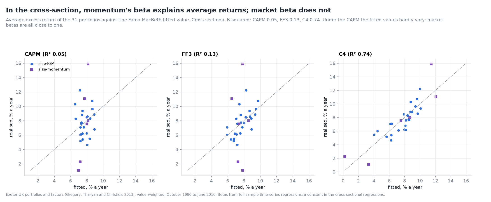
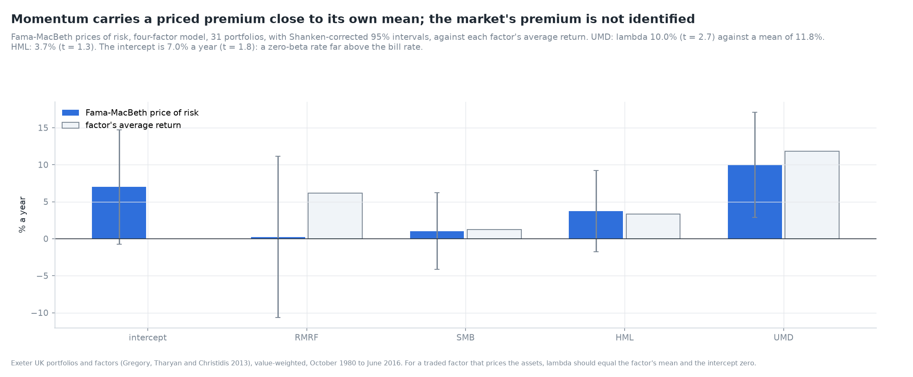
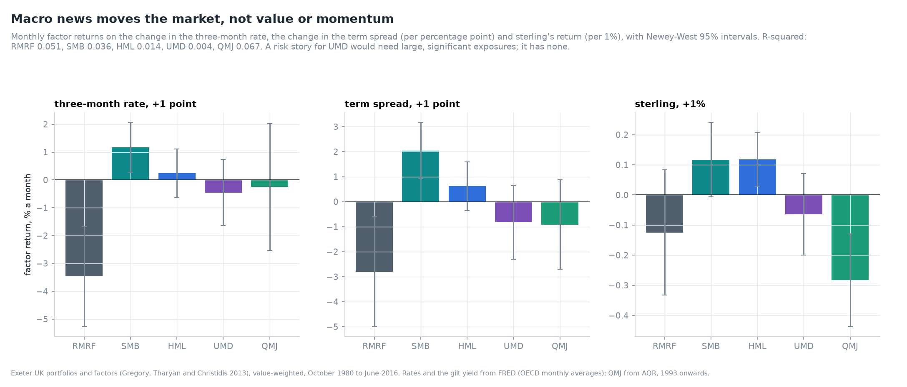
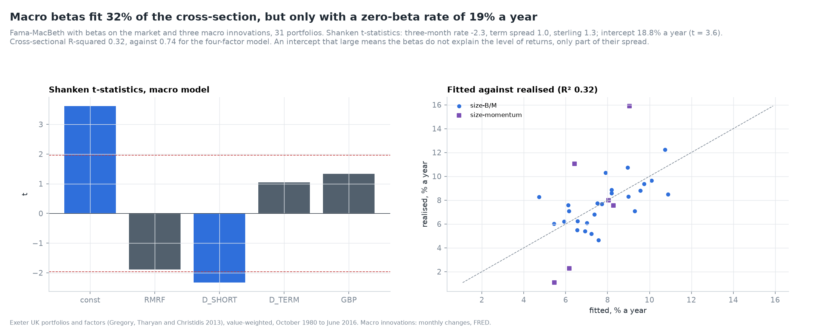
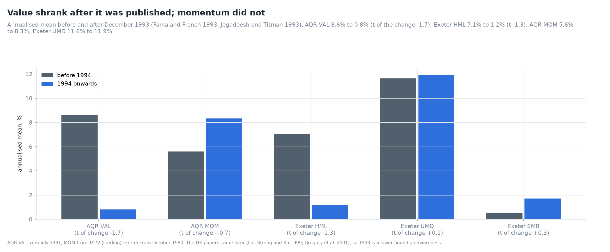
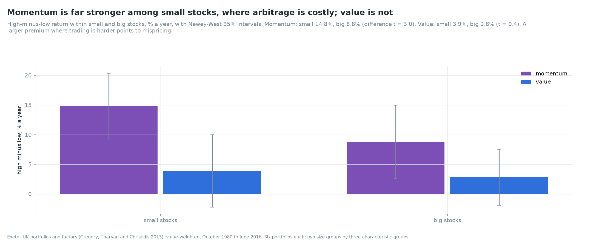
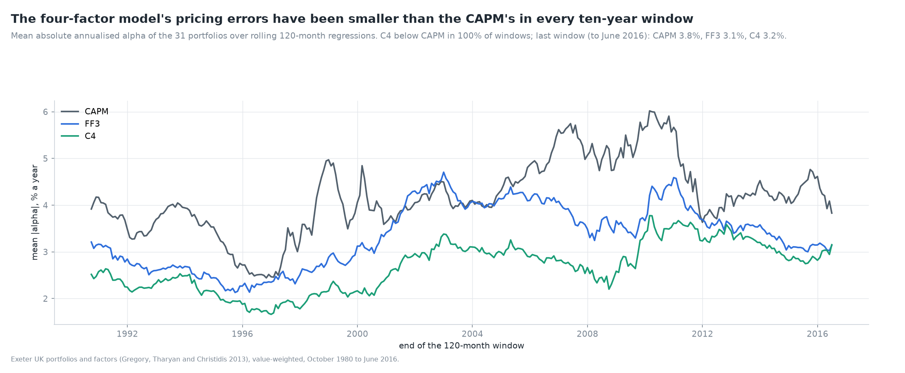

# Risk or mispricing? UK value and momentum under asset-pricing tests

*Day 8 of 15 · uk-value-momentum v0.8.0*

## Summary

A premium can be compensation for risk that investors bear, or a mispricing that investors have
not yet traded away. No single test settles the question, but each story makes predictions. If the
premium is risk, these should hold:

- a factor model should price the test portfolios;
- the premium should line up with macroeconomic risk;
- it should survive publication;
- it should not depend on how hard the stocks are to trade.

This note runs those tests on Exeter's UK portfolios (October 1980 to June 2016), with AQR's UK
factors for the longer history.

Findings:

1. **No model prices UK size, value and momentum portfolios together.**
   - On 31 test portfolios (25 size-book-to-market and 6 size-momentum), the GRS test rejects the
     CAPM (3.7), the Fama-French three-factor model (3.7) and the four-factor model with momentum
     (1.9, p = 0.003).
   - Four factors cut the mean absolute alpha from 2.6% to 1.4% a year.
2. **UK value is too weak to reject even the CAPM.** On the 25 size-book-to-market portfolios
   alone, the GRS p-value is 0.54 for the CAPM.
3. **Momentum's beta is priced in the cross-section.** Its Fama-MacBeth price of risk is 10.0% a
   year (Shanken t = 2.7), close to its 11.8% mean. HML's is 3.7% (t = 1.3). The market's price of
   risk is zero, and the zero-beta rate is 7.0% a year above the bill rate (t = 1.8).
4. **Momentum has no macroeconomic risk exposure.** UMD's exposures to changes in the three-month
   rate, the term spread and sterling are all insignificant, and together they explain 0.4% of its
   variance. The market falls by 3.5% when the short rate rises by a point.
5. **Macro betas can fit a third of the cross-section, but only with a 19% zero-beta rate.**
   That is not a risk explanation.
6. **Value shrank after publication; momentum did not.** After 1993, AQR's VAL fell from 8.6%
   to 0.8% a year (t of the change −1.7), and Exeter's HML from 7.1% to 1.2% (t −1.3). AQR's MOM
   rose from 5.6% to 8.3%, and Exeter's UMD was unchanged at about 12%.
7. **Momentum is far stronger among small stocks.** It earns 14.8% a year among small stocks
   against 8.8% among big ones (difference t = 3.0). Value shows no such gap (3.9% against 2.8%,
   t = 0.4).

Taken together, the UK evidence fits mispricing better than risk for momentum. It survives
publication, it is concentrated where arbitrage is costly, and it has no macro risk exposure. It is
"priced" only by a factor built from itself. For value, the evidence is too weak to say much. Its
premium in this sample is small and statistically fragile, and it shrank after publication, which
fits either arbitrage or bad luck (Day 5).

## 1. Data

**Table 1. Data**

| Series | Source | Months |
|---|---|---|
| 25 size x book-to-market portfolios | Exeter (Gregory, Tharyan and Christidis 2013), value-weighted | Oct 1980 - Jun 2016 (429) |
| 6 size x momentum portfolios | Exeter, 2x3, momentum t−12 to t−2, rebalanced monthly | same |
| 25 size x momentum portfolios | Exeter, re-sorted once a year | same |
| RMRF, SMB, HML, UMD, RF | Exeter factors | same |
| VAL (from Jul 1981), MOM (from 1972), QMJ (from 1993) | AQR, in sterling | to 2026 |
| Three-month rate, 10-year gilt yield, GBP/USD | FRED (OECD monthly averages) | to 2026 |

**Exeter's 25 size-momentum portfolios are re-sorted only once a year.** The readme in Exeter's
archive counts their constituents by year, and the six-portfolio file counts them by month. A
momentum signal that is up to a year old is stale, and the 25 portfolios' winner-minus-loser
spreads are small (0-5% a year) while UMD earns 11.8%. The main test set therefore uses the six
monthly size-momentum portfolios. The 25 are reported as a robustness check (ADR 0018).

## 2. Time-series tests

### 2.1 GRS

The Gibbons-Ross-Shanken statistic tests whether all the time-series intercepts of the test
portfolios are jointly zero. Under normal errors it is F(N, T − N − K). It can also be read as how
far the factors are from the efficient frontier of factors and test assets together.

**Table 2. GRS tests (p-values in brackets) and mean absolute alpha, % a year**

| Test set | CAPM | FF3 | C4 | Mean abs. alpha CAPM / FF3 / C4 |
|---|---:|---:|---:|---:|
| 25 size-B/M | 0.95 (0.54) | 0.92 (0.58) | 0.95 (0.53) | 2.0 / 1.1 / 1.3 |
| 6 size-momentum | 9.34 (<0.001) | 15.93 (<0.001) | 6.92 (<0.001) | 4.9 / 5.5 / 2.2 |
| 31 together | 3.70 (<0.001) | 3.65 (<0.001) | 1.92 (0.003) | 2.6 / 2.0 / 1.4 |
| 25 size-mom (annual sort) | 2.01 (0.003) | 2.06 (0.002) | 1.54 (0.050) | 2.4 / 2.1 / 2.0 |

Two results stand out. First, the 25 size-book-to-market portfolios do not reject the CAPM. Their
CAPM alphas do rise from growth to value within each size group: by 5.1 points among small stocks.
But the alphas are noisy, and over 36 years the evidence is not strong enough. Second, the
momentum portfolios reject every model, the four-factor model included. UMD is built from those
six portfolios, but it is their average spread, so it cannot price each one exactly. Small winners
keep an alpha of 4.9% a year under four factors.

### 2.2 Adding value to the momentum portfolios

The three-factor model prices the momentum portfolios worse than the CAPM (GRS 15.9 against 9.3).
Losers tend to be cheap stocks, so they load positively on HML. The model then credits them with a
value premium that they do not earn, and their alpha becomes more negative: small losers go from
−5.7% under the CAPM to −8.3%. This is the UK form of Fama and French's (1996) admission that
their model cannot explain momentum.

## 3. Cross-sectional tests

### 3.1 Fama-MacBeth

The first pass estimates each portfolio's betas on the factors over the full sample. The second
regresses the 31 portfolios' returns on those betas each month. The prices of risk λ are the time
averages of the second-pass slopes. Their standard errors are corrected for the estimated betas
(Shanken 1992). For a traded factor that prices the assets, λ should equal the factor's mean
excess return, and the intercept should be zero.

**Table 3. Fama-MacBeth prices of risk, % a year, 31 portfolios**

| | Intercept | RMRF | SMB | HML | UMD | R² |
|---|---:|---:|---:|---:|---:|---:|
| FF3: λ | 14.5 | −7.4 | 0.8 | 1.5 | | 0.13 |
| FF3: Shanken t | 3.9 | −1.4 | 0.3 | 0.6 | | |
| C4: λ | 7.0 | 0.2 | 1.0 | 3.7 | 10.0 | 0.74 |
| C4: Shanken t | 1.8 | 0.0 | 0.4 | 1.3 | 2.7 | |
| Factor mean | | 6.2 | 1.3 | 3.4 | 11.8 | |

Only momentum's price of risk is significant, and it is close to its mean. The market's price of
risk is zero, and the intercept is 7% a year. That is the familiar finding that market beta does
not explain average returns across portfolios whose betas are all close to one. Under the
three-factor model the intercept is 14.5% a year and the fit is poor (R² 0.13). Without momentum,
the cross-section cannot be explained.

### 3.2 What a priced UMD means

A significant λ on UMD shows that the portfolios with high UMD betas earn high returns. It does not
show that UMD is a risk factor. UMD is built from the same sorts as the test assets, so any
characteristic that predicts returns will produce a "priced" factor (Daniel and Titman 1997). The
risk story needs more: an economic reason why investors fear UMD's bad times. The macro tests look
for one.

### 3.3 A note on the first attempt

The first version of the macro innovations subtracted the three-month rate, stored as a monthly
return, from the gilt yield, stored as an annual rate. That produced a term spread off by a factor
of twelve in its short-rate leg. The macro module now converts the rate back to an annual
percentage before differencing. A validation check rebuilds FRED's published rate from the stored
monthly return to 10⁻¹³.

## 4. Macroeconomic risk

**Table 4. Factor returns on macro innovations, % a month per point (sterling: per 1%)**

| Factor | Three-month rate | t | Term spread | t | Sterling | t | R² |
|---|---:|---:|---:|---:|---:|---:|---:|
| RMRF | −3.47 | −3.8 | −2.80 | −2.5 | −0.13 | −1.2 | 0.051 |
| SMB | 1.17 | 2.5 | 2.05 | 3.6 | 0.12 | 1.9 | 0.036 |
| HML | 0.24 | 0.5 | 0.62 | 1.3 | 0.12 | 2.6 | 0.014 |
| UMD | −0.45 | −0.7 | −0.82 | −1.1 | −0.06 | −0.9 | 0.004 |
| QMJ (AQR, 1993-) | −0.26 | −0.2 | −0.92 | −1.0 | −0.28 | −3.6 | 0.067 |

Rate news moves the market: a one-point rise in the three-month rate costs it 3.5% in the month.
It also moves small stocks against big ones. It does not move momentum. Value gains a little when
sterling rises, and quality loses, which fits exporters being cheap and junky. None of these
exposures is large enough to account for a premium.

**Table 5. Fama-MacBeth with macro betas, 31 portfolios**

| | Intercept | RMRF | Δ three-month rate | Δ term spread | Sterling |
|---|---:|---:|---:|---:|---:|
| λ (monthly, units of the innovation) | 1.57% | −1.10% | −0.27 | 0.12 | 1.48 |
| Shanken t | 3.6 | −1.9 | −2.3 | 1.1 | 1.3 |
| R² | 0.32 | | | | |

The macro betas fit a third of the cross-section of average returns. But the intercept is 1.57%
a month, a zero-beta rate of 19% a year, and the market's price of risk is negative. A model that
needs a 19% zero-beta rate explains part of the spread of returns, not their level. With five
estimated prices of risk on 31 means, a fit of this size is easy to get.

## 5. Signs of mispricing

### 5.1 Publication

McLean and Pontiff (2016) find that US anomaly returns fall by about a third after the papers
that document them are published. That is consistent with mispricing that investors learn about,
and not with risk. Fama and French (1993) and Jegadeesh and Titman (1993) were published in 1993.
The UK evidence came later (Liu, Strong and Xu 1999 for momentum; Gregory, Harris and Michou 2001
for value), so 1993 is the earliest date at which investors could have known.

**Table 6. Before and after December 1993, % a year**

| Factor | Months before / after | Before | After | Change | t |
|---|---:|---:|---:|---:|---:|
| AQR VAL | 149 / 392 | 8.6 | 0.8 | −7.8 | −1.7 |
| Exeter HML | 158 / 271 | 7.1 | 1.2 | −5.9 | −1.3 |
| AQR MOM | 263 / 392 | 5.6 | 8.3 | +2.7 | +0.7 |
| Exeter UMD | 158 / 271 | 11.6 | 11.9 | +0.3 | +0.1 |
| Exeter SMB | 158 / 271 | 0.5 | 1.7 | +1.2 | +0.3 |

Value lost most of its premium after 1993, though no change is significant at 5%. Part of the
fall is the lost decade (Day 5), which began 14 years later, so publication is only one candidate
explanation. Momentum's premium did not shrink at all. If momentum is mispricing, it is mispricing
that has survived three decades of publicity. That fits limits to arbitrage: the trade is known,
but it is costly and risky to exploit (Day 7's crashes; Day 9's costs).

### 5.2 Small stocks

**Table 7. High-minus-low spreads within size groups (Exeter 2x3), % a year**

| | Small | t | Big | t | Small − big, t |
|---|---:|---:|---:|---:|---:|
| Momentum | 14.8 | 5.2 | 8.8 | 2.8 | 3.0 |
| Value | 3.9 | 1.2 | 2.8 | 1.2 | 0.4 |

Momentum among small stocks earns two-thirds more than among big stocks, and the difference is
significant. Small stocks cost more to trade and to short, so a mispricing there survives longer.
A risk premium need not depend on size this way. Value shows no gap. Its premium is small in both
groups over this period.

### 5.3 Pricing errors over time

In rolling ten-year windows, the four-factor model's mean absolute alpha on the 31 portfolios is
always below the CAPM's. In 2016 the three models were within a point of each other (CAPM 3.8%,
FF3 3.1%, C4 3.2%), as momentum's alphas and the value spread both shrank.

## 6. Limits

- **No sentiment index.** The plan included sentiment exposures (Baker and Wurgler 2006; Stambaugh,
  Yu and Yuan 2012). No UK sentiment index is freely available, and building one needs IPO,
  turnover and closed-end fund data that this project does not have.
- **Exeter's portfolios end in June 2016.** The cross-sectional tests stop there.
- **Unconditional betas.** Momentum's beta swings with the market state (Day 7). Conditional
  models are not tested.
- **One publication date.** UK investors may have learnt of these effects at other times.
- **Statistical power.** 36 years of UK data cannot distinguish a 3% value premium from zero.

## References

- Daniel, K. and Titman, S. (1997). Evidence on the characteristics of cross-sectional variation in
  stock returns. *Journal of Finance* 52, 1-33.
- Fama, E. and French, K. (1993). Common risk factors in the returns on stocks and bonds. *Journal
  of Financial Economics* 33, 3-56.
- Fama, E. and French, K. (1996). Multifactor explanations of asset pricing anomalies. *Journal of
  Finance* 51, 55-84.
- Fama, E. and MacBeth, J. (1973). Risk, return, and equilibrium: empirical tests. *Journal of
  Political Economy* 81, 607-636.
- Gibbons, M., Ross, S. and Shanken, J. (1989). A test of the efficiency of a given portfolio.
  *Econometrica* 57, 1121-1152.
- Gregory, A., Tharyan, R. and Christidis, A. (2013). Constructing and testing alternative versions
  of the Fama-French and Carhart models in the UK. *Journal of Business Finance and Accounting* 40,
  172-214.
- Jegadeesh, N. and Titman, S. (1993). Returns to buying winners and selling losers. *Journal of
  Finance* 48, 65-91.
- Liu, W., Strong, N. and Xu, X. (1999). The profitability of momentum investing. *Journal of
  Business Finance and Accounting* 26, 1043-1091.
- McLean, R. D. and Pontiff, J. (2016). Does academic research destroy stock return
  predictability? *Journal of Finance* 71, 5-32.
- Shanken, J. (1992). On the estimation of beta-pricing models. *Review of Financial Studies* 5,
  1-33.
