# The anatomy of UK momentum: horizons, signals, market states, seasons and the stocks behind the premium

*Day 2 of 15 · uk-value-momentum v0.2.0 · data downloaded 18-24 October 2026*

## Summary

Day 1 established that UK momentum is the strongest premium in fifty-four years of factor data.
This note takes it apart. It asks which formation and holding periods pay, what happens to a
cohort of winners over the following five years, which parts of the signal carry the premium,
when the strategy pays and when it does not, and which stocks it holds. Stock-level questions are
answered on today's FTSE 350, a survivor sample whose bias Day 2 measures and signs (ADR 0009);
every headline is checked against AQR's and Exeter's survivorship-free factors.

The main findings:

1. **Short horizons pay; long ones give it back.** On survivors since 2001, every formation period
   from three to twelve months earns 5% to 8% a year when held one month. Held twelve months, the
   same signals earn −1.8% to +1.8%.
2. **The skip month matters.** Twelve-month momentum without a skip has a Sharpe ratio of 0.14;
   with a one-month skip, 0.32. Last month's winners lose the next month: the top decile of
   one-month returns earns 8.4% a year less than the bottom (*t* = −2.7).
3. **Momentum is a few good months, then years of giving back.** Cohorts of winners minus losers
   gain 1.2% in their first three months and lose in every month from the fourth to the
   twenty-fourth. By month 60 the cumulative spread is −14.0%: long-run reversal.
4. **In the UK the recent half of the signal carries momentum.** Months *t*−6 to *t*−2 earn 5.4% a
   year, months *t*−12 to *t*−7 3.2%. Novy-Marx's (2012) US finding does not carry over.
5. **Residual momentum halves the risk.** Ranking on returns unexplained by market, size and value
   gives a Sharpe ratio of 0.49 against 0.28, a worst drawdown of 41% against 71%, and a market
   beta of −0.08 against −0.54.
6. **Nearness to the 52-week high does not work on month-end prices** (−0.7% a year), although it
   correlates 0.88 with momentum.
7. **UMD pays after rising markets.** AQR's UMD earns 14.6% a year after a 24-month market rise
   (*t* = 6.3) and 1.8% after a fall. Exeter's UMD shows the same pattern: 12.7% against 2.5%.
   Only 68 months follow a falling market, so no difference is significant, and AQR's
   rank-weighted MOM shows no such pattern.
8. **Momentum's beta follows the market's past.** UMD's 24-month beta rises 0.76 for every unit of
   past market return; it reached −1.34 in May 2022.
9. **UK momentum loses in April, the month the tax year ends.** Momentum earns 2.0 points less in
   April than in other months in AQR's MOM (*t* = −2.8), 2.9 points less in UMD (*t* = −2.8) and
   3.3 points less in Exeter's UMD (*t* = −3.5). January, the US tax-loss month, shows nothing.
   The losers drive it: Exeter's past losers earn 3.6% over cash in April and −0.2% in other
   months.
10. **Residual momentum has no April effect** (−0.2 points, *t* = −0.2). The April rebound works
    through factor exposures, not stock-specific returns.
11. **Momentum is stronger among smaller companies in every decade:** 14.8% a year (Sharpe 1.00)
    against 8.8% (Sharpe 0.50) among large ones.
12. **Survivorship hides the short leg.** Among survivors the loser decile earns 11.4% a year,
    more than the average stock, and the short leg loses 1.3% a year. In Exeter's
    survivorship-free portfolios both legs earn: 7.3% long and 4.5% short.
13. **Momentum trades a lot.** 27% of the long leg is replaced every month. The break-even
    round-trip cost of the monthly strategy is 1.17%, against 0.5% UK stamp duty on every purchase.
14. **Winners stay winners for months, not years.** 77% of top-quintile stocks are still there a
    month later; 25% a year later, barely more than the 24% of losers who have become winners.

A data defect found on the way changed Day 1's survivorship numbers. Yahoo's monthly bars
mishandle dividends; prices are now daily closes (ADR 0011, and the Errata in the Day 1 note).
Six new checks bring the validation suite to 19, all passing.

## 1. The question

Momentum is easy to state: buy what has risen, sell what has fallen. The anatomy is not. Every
choice in the recipe changes the answer:

- how many months to look back;
- whether to skip the latest month;
- how long to hold;
- whether to rank on raw or risk-adjusted returns.

The premium may also live in particular stocks (small, illiquid, in fashionable industries), in
particular states of the market, or in particular months. Day 2 asks, for the UK:

* **Horizons.** Which formation and holding periods pay, and for how long does a signal last?
* **Ingredients.** Which months of the past carry the information; does adjusting for risk help;
  is nearness to the 52-week high a better signal?
* **Timing.** When does momentum pay: in which market states and which calendar months?
* **Holdings.** Which stocks, sizes and industries carry the premium, and how much does the
  strategy trade?

## 2. Literature

Jegadeesh and Titman (1993) introduced the J × K design: rank on *J* months of past returns, hold
for *K* months in overlapping cohorts. They found US profits for every combination from 3 to 12
months, largest for 12 × 3. They skipped a week between formation and holding because of
short-term reversal: last month's winners tend to lose the next month (Jegadeesh, 1990; Lehmann,
1990). In event time, Jegadeesh and Titman (2001) found the profits reverse in years two to five.
This links momentum to the long-run overreaction of De Bondt and Thaler (1985).

Novy-Marx (2012) argued that US momentum comes from returns seven to twelve months ago, not from
the most recent six. Blitz, Huij and Martens (2011) ranked stocks on residuals from a factor model,
removing the factor exposures that make raw momentum crash. George and Hwang (2004) showed that
nearness to the 52-week high predicts returns at least as well as past returns.

Cooper, Gutierrez and Hameed (2004) found US momentum profits only after rising markets. Grundy and
Martin (2001) showed that momentum's factor exposures are time-varying and follow the market's
past. Daniel and Moskowitz (2016) linked that to momentum crashes. Hong, Lim and Stein (2000) found
momentum strongest in small stocks with few analysts. Moskowitz and Grinblatt (1999) argued that
much of it is industry momentum (Day 3).

On seasonality, US tax-loss selling depresses losers in December and lifts them in January (Roll,
1983; Reinganum, 1983). In the UK the tax year ends on 5 April. Reinganum and Shapiro (1987) found
that after capital gains tax was introduced in 1965, UK returns developed an April seasonal: the
end of the tax year, not of the calendar year, is the moment to realise losses. Heston and Sadka
(2008) document a broader seasonal pattern in the cross-section.

In the UK, Liu, Strong and Xu (1999) found significant momentum profits from 1977 to 1998.
Gregory, Tharyan and Christidis (2013) built the UK factors and portfolios used here.

## 3. Data

**Table 1. Data used on Day 2.**

| Series | Source | Period | Use |
|---|---|---|---|
| Monthly returns of today's FTSE 350 (327 clean series) | Yahoo Finance daily closes at month end; Wikipedia constituents and ICB sectors | 1999-2026 (strategies from 2001) | J × K grid, event time, signals, turnover, holdings |
| AQR UK MOM and UMD, in sterling | AQR data library (ADR 0002) | 1972-2026, 1987-2026 | market states, seasonality, comparison |
| Exeter UMD and the six size × momentum portfolios | Exeter Xfi Centre | 1980-2016 | market states, seasonality, legs, size |
| UK market, sterling total return | Exeter to 1985, AQR converted from dollars after | 1980-2026 | market states, betas, residual momentum |
| AQR UK SMB and HML, in sterling | AQR | 1988-2026 | residual momentum |

The stock sample is a survivor sample. Section 5.10 measures what that does to the legs of
momentum. ICB industries are mapped from Wikipedia's free-text sector labels by ordered keyword
rules (`ukfactors.sectors`). One mapping bug, "biotechnology" matching "technology" before
"pharma", was caught and fixed. A company's industry is taken as constant over its history.

### 3.1 A data defect, and its fix

The first J × K grid was impossible. Twelve-month momentum earned +12.9% a year with an 11-month
formation window and −16.9% with a 12-month one. The returns themselves were at fault.

**Table 2. Monthly stock returns before and after the data fix.**

| Statistic | Yahoo monthly bars (v0.1.x) | Daily closes, tighter cleaning (v0.2.0) |
|---|---|---|
| Pooled autocorrelation, lag 1 | −0.143 | +0.007 |
| Pooled autocorrelation, lag 2 | −0.049 | −0.020 |
| Pooled autocorrelation, lag 3 | +0.316 | +0.023 |
| Pooled autocorrelation, lag 12 | +0.159 | +0.026 |
| Standard deviation of monthly returns | 14.9% | 9.5% |
| Series excluded / kept | 39 / 310 | 22 / 327 |
| 12-1 momentum, 11- vs 12-month window | +12.9% vs −16.9% | +7.7% vs +8.0% |

Yahoo's monthly bars apply dividend adjustments inconsistently. Investment trusts showed spikes in
ex-dividend months that reversed the next month, and quarterly dividends produced the lag-3
autocorrelation. Some series also flipped units by about ×5 inside the old limits. ADR 0011 sets out
the fix:

- daily closes sampled at month end;
- a +300% ceiling;
- a rule that drops two cancelling moves of at least a factor of 3 within 36 months.

A new validation check fails if the autocorrelations return.

## 4. Methods

**Formation return.** For a strategy held in month *h*, with formation length *j* and skip *s*,

$$
R^{\text{form}}_{i,h} = \prod_{m=h-j-s}^{h-1-s} (1 + r_{i,m}) - 1 ,
$$

required to exist in every month of the window. The standard "12-1" signal is *j* = 11, *s* = 1.

**Jegadeesh-Titman portfolios.** Each month stocks with a signal (at least 30) are ranked. The top
decile *W*_c and bottom decile *L*_c of the cohort formed for month *c* are equally weighted. A
strategy holding for *K* months owns the cohorts formed in the last *K* months:

$$
\text{WML}_m = \frac{1}{K}\sum_{c=m-K+1}^{m} \Big( \bar r_{W_c, m} - \bar r_{L_c, m} \Big),
$$

where $\bar r_{W_c,m}$ is the average month-*m* return of cohort *c*'s winners that still trade.
The validation suite reimplements this with plain loops and matches it to 10⁻¹⁷.

**Event time.** For each formation month *h*, the cohort's winner-minus-loser return in month
*h* + τ − 1 is recorded for τ = 1, …, 60 without rebalancing. The profile is the average over
formation months, with Newey-West standard errors across them. At τ = 1 it equals the mean of the
*K* = 1 strategy exactly, which is another validation check.

**Residual momentum (Blitz, Huij and Martens, 2011).** For formation month *h*, each stock with a
complete 36-month window is regressed on the factors:

$$
r_{i,m} = a_i + \beta_i' f_m + e_{i,m}, \qquad m = h-36, \dots, h-1,
\qquad
\text{signal}_{i,h} = \frac{\sum_{m=h-12}^{h-2} \hat e_{i,m}}{\operatorname{sd}(\hat e_{i,h-12..h-2})}.
$$

All stocks share the regressors, so one least-squares solve per month covers the cross-section. The
factors are the UK market's sterling total return and AQR's SMB and HML. The signal matches
statsmodels' residuals to 3 × 10⁻¹⁵.

**Market states (Cooper, Gutierrez and Hameed, 2004).** Month *h* is DOWN if the market's
cumulative return over months *h* − 24 to *h* − 1 is negative, UP otherwise. The difference is the
coefficient on a DOWN dummy in a regression with Newey-West errors.

**Conditional beta (Grundy and Martin, 2001).** The 24-month rolling beta of UMD on the market,
against the market's return over the same 24 months.

**Seasonality.** Monthly returns are regressed on dummies for January and April (and March as a
check), with Newey-West errors. Calendar-month means use each month's own standard error.

**Turnover and break-even cost.** Turnover is half the sum of absolute changes in the long leg's
target weights. The break-even round-trip cost is the annual mean return divided by 2 × 12 ×
turnover: the cost that, charged on both legs' trades, would set the return to zero.

**Persistence.** Quintile transition matrices of the 12-1 signal at lags of 1, 6 and 12 months.
Spells are unbroken runs in the top or bottom decile.

**Six validation checks** were added (19 in all, all passing):

- Jegadeesh-Titman portfolios against a brute-force loop (1.4 × 10⁻¹⁷);
- residual momentum against statsmodels (3.1 × 10⁻¹⁵);
- signals that use only the past (12-1, 52-week high, market state; future months perturbed);
- event time against the *K* = 1 strategy (0);
- serially clean stock returns (|ρ| ≤ 0.023 at lags 1-3);
- unit flips that reverse are caught while a lasting crash and rally are kept.

## 5. Results

### 5.1 Formation and holding periods

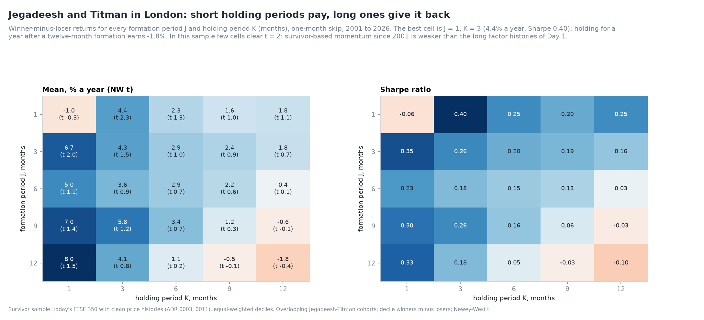

*Figure 1. Mean and Sharpe ratio of every J × K strategy, survivors, 2001-2026.*

**Table 3. Mean winner-minus-loser return, % a year (Newey-West *t*), survivors, January 2001 to
September 2026.**

| J \ K | 1 | 3 | 6 | 9 | 12 |
|---|---|---|---|---|---|
| 1 | −1.0 (−0.3) | 4.4 (2.3) | 2.3 (1.3) | 1.6 (1.0) | 1.8 (1.1) |
| 3 | 6.7 (2.0) | 4.3 (1.5) | 2.9 (1.0) | 2.4 (0.9) | 1.8 (0.7) |
| 6 | 5.0 (1.1) | 3.6 (0.9) | 2.9 (0.7) | 2.2 (0.6) | 0.4 (0.1) |
| 9 | 7.0 (1.4) | 5.8 (1.2) | 3.4 (0.7) | 1.2 (0.3) | −0.6 (−0.1) |
| 12 | 8.0 (1.5) | 4.1 (0.8) | 1.1 (0.2) | −0.5 (−0.1) | −1.8 (−0.4) |

**Table 4. Sharpe ratios of the same strategies.**

| J \ K | 1 | 3 | 6 | 9 | 12 |
|---|---|---|---|---|---|
| 1 | −0.06 | 0.40 | 0.25 | 0.20 | 0.25 |
| 3 | 0.35 | 0.26 | 0.20 | 0.19 | 0.16 |
| 6 | 0.23 | 0.18 | 0.15 | 0.13 | 0.03 |
| 9 | 0.30 | 0.26 | 0.16 | 0.06 | −0.03 |
| 12 | 0.33 | 0.18 | 0.05 | −0.03 | −0.10 |

The grid has a clear shape. Returns fall as the holding period lengthens, in every row. The
longest formation (12 months) has the best one-month return and the worst twelve-month one. The
J = 1 row is the exception: a one-month signal held one month is short-term reversal, not momentum
(Section 5.2). Few cells clear *t* = 2. Survivor-based momentum since 2001 is noisy (about 30 names
a leg) and biased downwards (Section 5.10); the long factor histories of Day 1 remain the evidence
for the premium.

**Table 5. The 12-1 strategy with different breakpoints (K = 1, survivors).**

| Legs | Mean | Volatility | Sharpe | NW *t* | Max drawdown |
|---|---|---|---|---|---|
| Deciles | 7.7% | 24.1% | 0.32 | 1.43 | 71% |
| Quintiles | 7.3% | 18.4% | 0.40 | 1.82 | 58% |
| 30% | 5.0% | 15.1% | 0.33 | 1.51 | 54% |

Broader legs lower the mean but lower volatility faster, so quintiles give the best Sharpe ratio.

### 5.2 The skip month and short-term reversal

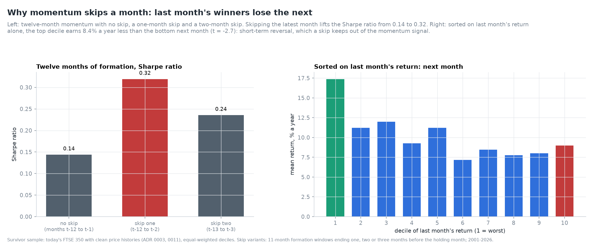

*Figure 2. Twelve-month momentum with and without a skip, and returns sorted on last month's
return.*

**Table 6. The skip and short-term reversal (survivors, 2001-2026).**

| Strategy | Mean | Sharpe | NW *t* |
|---|---|---|---|
| 11-month formation, no skip (*t*−12 to *t*−1) | 3.5% | 0.14 | 0.67 |
| 11-month formation, skip one (*t*−12 to *t*−2) | 7.7% | 0.32 | 1.43 |
| 11-month formation, skip two (*t*−13 to *t*−3) | 5.5% | 0.24 | 1.08 |
| Top minus bottom decile of last month's return | −8.4% | – | −2.69 |

| Decile of last month's return | 1 | 2 | 3 | 4 | 5 | 6 | 7 | 8 | 9 | 10 |
|---|---|---|---|---|---|---|---|---|---|---|
| Next month, % a year | 17.4 | 11.2 | 12.0 | 9.3 | 11.2 | 7.2 | 8.5 | 7.8 | 8.0 | 9.0 |

The worst decile of last month earns 17.4% a year the next month, almost twice the best decile's
9.0%. Including that month in the momentum signal therefore adds the opposite effect, and halves
the Sharpe ratio. Skipping two months loses some of the signal's freshest information.

### 5.3 Five years after formation

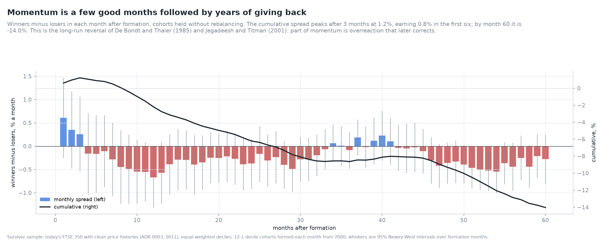

*Figure 3. Winners minus losers in each month after formation.*

**Table 7. The event-time profile of 12-1 decile cohorts (survivors, formed 2000-2026).**

| Months after formation | Sum of monthly spreads | Positive months |
|---|---|---|
| 1-3 | +1.2% | 3 of 3 |
| 1-6 | +0.8% | 3 of 6 |
| 7-12 | −3.0% | 0 of 6 |
| 13-24 | −4.0% | 0 of 12 |
| 25-36 | −2.4% | 2 of 12 |
| 37-60 | −5.4% | 4 of 24 |
| Cumulative at 12, 24, 36, 60 | −2.2%, −6.2%, −8.6%, −14.0% | – |

Momentum on survivors is a short-lived effect. Cohorts gain for three months, and by month 7 every
month is negative. This is the reversal of Jegadeesh and Titman (2001) and De Bondt and Thaler
(1985), and it explains the grid: a 12-month holding period averages three good months with nine
bad ones. Survivorship strengthens the reversal, since the losers in the sample are those that
recovered. The shape, not the level, is the finding.

### 5.4 Which half of the year?

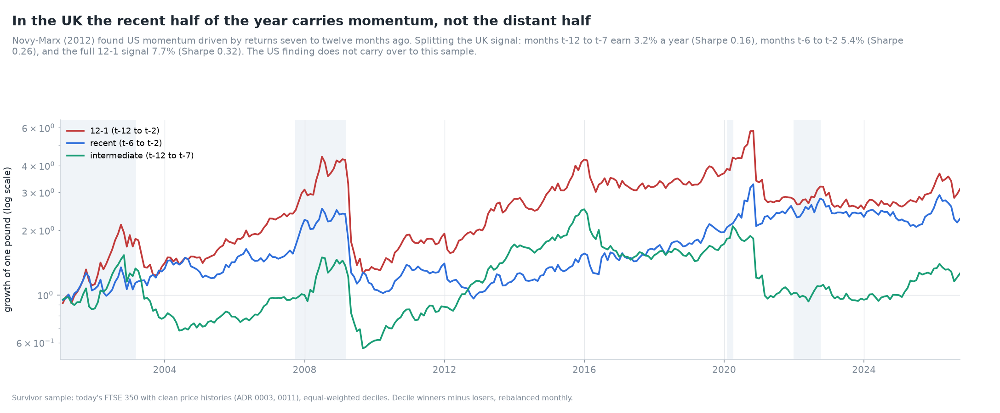

*Figure 4. Intermediate (*t*−12 to *t*−7), recent (*t*−6 to *t*−2) and full 12-1 momentum.*

**Table 8. Splitting the signal (survivors, 2001-2026).**

| Signal | Mean | Volatility | Sharpe | NW *t* | Market beta |
|---|---|---|---|---|---|
| Intermediate, *t*−12 to *t*−7 | 3.2% | 20.6% | 0.16 | 0.66 | −0.43 |
| Recent, *t*−6 to *t*−2 | 5.4% | 20.6% | 0.26 | 1.35 | −0.42 |
| Full 12-1 | 7.7% | 24.1% | 0.32 | 1.43 | −0.59 |

The two halves correlate 0.42 and the recent half earns more, the opposite of Novy-Marx's US
result. The full signal earns more than either half alone, so both carry information.

### 5.5 Residual momentum

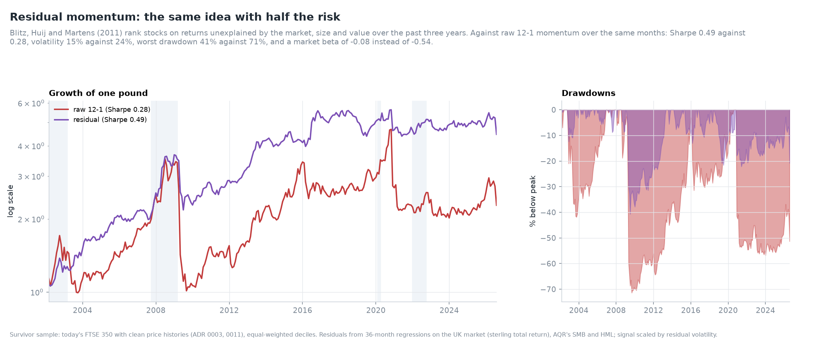

*Figure 5. Raw and residual momentum: growth of one pound and drawdowns.*

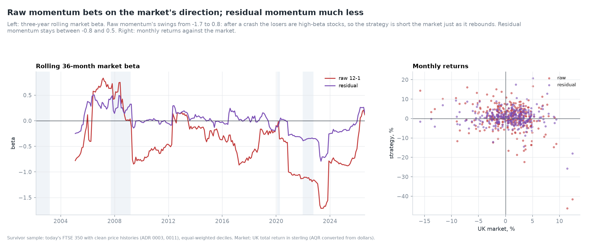

*Figure 6. Rolling 36-month market beta, and monthly returns against the market.*

**Table 9. Raw and residual 12-1 momentum over the same 294 months (survivors, February 2002 to
July 2026).**

| Measure | Raw | Residual |
|---|---|---|
| Mean | 6.6% | 7.2% |
| Volatility | 24.0% | 14.6% |
| Sharpe ratio | 0.28 | 0.49 |
| NW *t* | 1.19 | 2.25 |
| Maximum drawdown | 71% | 41% |
| Skewness | −2.09 | −0.54 |
| Market beta | −0.54 | −0.08 |
| Alpha against market, SMB and HML | 12.3% (*t* 2.73) | 7.4% (*t* 2.62) |
| Loadings: market, SMB, HML | −0.39, −0.39, −0.60 | −0.08, −0.15, 0.02 |
| R² on the factors | 0.17 | 0.02 |
| Correlation with raw | – | 0.64 |

Residual momentum keeps the premium and sheds the risk. Its volatility is 40% lower, its skewness
is a quarter as negative and its drawdown 30 points shallower. Raw momentum's betas swing from
−1.7 to 0.8 over three-year windows: after a crash the losers are the high-beta stocks, so raw
momentum is short the market just as it rebounds. Residual momentum's betas stay between −0.8 and
0.5. Raw momentum's alpha against the factors is larger than its raw mean because its negative
loadings on all three factors were a drag. The residual strategy has no such drag to remove.

### 5.6 The 52-week high

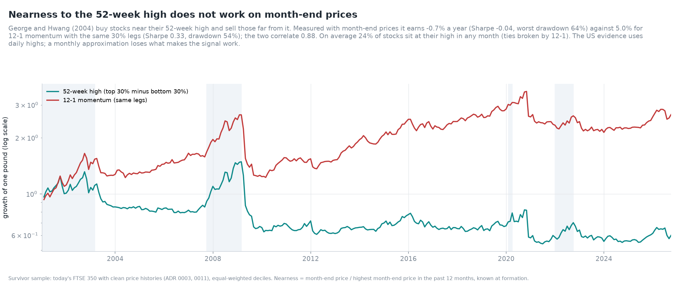

*Figure 7. The 52-week-high strategy against 12-1 momentum with the same 30% legs.*

On month-end prices, buying the 30% of stocks nearest their twelve-month high and selling the 30%
furthest from it earned −0.7% a year (Sharpe −0.04, worst drawdown 64%). 12-1 momentum with the
same legs earned 5.0% (Sharpe 0.33). The two correlate 0.88. On average 24% of stocks sit exactly
at their twelve-month month-end high, so the ratio cannot rank them; ties are broken by 12-1
momentum (ADR 0010).

George and Hwang (2004) measure the high from daily prices. A month-end approximation misses
intra-month highs, so it is a weaker test of their idea, not a rejection.

### 5.7 Market states

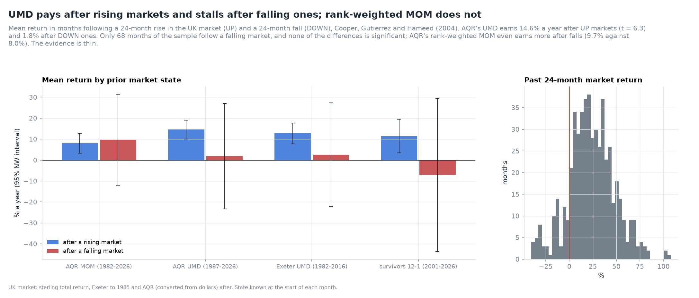

*Figure 8. Mean momentum return after rising and falling markets.*

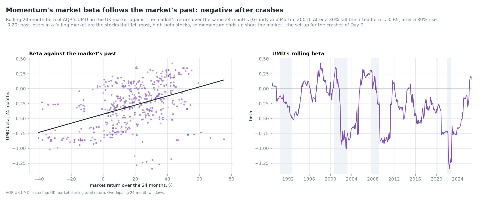

*Figure 9. UMD's 24-month beta against the market's return over the same window.*

**Table 10. Momentum after rising (UP) and falling (DOWN) 24-month markets, % a year (NW *t*).**

| Series | Months UP / DOWN | After UP | After DOWN | DOWN − UP |
|---|---|---|---|---|
| AQR MOM, 1982-2026 | 458 / 68 | 8.0 (3.29) | 9.7 (0.87) | +1.6 (0.15) |
| AQR UMD, 1987-2026 | 407 / 68 | 14.6 (6.33) | 1.8 (0.14) | −12.7 (−0.97) |
| Exeter UMD, 1982-2016 | 346 / 59 | 12.7 (5.04) | 2.5 (0.20) | −10.2 (−0.76) |
| Survivors 12-1, 2001-2026 | 239 / 68 | 11.5 (2.82) | −7.1 (−0.38) | −18.6 (−0.97) |

Three of the four series earn far less after falling markets, consistent with Cooper, Gutierrez
and Hameed (2004). But only 68 of 526 months follow a 24-month fall, and the DOWN months are
volatile, so no difference is significant. AQR's rank-weighted MOM, which holds every stock rather
than the extremes, shows no state dependence at all. The evidence is consistent, not conclusive.

The mechanism is visible in UMD's beta. Its fitted 24-month beta is −0.43 at a flat market and
moves 0.76 for every unit of past market return: −0.65 after a 30% fall, −0.20 after a 30% rise
(correlation 0.43). The low was −1.34 in May 2022. A momentum portfolio formed after a fall is short a high-beta basket,
and loses when the market recovers. Day 7 models these crashes.

### 5.8 The April effect

*Figure 10. AQR UK momentum by calendar month, 1972-2026.*

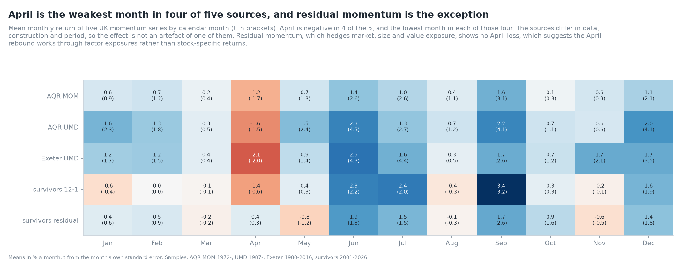

*Figure 11. Calendar-month means of five momentum series.*

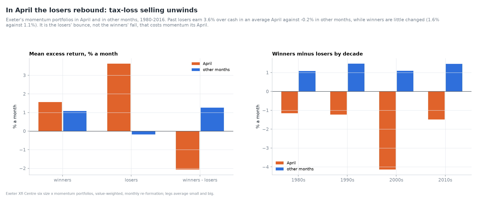

*Figure 12. Exeter's winners and losers in April and in other months.*

**Table 11. Mean momentum return by calendar month, % a month.**

| Month | AQR MOM | AQR UMD | Exeter UMD | Survivors 12-1 | Residual |
|---|---|---|---|---|---|
| Jan | 0.57 | 1.58 | 1.18 | −0.58 | 0.40 |
| Feb | 0.71 | 1.27 | 1.24 | 0.01 | 0.54 |
| Mar | 0.23 | 0.35 | 0.35 | −0.10 | −0.16 |
| **Apr** | **−1.21** | **−1.61** | **−2.07** | **−1.39** | 0.40 |
| May | 0.67 | 1.45 | 0.87 | 0.36 | −0.76 |
| Jun | 1.36 | 2.26 | 2.50 | 2.29 | 1.91 |
| Jul | 1.00 | 1.33 | 1.62 | 2.38 | 1.54 |
| Aug | 0.44 | 0.71 | 0.29 | −0.38 | −0.12 |
| Sep | 1.61 | 2.21 | 1.69 | 3.38 | 1.72 |
| Oct | 0.15 | 0.69 | 0.75 | 0.32 | 0.91 |
| Nov | 0.63 | 0.57 | 1.69 | −0.18 | −0.55 |
| Dec | 1.09 | 1.99 | 1.71 | 1.56 | 1.38 |

**Table 12. Regressions on calendar dummies (coefficients in % a month, NW *t* in brackets).**

| Series | Other months (intercept) | January | March | April |
|---|---|---|---|---|
| AQR MOM, 1972-2026 | 0.85 | −0.28 (−0.45) | −0.62 (−0.93) | **−2.06 (−2.81)** |
| Exeter UMD, 1980-2016 | 1.37 | −0.20 (−0.27) | −1.02 (−1.16) | **−3.44 (−3.48)** |
| AQR UMD, 1987-2026 (Jan, Apr) | 1.28 | +0.30 (0.42) | – | **−2.89 (−2.84)** |
| Survivors 12-1 (Jan, Apr) | 0.97 | −1.55 (−1.08) | – | −2.36 (−1.18) |
| Residual (Jan, Apr) | 0.64 | −0.24 (−0.32) | – | −0.24 (−0.17) |
| AQR MOM April, 1972-1989 | – | – | – | −0.60 (−0.84) |
| AQR MOM April, 1990-2007 | – | – | – | −3.20 (−2.19) |
| AQR MOM April, 2008-2026 | – | – | – | −2.13 (−1.58) |

**Table 13. Exeter's six portfolios in April and in other months (excess return, % a month).**

| Portfolio | April | Other months |
|---|---|---|
| Small losers | 3.62 | −0.23 |
| Small middle | 2.40 | 0.51 |
| Small winners | 2.02 | 1.26 |
| Big losers | 3.63 | −0.13 |
| Big middle | 1.59 | 0.54 |
| Big winners | 1.10 | 0.91 |
| Market excess return | 1.94 | 0.38 |

April is the weakest month for momentum in four of the five series. It is significant in all
three survivorship-free ones, and survives a Bonferroni correction for twelve months in Exeter's
UMD (*t* = −3.5, *p* ≈ 0.0005 before correction). January shows nothing. March is weak but not
significant.

The UK tax year ends on 5 April. An investor who sells a loser before that date realises the loss
against the year's gains. This depresses losers into early April and lets them rebound afterwards,
the UK counterpart of the US January effect (Reinganum and Shapiro, 1987). Table 13 is consistent
with that reading. Every portfolio rises in an average April, but past losers rise most: 3.6%
against −0.2% in other months. Winners change little.

Residual momentum shows no April effect. The losers' rebound is shared with the market's strong
Aprils (1.9% against 0.4%), and momentum's short leg is a high-beta position. That suggests the
effect works through factor exposure rather than stock-specific returns. The effect was strongest
in 1990-2007 (−3.2 points) and weaker since. Day 14 tests whether avoiding April would have
improved a real-time strategy.

### 5.9 Size

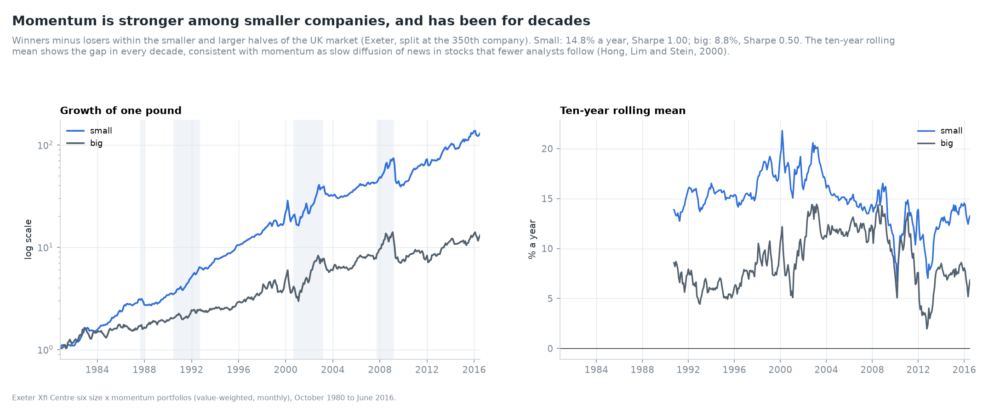

*Figure 13. Momentum among small and big companies (Exeter).*

**Table 14. Momentum within size groups (Exeter six portfolios, 1980-2016).**

| Measure | Small | Big |
|---|---|---|
| Mean, % a year | 14.8 | 8.8 |
| Volatility | 14.8% | 17.7% |
| Sharpe ratio | 1.00 | 0.50 |
| NW *t* | 5.22 | 2.79 |
| Maximum drawdown | 47% | 50% |
| 1980s / 1990s / 2000s / 2010s mean | 13.7 / 19.3 / 8.6 / 19.0 | 7.9 / 10.7 / 7.2 / 9.7 |

Momentum among the smaller half of the market earns more with less volatility, in every decade.
This fits Hong, Lim and Stein's (2000) view of momentum as slow diffusion of news in stocks that
few analysts follow. It also matters for costs: small stocks are the expensive ones to trade
(Day 9).

### 5.10 Deciles, legs and the survivorship of losers

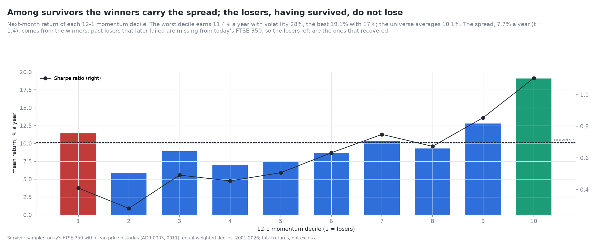

*Figure 14. Next-month returns of the ten 12-1 deciles (survivors).*

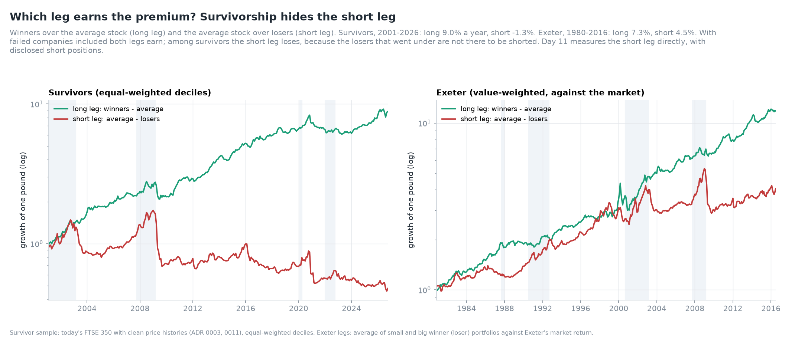

*Figure 15. Long and short legs, survivors and Exeter.*

**Table 15. The ten 12-1 deciles (survivors, 2001-2026, total returns).**

| Decile | 1 (losers) | 2 | 3 | 4 | 5 | 6 | 7 | 8 | 9 | 10 (winners) |
|---|---|---|---|---|---|---|---|---|---|---|
| Mean, % a year | 11.4 | 5.9 | 8.9 | 7.0 | 7.4 | 8.7 | 10.3 | 9.3 | 12.8 | 19.1 |
| Volatility, % | 27.9 | 20.9 | 18.1 | 15.4 | 14.7 | 13.7 | 13.7 | 13.8 | 15.0 | 17.3 |
| Sharpe ratio | 0.41 | 0.28 | 0.49 | 0.45 | 0.51 | 0.63 | 0.75 | 0.67 | 0.85 | 1.10 |

| Leg | Survivors, 2001-2026 | Exeter, 1980-2016 |
|---|---|---|
| Long: winners minus the average stock | +9.0% a year | +7.3% a year |
| Short: the average stock minus losers | −1.3% a year | +4.5% a year |

Among survivors the winners carry the whole spread. The loser decile earns 11.4% a year, more than
the average survivor (10.1%), with by far the highest volatility. In Exeter's survivorship-free
portfolios both legs earn. The difference is survivorship. The losers that later failed are
missing from today's FTSE 350, so the losers that remain are the ones that recovered. This is why
survivor momentum understates the clean factor (4.1% against 6.1% a year), the corrected Day 1
result (ADR 0009). It is also a warning for Day 11: the short leg cannot be studied on survivors.

### 5.11 Turnover

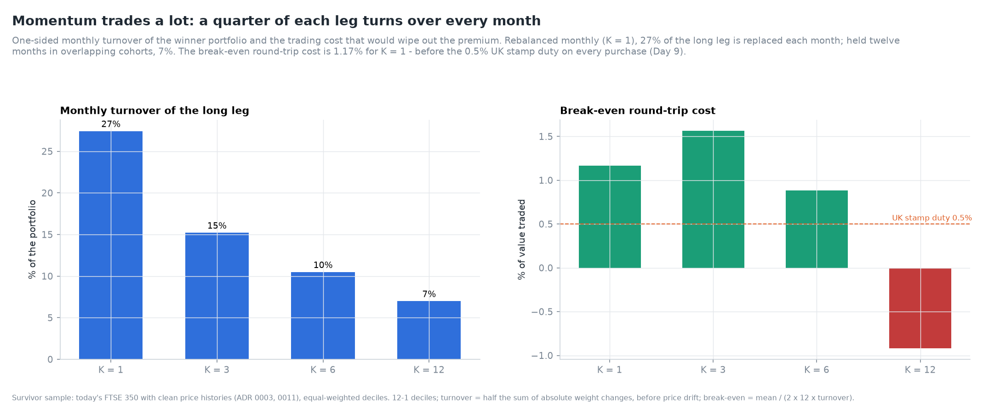

*Figure 16. Turnover and break-even trading costs by holding period.*

**Table 16. Turnover and break-even costs of 12-1 decile strategies (survivors, 2001-2026).**

| Holding period | Monthly turnover, long leg | Mean | Sharpe | Break-even round-trip cost |
|---|---|---|---|---|
| K = 1 | 27.4% | 7.7% | 0.32 | 1.17% |
| K = 3 | 15.2% | 5.7% | 0.25 | 1.57% |
| K = 6 | 10.5% | 2.2% | 0.10 | 0.88% |
| K = 12 | 7.0% | −1.5% | −0.08 | – |

A monthly-rebalanced momentum portfolio replaces more than a quarter of each leg every month,
over three times a year. Holding three months in overlapping cohorts nearly halves turnover and
gives the highest break-even cost. A round trip in a UK small cap costs the bid-ask spread plus
0.5% stamp duty on the purchase, so these margins are thin. Day 9 measures them properly.

### 5.12 Persistence and spells

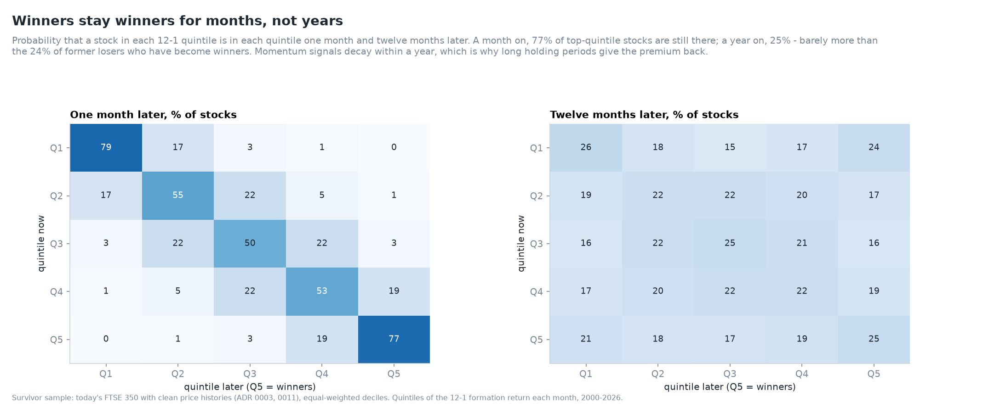

*Figure 17. Quintile transition matrices at one and twelve months.*

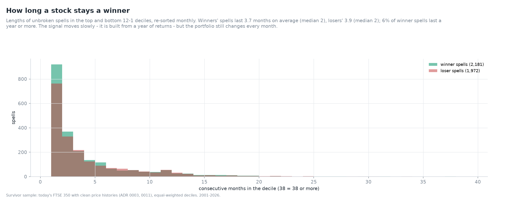

*Figure 18. Lengths of spells in the winner and loser deciles.*

**Table 17. Probability of staying in the same 12-1 quintile.**

| Quintile now | 1 month later | 6 months later | 12 months later |
|---|---|---|---|
| Q1 (losers) | 78.5% | 46.9% | 26.3% |
| Q2 | 54.7% | 28.6% | 21.8% |
| Q3 | 49.9% | 27.4% | 24.7% |
| Q4 | 53.1% | 29.3% | 22.2% |
| Q5 (winners) | 77.0% | 45.1% | 24.7% |
| Losers becoming winners (Q1 → Q5) | 0.3% | 8.7% | 24.1% |

A year on, a winner is a winner with probability 25%, about the same as a former loser (24%). The
extreme quintiles hold the most volatile stocks, which move between extremes in both directions.
Spells in the winner decile last 3.7 months on average (median 2, 90th percentile 10); only 6%
last a year or more. Losers' spells last 3.9 months. A signal built from a year of returns still
turns over its extremes within months.

### 5.13 Industries

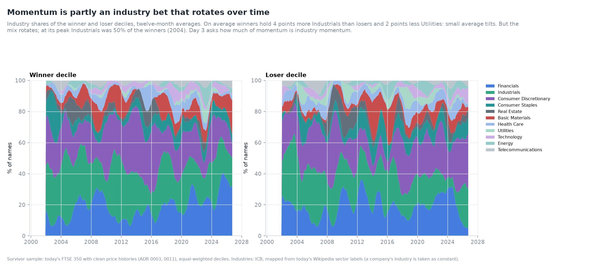

*Figure 19. Industry shares of the winner and loser deciles, twelve-month averages.*

**Table 18. Average industry shares, % of names (survivors, 2001-2026).**

| Industry | Universe | Winners | Losers |
|---|---|---|---|
| Financials | 34.7 | 19.0 | 18.9 |
| Industrials | 20.5 | 26.7 | 22.7 |
| Consumer Discretionary | 16.5 | 23.4 | 22.9 |
| Consumer Staples | 6.8 | 7.1 | 8.2 |
| Real Estate | 6.4 | 4.0 | 4.7 |
| Basic Materials | 4.4 | 7.7 | 6.6 |
| Health Care | 3.1 | 4.4 | 5.2 |
| Utilities | 2.9 | 1.2 | 3.4 |
| Technology | 1.9 | 2.8 | 2.7 |
| Energy | 1.7 | 1.8 | 2.7 |
| Telecommunications | 1.1 | 1.9 | 1.8 |

Both legs under-weight Financials, mostly low-volatility investment trusts that rarely reach the
extremes, and over-weight the cyclical industries. Winners and losers differ little on average.
At any time the mix can be concentrated: at its peak Industrials made up 50% of the winners (2004),
Consumer Discretionary 44% (2016) and Financials 41% (2025). Whether momentum is mostly industry
momentum is Day 3's question.

### 5.14 The formation spread

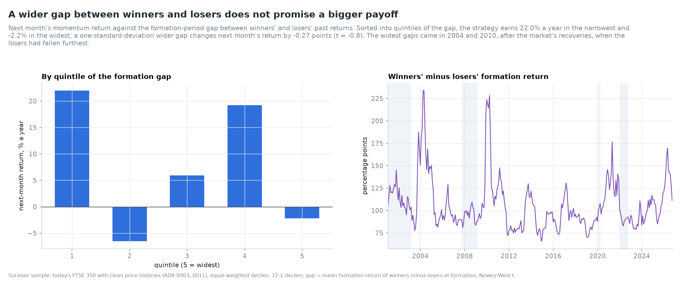

*Figure 20. Next-month momentum against the winners-losers formation gap.*

The gap between winners' and losers' past returns varies from 66 to 234 percentage points. It does
not predict next month's momentum return: a one-standard-deviation wider gap changes it by −0.27
points (*t* = −0.8). By quintile of the gap the returns are 22.0%, −6.5%, 5.9%, 19.2% and −2.2% a
year, with no pattern. The widest gaps came in April 2004 and early 2010, after the market's
recoveries, when the losers had fallen furthest.

### 5.15 Survivors against the factors, and stability

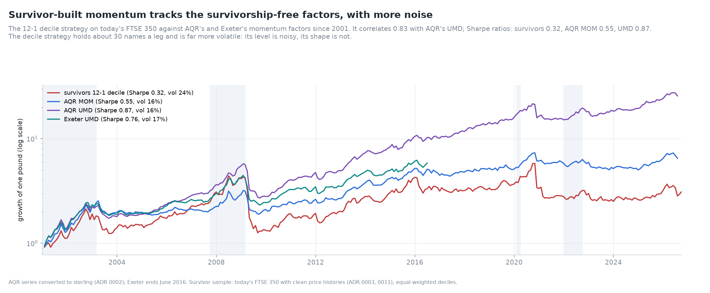

*Figure 21. Survivor-built momentum against AQR and Exeter.*

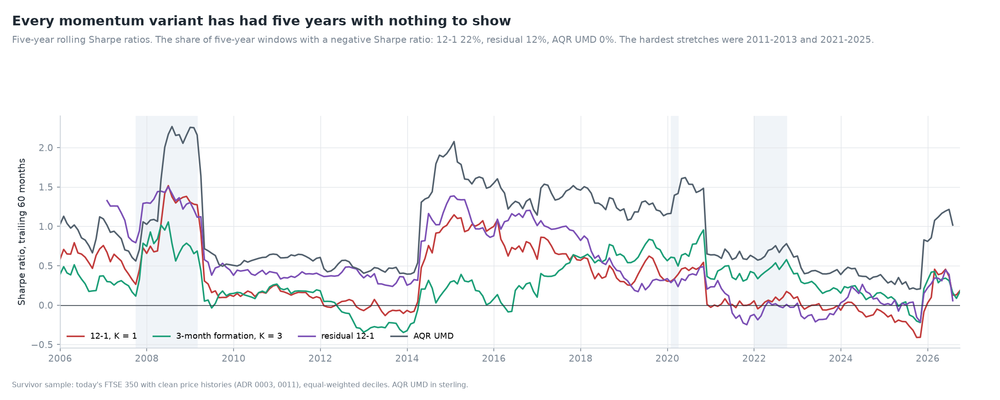

*Figure 22. Rolling five-year Sharpe ratios.*

**Table 19. Momentum since 2001, five ways.**

| Series | Months | Mean | Volatility | Sharpe | NW *t* | Max drawdown | Negative 5-year windows |
|---|---|---|---|---|---|---|---|
| Survivors, 12-1 deciles | 309 | 7.7% | 24.1% | 0.32 | 1.43 | 71% | 22% |
| Survivors, residual 12-1 | 294 | 7.2% | 14.6% | 0.49 | 2.25 | 41% | 12% |
| AQR MOM | 307 | 8.6% | 15.6% | 0.55 | 2.57 | 40% | – |
| AQR UMD | 307 | 14.2% | 16.2% | 0.87 | 3.75 | 53% | 0% |
| Exeter UMD (to 2016) | 186 | 12.9% | 17.0% | 0.76 | 2.48 | 48% | – |

Survivor momentum correlates 0.82 with AQR's UMD and 0.78 with MOM, so it tracks the same
strategy. It is noisier, with 30 names a leg against AQR's broad portfolios, and biased down by
its losers. Every survivor variant has had five-year windows with a negative Sharpe ratio, most of
them in 2011-2013 and 2021-2025. AQR's UMD never has since 2001.

## 6. Robustness

* **Sources.** The market-state and April results are reported in three survivorship-free series
  as well as on survivors; the size and leg results come from Exeter's portfolios. The April effect
  is significant in all three factor series.
* **Breakpoints.** Deciles, quintiles and 30% legs give Sharpe ratios of 0.32, 0.40 and 0.33 for
  12-1 momentum. The grid's shape does not depend on the choice.
* **Skip.** The skip-one result holds against skip-zero and skip-two.
* **Multiple testing.** Twelve calendar months were examined. April in Exeter's UMD survives a
  Bonferroni correction; in AQR's MOM and UMD (*t* ≈ −2.8) it is borderline after correction. The
  hypothesis came from Reinganum and Shapiro (1987), not from the data, which strengthens it.
* **Data.** The data defect of Section 3.1 changed the stock-level levels but not the factor-level
  results. The validation suite now guards against it.

## 7. Limitations

1. **Survivor sample.** Stock-level levels are biased: downwards for momentum, upwards for the
   loser decile. Shapes and comparisons are more reliable than levels (ADR 0009).
2. **Twenty-six years of stock data.** The stock-level sample starts in 1999, so grid cells have
   about 300 months and wide intervals.
3. **Few DOWN-market months.** 68 months follow a 24-month fall; the market-state differences are
   not significant.
4. **Monthly prices.** The 52-week high and all returns use month-end prices. Intra-month highs,
   and the timing of trades within the month, are not captured.
5. **No costs.** All returns are gross. The break-even costs in Table 16 are a first look; Day 9
   models spreads, stamp duty and market impact.
6. **Constant industries.** Each company is assigned today's ICB industry for its whole history.
7. **The April mechanism is inferred.** Tax-loss selling fits the evidence, but the note does not
   observe trades. The residual-momentum result points to a factor channel that Day 8 can test.

## 8. What comes next

Day 3 asks how much of UK momentum is industry momentum. It builds industry portfolios from the
same sample, ranks industries on their own past returns, and tests whether stock momentum
survives within industries.

## References

* Asness, C. S., Moskowitz, T. J. and Pedersen, L. H. (2013). Value and momentum everywhere.
  *Journal of Finance* 68(3), 929-985.
* Blitz, D., Huij, J. and Martens, M. (2011). Residual momentum. *Journal of Empirical Finance*
  18(3), 506-521.
* Brown, S. J., Goetzmann, W., Ibbotson, R. G. and Ross, S. A. (1992). Survivorship bias in
  performance studies. *Review of Financial Studies* 5(4), 553-580.
* Cooper, M. J., Gutierrez, R. C. and Hameed, A. (2004). Market states and momentum. *Journal of
  Finance* 59(3), 1345-1365.
* Daniel, K. and Moskowitz, T. J. (2016). Momentum crashes. *Journal of Financial Economics*
  122(2), 221-247.
* De Bondt, W. F. M. and Thaler, R. (1985). Does the stock market overreact? *Journal of Finance*
  40(3), 793-805.
* George, T. J. and Hwang, C.-Y. (2004). The 52-week high and momentum investing. *Journal of
  Finance* 59(5), 2145-2176.
* Gregory, A., Tharyan, R. and Christidis, A. (2013). Constructing and testing alternative versions
  of the Fama-French and Carhart models in the UK. *Journal of Business Finance & Accounting*
  40(1-2), 172-214.
* Grundy, B. D. and Martin, J. S. (2001). Understanding the nature of the risks and the source of
  the rewards to momentum investing. *Review of Financial Studies* 14(1), 29-78.
* Heston, S. L. and Sadka, R. (2008). Seasonality in the cross-section of stock returns. *Journal
  of Financial Economics* 87(2), 418-445.
* Hong, H., Lim, T. and Stein, J. C. (2000). Bad news travels slowly: size, analyst coverage, and
  the profitability of momentum strategies. *Journal of Finance* 55(1), 265-295.
* Jegadeesh, N. (1990). Evidence of predictable behavior of security returns. *Journal of Finance*
  45(3), 881-898.
* Jegadeesh, N. and Titman, S. (1993). Returns to buying winners and selling losers: implications
  for stock market efficiency. *Journal of Finance* 48(1), 65-91.
* Jegadeesh, N. and Titman, S. (2001). Profitability of momentum strategies: an evaluation of
  alternative explanations. *Journal of Finance* 56(2), 699-720.
* Lehmann, B. N. (1990). Fads, martingales, and market efficiency. *Quarterly Journal of
  Economics* 105(1), 1-28.
* Liu, W., Strong, N. and Xu, X. (1999). The profitability of momentum investing. *Journal of
  Business Finance & Accounting* 26(9-10), 1043-1091.
* Moskowitz, T. J. and Grinblatt, M. (1999). Do industries explain momentum? *Journal of Finance*
  54(4), 1249-1290.
* Newey, W. K. and West, K. D. (1987). A simple, positive semi-definite, heteroskedasticity and
  autocorrelation consistent covariance matrix. *Econometrica* 55(3), 703-708.
* Novy-Marx, R. (2012). Is momentum really momentum? *Journal of Financial Economics* 103(3),
  429-453.
* Reinganum, M. R. (1983). The anomalous stock market behavior of small firms in January:
  empirical tests for tax-loss selling effects. *Journal of Financial Economics* 12(1), 89-104.
* Reinganum, M. R. and Shapiro, A. C. (1987). Taxes and stock return seasonality: evidence from the
  London Stock Exchange. *Journal of Business* 60(2), 281-295.
* Roll, R. (1983). Vas ist das? The turn-of-the-year effect and the return premia of small firms.
  *Journal of Portfolio Management* 9(2), 18-28.
