# Time-series momentum on UK assets

*Day 4 of 15 · uk-value-momentum v0.4.0*

## Summary

Days 2 and 3 studied cross-sectional momentum: buy the stocks or industries that beat the others.
Time-series momentum asks a simpler question of each asset alone: was its own excess return over
the past year positive? If so, hold it; if not, short it. Moskowitz, Ooi and Pedersen (2012,
"MOP") found this rule profitable in 58 futures markets. This note applies it to the three UK
asset classes with free long histories, to the UK equity factors, and to UK stocks.

The assets are the UK stock market (AQR, converted to sterling, 1986-2026), a constant-maturity
ten-year gilt priced from the OECD yield (1972-2026), and the pound against the dollar
(1972-2026). Positions are scaled to 10% ex-ante volatility and equally weighted across assets.

Findings:

1. **Trend following paid in all three UK asset classes.** Sharpe ratios: gilts 0.32, equity 0.21,
   the pound 0.13. The diversified portfolio earned 2.9% a year at 8.2% volatility (Sharpe 0.36),
   with a worst drawdown of 21%, 1973-2026.
2. **It is not luck in the timing.** Shifting each asset's own signal by a random number of months
   keeps its persistence and its share of time long. Only 1% of 500 such placebos match the
   actual Sharpe ratio (one-sided p = 0.01).
3. **Past returns predict future returns only weakly for UK assets.** In MOP's pooled regression,
   only lag 1 is significant (t = 4.2), and it comes entirely from gilts. The OECD yield is a
   monthly average, and averaging creates autocorrelation (Working 1960). Without gilts, lag 1 has
   t = 0.3.
4. **The 12-month result does not depend on that artefact.** Leaving out the latest month (a 12-1
   signal) gives a Sharpe ratio of 0.38 against 0.36.
5. **Trend following has a smile.** Quarterly portfolio returns against the UK market fit a
   U-shape with curvature 1.02 (t = 3.6) and no linear exposure (−0.04, t = −0.9). It behaves
   like a long straddle on the market, as Fung and Hsieh (2001) found for trend-following funds.
6. **It made money in six of seven UK stress episodes.** +27% in the dot-com bust (market −49%),
   +8% in the financial crisis (−47%), +21% in the 2022 gilt crisis, where the short gilt position
   alone made 55%. The one loss: −3% around the ERM exit in 1992.
7. **Factor momentum is stronger than asset momentum.** Timing six UK equity factors by their own
   12-month return gives a Sharpe ratio of 0.88. Timing beats holding for five of six factors. The
   factors' own lag-1 autocorrelations (0.13 to 0.25) carry part of it: skipping the latest month
   lowers the Sharpe ratio to 0.69.
8. **Asset and factor momentum diversify each other.** Their correlation is 0.16. An equal mix has
   a Sharpe ratio of 0.83 and a worst drawdown of 16%.
9. **The rule matters less than the idea, but scaling matters.** Six variants earn Sharpe ratios
   from 0.22 to 0.52. Without volatility scaling the Sharpe ratio falls from 0.36 to 0.22, since
   UK equity, the most volatile asset, then dominates.
10. **Among stocks, time-series momentum is cross-sectional momentum in disguise.** On the FTSE 350
    survivor sample (2000-2026) the two correlate 0.78. Regressing the time-series strategy on the
    cross-sectional one and the market leaves no alpha (t = 0.1) and no market loading (t = 0.5).
11. **Trend following comes and goes.** The asset portfolio's rolling five-year Sharpe ratio ranged
    from −0.5 to 1.2. Its Sharpe ratio was 0.41 in 1973-1989, 0.52 in 1990-2007 and 0.15 since 2008.

Four new validation checks bring the suite to 27, all passing.

## 1. The question

Cross-sectional momentum ranks assets against each other. It is always long some assets and short
others, so it has no net market position. Time-series momentum judges each asset against zero: an
asset that rose over the past year is held long whatever the others did. When every market falls,
the strategy can be short all of them. That is why trend-following funds, the managed-futures
industry, are sold as "crisis alpha".

The UK has received little attention in this literature, beyond appearing as one market among
many in MOP's futures sample. A UK investor's three main asset classes are domestic equity, gilts
and sterling. Two questions follow:

* Does time-series momentum work in each UK asset class over five decades?
* Is it distinct from the cross-sectional momentum of Days 2 and 3, among UK factors and stocks?

## 2. Literature

**Moskowitz, Ooi and Pedersen (2012)** define the strategy and document it in equity index, bond,
currency and commodity futures from 1985. Their regressions of an asset's scaled return on its own
past scaled returns show positive coefficients for about a year and partial reversal afterwards.
**Hurst, Ooi and Pedersen (2017)** extend the evidence back to 1880. **Baltas and Kosowski (2013)**
study the sampling frequency and the volatility estimator. **Kim, Tse and Wald (2016)** argue that
much of the record comes from volatility scaling rather than from the sign of past returns.
**Huang, Li, Wang and Zhou (2020)** question whether the predictability holds asset by asset
rather than only in pooled regressions.

**Fung and Hsieh (2001)** show that trend-following hedge funds have option-like returns. They
resemble a lookback straddle: they gain in large moves of either sign. **Ehsani and Linnainmaa
(2022)** find that equity factors themselves have time-series momentum, and argue it explains
much of stock momentum. **Goyal and Jegadeesh (2018)** compare time-series and cross-sectional
stock momentum. They show the time-series version carries a time-varying net long position, and
that this net position explains most of the difference between the two.

## 3. Data and method

### 3.1 Assets

| Asset | Series | Source | Months | Mean excess, % a year | Volatility, % | Sharpe |
|---|---|---|---|---|---|---|
| UK equity | Market excess return, sterling | AQR, converted (ADR 0004) | 481 | 4.7 | 14.8 | 0.32 |
| Ten-year gilt | Constant-maturity par bond priced from yields | FRED / OECD (ADR 0014) | 649 | 1.3 | 7.4 | 0.18 |
| Pound vs dollar | Long pounds funded in dollars | FRED, AQR US bill | 649 | 1.1 | 9.9 | 0.11 |

*Table 1. The three UK asset classes, 1972 (equity 1986) to January 2026, the last month of
the UK rate series.*

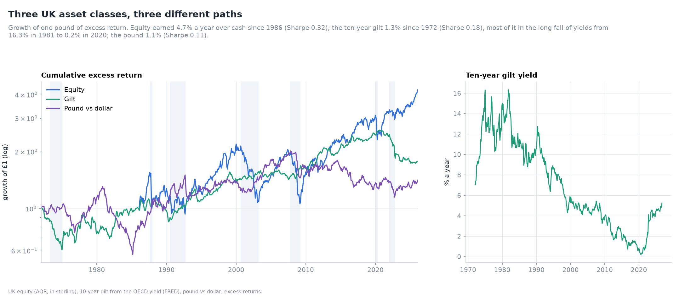

The gilt series is built from the OECD long-term yield. Each month, a par ten-year bond is bought
and repriced a month later at the new yield (ADR 0014). Gilt excess returns were small on
average (1.3% a year), but they are dominated by two eras: the yield rose to 16.3% in October
1981, then fell for four decades to 0.2% in July 2020.

### 3.2 The strategy

At each month end, for each asset (ADR 0013):

1. compute the cumulative log excess return over the past 12 months;
2. take its sign, +1 or −1;
3. scale by 10% / σ_t, where σ_t is the EWMA volatility of monthly excess returns (centre of mass
   6 months);
4. hold the position over the next month.

The portfolio is the equal-weighted average across assets. Variants: a linear signal (the 12-month
return divided by its volatility, clipped at ±1), a moving-average rule, other lookback and holding
periods, no scaling, and a 12-1 signal that skips the latest month.

## 4. Predictability

MOP's first piece of evidence is a pooled regression of each asset's scaled return on its own
scaled return h months earlier:

  r_t / σ_{t−1} = α + β_h · r_{t−h} / σ_{t−h−1} + ε_t.

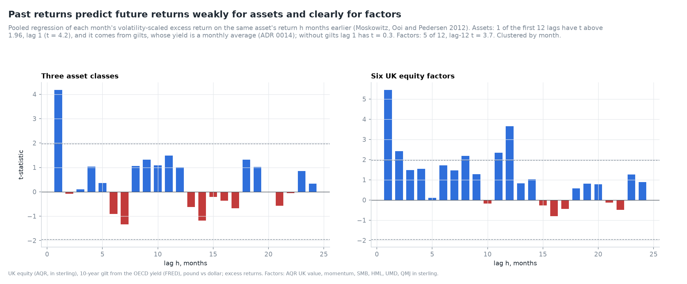

| Lag (months) | Assets β | Assets t | Factors β | Factors t |
|---|---|---|---|---|
| 1 | 0.107 | 4.18 | 0.152 | 5.45 |
| 2 | −0.002 | −0.09 | 0.067 | 2.42 |
| 3 | 0.003 | 0.10 | 0.038 | 1.48 |
| 6 | −0.022 | −0.91 | 0.049 | 1.72 |
| 9 | 0.035 | 1.32 | 0.035 | 1.28 |
| 11 | 0.036 | 1.48 | 0.065 | 2.34 |
| 12 | 0.025 | 1.00 | 0.092 | 3.65 |
| 13 | −0.016 | −0.62 | 0.021 | 0.83 |
| 18 | 0.033 | 1.32 | 0.014 | 0.57 |
| 24 | 0.008 | 0.34 | 0.020 | 0.88 |

*Table 2. Pooled predictive regressions, t-statistics clustered by month. Assets: 1,707 to 1,638
asset-months. Factors: 2,838 to 2,700.*

For the three asset classes, the coefficients at lags 8 to 12 are positive but individually
insignificant. Only lag 1 is significant. Splitting it by asset settles where it comes from:

| Asset | Lag-1 autocorrelation | Lag-1 t, own regression |
|---|---|---|
| UK equity | 0.05 | −0.4 |
| Ten-year gilt | 0.32 | 7.4 |
| Pound vs dollar | 0.07 | 0.7 |

*Table 3. The lag-1 effect by asset.*

The gilt's autocorrelation of 0.32 is close to the 0.25 that Working (1960) showed averaging alone
creates in a random walk. The OECD yield is an average of the month's observations, not a month-end
value. Equity and sterling, both measured at month ends, show nothing at lag 1. The one-month
predictability of UK assets is a measurement artefact, and the note does not rely on it.

The six UK factors, all measured at month ends, behave differently. They have significant
coefficients at lags 1, 2, 8, 11 and 12. The lag-12 coefficient (t = 3.7) recalls the seasonal
pattern in the cross-section (Heston and Sadka 2008): factors tend to do well in the same calendar
month as a year before.

## 5. The strategy's record

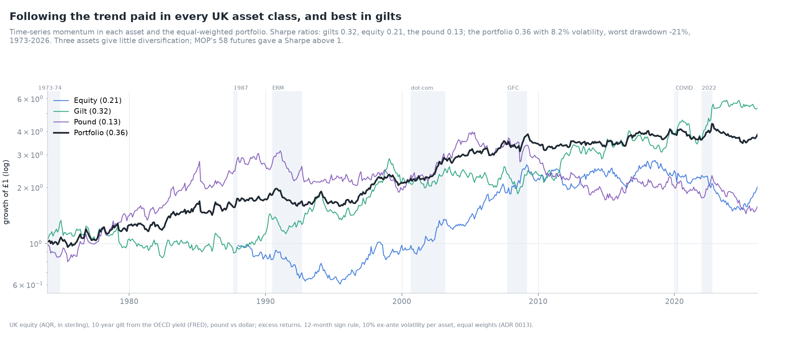

| | Mean, % a year | Volatility, % | Sharpe | Skewness | Worst drawdown, % | Months |
|---|---|---|---|---|---|---|
| UK equity TSMOM | 2.5 | 11.9 | 0.21 | 0.05 | −47 | 458 |
| Gilt TSMOM | 4.0 | 12.4 | 0.32 | 0.16 | −37 | 626 |
| Pound TSMOM | 1.7 | 12.8 | 0.13 | −0.71 | −64 | 626 |
| **Portfolio** | **2.9** | **8.2** | **0.36** | **−0.05** | **−21** | **626** |
| Portfolio, 12-1 signal | 3.0 | 7.9 | 0.38 | −0.26 | −22 | 626 |

*Table 4. Time-series momentum by asset, 1973-2026. Each asset's strategy is scaled to 10%
ex-ante volatility. Realised volatility is about 12% because the EWMA estimate is biased low
(ADR 0013).*

Three points stand out:

* **Each asset is positive, none is strong.** Single-asset Sharpe ratios of 0.13 to 0.32 are
  modest. MOP's portfolio Sharpe ratio above 1 comes from diversifying across 58 markets. Here
  there are three.
* **The three strategies are nearly uncorrelated** (pairwise 0.05 to 0.07), so the portfolio
  improves on its parts. Its volatility of 8.2% is two thirds of a single asset's.
* **The strategies barely correlate with the assets themselves** (0.02 to 0.08). Following the
  trend in gilts is not the same as holding gilts.

### 5.1 Lookback and holding period

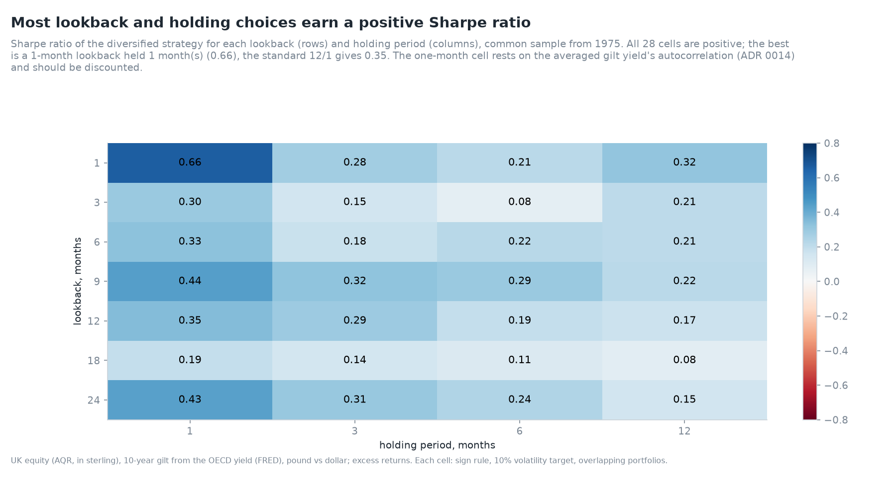

| Lookback \ Hold | 1 | 3 | 6 | 12 |
|---|---|---|---|---|
| 1 | 0.66 | 0.28 | 0.21 | 0.32 |
| 3 | 0.30 | 0.15 | 0.08 | 0.21 |
| 6 | 0.33 | 0.18 | 0.22 | 0.21 |
| 9 | 0.44 | 0.32 | 0.29 | 0.22 |
| 12 | 0.35 | 0.29 | 0.19 | 0.17 |
| 18 | 0.19 | 0.14 | 0.11 | 0.08 |
| 24 | 0.43 | 0.31 | 0.24 | 0.15 |

*Table 5. Sharpe ratio of the diversified portfolio, common sample from 1975.*

All 28 cells are positive. The best, a one-month lookback held one month (0.66), rests on the gilt
averaging artefact of Section 4 and should be discounted. Without it, Sharpe ratios of 0.2 to 0.45
are typical. Longer holding periods lower the Sharpe ratio, as signals go stale.

### 5.2 Is it luck?

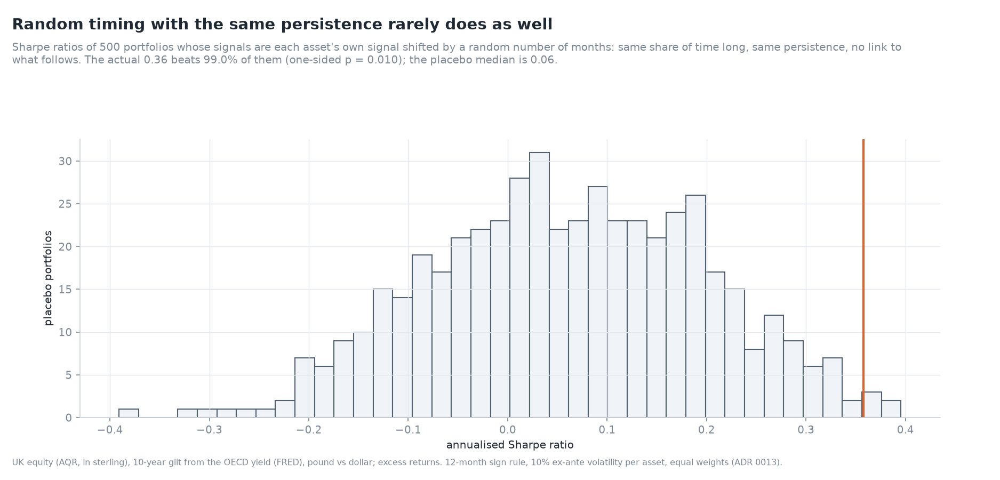

A random-sign placebo would be too easy to beat. The signals are persistent, and a persistent
signal that happens to be long in a rising market earns money without timing anything. The placebo
here keeps each asset's actual signal series and shifts it in time by a random offset of at least
two years. That preserves its persistence and the share of months long, and breaks only the link to
what follows.

| Statistic | Sharpe ratio |
|---|---|
| Actual | 0.36 |
| Placebo 5th percentile | −0.16 |
| Placebo median | 0.06 |
| Placebo 95th percentile | 0.29 |
| Placebo 99th percentile | 0.35 |
| Share of placebos ≥ actual | 1.0% |

*Table 6. 500 placebo portfolios with time-shifted signals.*

The placebo median of 0.06 is the return to persistence alone, from being long rising assets more
often than not. The timing adds about 0.30 of Sharpe ratio on top.

## 6. The smile and crises

| | Coefficient | t |
|---|---|---|
| Intercept (quarterly) | 0.0008 | 0.2 |
| Market | −0.042 | −0.9 |
| Market squared | 1.019 | 3.6 |

*Table 7. Quarterly portfolio return on the UK market's quarterly excess return and its square,
160 quarters, 1986-2026. R² = 0.10.*

The curvature is the payoff of a long straddle. In a quarter when the market moves 20% in either
direction, the fitted portfolio return is 3% to 5%. The intercept is close to zero, so the average
return comes from the curvature: trend following earns its money in large moves. Factor momentum
has a weaker smile (curvature 0.51, t = 1.6) but a large intercept (t = 4.3). Its returns do not
depend on the market's moves.

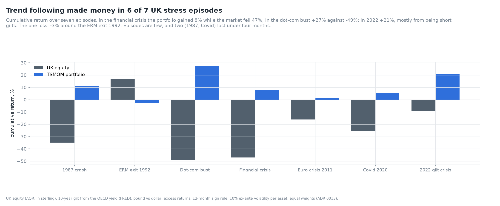

| Episode | Months | UK equity | TSMOM portfolio |
|---|---|---|---|
| 1987 crash | 2 | −35% | +11% |
| ERM exit 1992 | 5 | +17% | −3% |
| Dot-com bust | 31 | −49% | +27% |
| Financial crisis | 16 | −47% | +8% |
| Euro crisis 2011 | 5 | −16% | +1% |
| Covid 2020 | 3 | −26% | +5% |
| 2022 gilt crisis | 10 | −9% | +21% |

*Table 8. Cumulative returns over stress episodes.*

The portfolio gained in six of seven episodes. The long episodes give trends time to form. In the
financial crisis it was the equity position (+33%) that paid, while gilts were flat. In 2022 the
gilt position made 55% as yields rose sharply. The pound position added 26%, partly offset by
equity (−11%). The one loss, −3%, came in the months around sterling's exit from the ERM in 1992.

Two caveats: seven episodes are few, and the episodes are chosen after the fact. The smile
regression, which uses every quarter, is the better evidence.

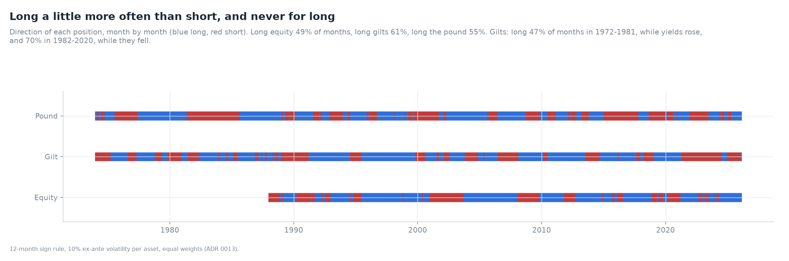

The positions chart shows how the strategy rotates. It was long equity in 49% of months, long gilts
in 61% and long the pound in 55%. For gilts the split is by era: long in 47% of months in
1972-1981, when yields rose, and in 70% of 1982-2020, when they fell.

## 7. Design choices

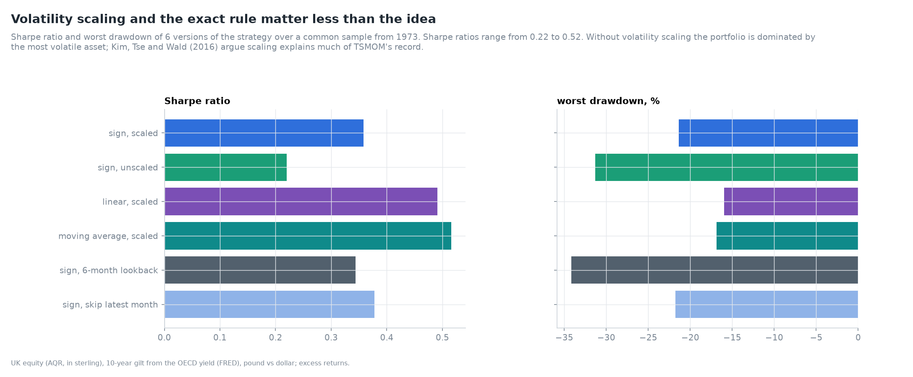

| Variant | Mean, % | Volatility, % | Sharpe | Worst drawdown, % |
|---|---|---|---|---|
| Sign, scaled (base) | 2.9 | 8.2 | 0.36 | −21 |
| Sign, unscaled | 1.5 | 6.9 | 0.22 | −31 |
| Linear, scaled | 3.4 | 6.9 | 0.49 | −16 |
| Moving average, scaled | 4.2 | 8.2 | 0.52 | −17 |
| Sign, 6-month lookback | 2.8 | 8.2 | 0.34 | −34 |
| Sign, 12-1 | 3.0 | 7.9 | 0.38 | −22 |

*Table 9. Variants of the rule, common sample from 1973 (unscaled positions hold one unit of each
asset).*

The linear and moving-average rules do better than the sign. Both weight recent months more than a
plain 12-month sum, so part of their edge may come from the gilt averaging artefact. Volatility
scaling matters: unscaled, UK equity's 15% volatility dominates the portfolio and the Sharpe ratio
falls to 0.22. That supports Kim, Tse and Wald (2016) in part. Scaling helps, but the scaled sign
rule beats its placebo too, so scaling is not the whole story.

A technical point: with monthly data, a 6-month EWMA uses about 13 effective observations. Its
volatility estimate is biased low by about 15%, so positions run at about 12% volatility, not the
10% target (ADR 0013, validation check). The Sharpe ratio is unaffected.

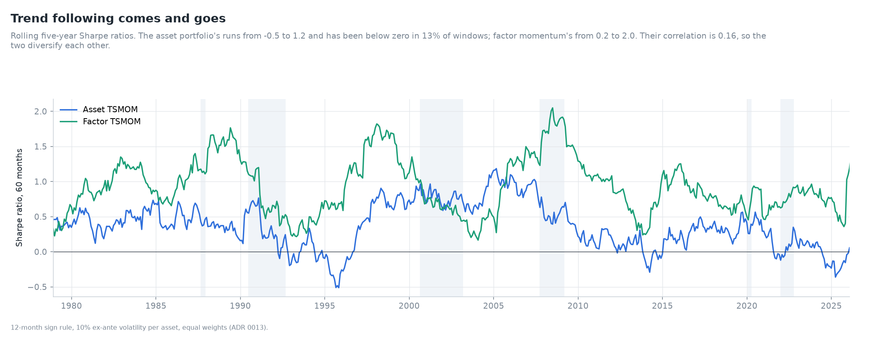

| Period | Asset TSMOM Sharpe | Factor TSMOM Sharpe |
|---|---|---|
| 1973-1989 | 0.41 | 0.88 |
| 1990-2007 | 0.52 | 0.99 |
| 2008-2026 | 0.15 | 0.82 |

*Table 10. Sharpe ratios by period.*

Asset trend following has been weak since 2008, as was widely reported for managed-futures funds in
the 2010s. Factor momentum held up.

## 8. Factor momentum

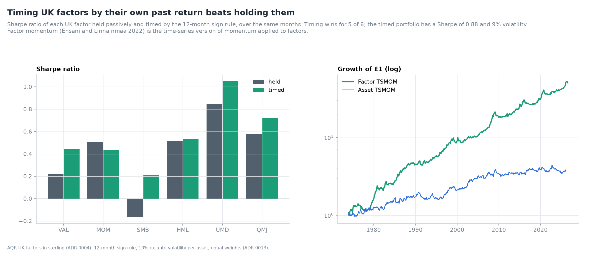

| Factor | First month | Held Sharpe | Timed Sharpe | Timed, 12-1 |
|---|---|---|---|---|
| Value (AQR VAL) | 1981 | 0.22 | 0.44 | 0.33 |
| Momentum (AQR MOM) | 1972 | 0.51 | 0.43 | 0.33 |
| Size (SMB) | 1988 | −0.16 | 0.21 | 0.08 |
| Value (HML) | 1988 | 0.52 | 0.53 | 0.30 |
| Momentum (UMD) | 1987 | 0.85 | 1.05 | 0.97 |
| Quality (QMJ) | 1993 | 0.58 | 0.72 | 0.71 |
| **Portfolio** | | | **0.88** | **0.69** |

*Table 11. UK factors held passively and timed by their own past return, same months. Factors in
sterling (ADR 0004).*

Timing improves five of six factors. The biggest gains are for value (0.22 → 0.44) and size
(−0.16 → 0.21), the two factors with long losing spells.
Momentum (AQR MOM) is the exception: it is already a trend strategy, and timing it adds little.

The 12-1 column shows that part of factor momentum is the factors' own short-run autocorrelation.
Unlike gilts, this is not an artefact: factor returns are month-end long/short returns. The
portfolio's Sharpe ratio of 0.69 without the latest month is still about twice the asset
portfolio's.

## 9. Stocks: time series against cross section

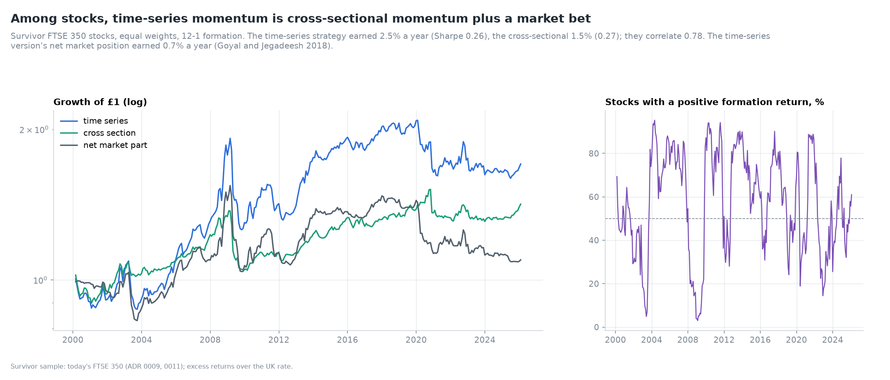

On the FTSE 350 survivor sample, each stock's 12-1 excess return gives two strategies. The
time-series strategy is long each stock with a positive return and short each with a negative one,
weight 1/N each. The cross-sectional strategy is long stocks above the month's average and short
those below.

| Strategy | Mean, % a year | Volatility, % | Sharpe | Skewness | Worst drawdown, % |
|---|---|---|---|---|---|
| Time series | 2.5 | 9.6 | 0.26 | −1.09 | −34 |
| Cross section | 1.5 | 5.6 | 0.27 | −2.41 | −24 |
| Net market part of TS | 0.7 | 8.2 | 0.09 | −0.86 | −33 |
| Equal-weighted market | 7.6 | 15.2 | 0.50 | −0.61 | −54 |

*Table 12. Stock-level strategies, 2000-2026, survivor sample (ADR 0009).*

| Regression of TS on | Coefficient | t |
|---|---|---|
| Intercept | 0.000 | 0.1 |
| Cross section | 1.39 | 16.1 |
| Market | 0.035 | 0.5 |

*Table 13. The time-series stock strategy explained.*

Among stocks, the time-series strategy is the cross-sectional one with more leverage. Its net
market position follows the share of stocks with positive formation returns, which swung between
3% (net 94% short) and 95% (net 90% long). That position earned only 0.7% a year, because it is long after markets have risen
and short after they have fallen, and stock markets did not trend reliably over 2000-2026. This
matches Goyal and Jegadeesh's (2018) US finding. The survivor sample overstates both strategies'
long legs. ADR 0009 applies: these results are comparative, not estimates of the true premia.

## 10. Validation

| Check | Reference | Result |
|---|---|---|
| Gilt returns | par-bond price against an explicit sum of cash flows; flat yield earns y/12 | 2 × 10⁻¹⁵ |
| Volatility scaling | assets with 10-40% volatility end with equal risk | 12.0-12.2% (max/min 1.012) |
| Planted trend | AR(1) expected returns found (Sharpe 1.43); noise not (0.09) | pass |
| Pooled regression | slope and month-clustered t against statsmodels | 1 × 10⁻¹⁵ |

*Table 14. The four new checks. All 27 checks pass; see [VALIDATION.md](../VALIDATION.md).*

Fourteen new tests cover gilt pricing, the carry return on sterling, look-ahead (changing future
returns leaves past positions unchanged), the signals, overlapping holding periods, the smile on a
planted straddle, the placebo and the stock decomposition.

## 11. Limitations

* **Three assets.** The UK has no free long history for commodities or other bond maturities.
  The portfolio cannot reach MOP's diversification.
* **A constructed gilt series** built from averaged yields (ADR 0014). It is a proxy, not a
  tradable bond, and it is autocorrelated at lag 1.
* **No costs.** The strategy trades when signals flip. With futures, costs on three liquid UK
  markets would be small, but they are not modelled (Day 9).
* **Survivor stocks** for Section 9.
* **Sample end.** The UK rate series ends in January 2026, so excess returns stop there.

## 12. What comes next

Day 5 turns to value's lost decade: why UK value lost after 2007, decomposed into changes in
valuation spreads, profitability and migration (Arnott, Harvey, Kalesnik and Linnainmaa 2021).

## References

* Arnott, R. D., Harvey, C. R., Kalesnik, V. and Linnainmaa, J. T. (2021). Reports of value's
  death may be greatly exaggerated. *Financial Analysts Journal*, 77(1), 44-67.
* Baltas, A.-N. and Kosowski, R. (2013). Momentum strategies in futures markets and
  trend-following funds. Working paper, Imperial College London.
* Ehsani, S. and Linnainmaa, J. T. (2022). Factor momentum and the momentum factor. *Journal of
  Finance*, 77(3), 1877-1919.
* Fung, W. and Hsieh, D. A. (2001). The risk in hedge fund strategies: Theory and evidence from
  trend followers. *Review of Financial Studies*, 14(2), 313-341.
* Goyal, A. and Jegadeesh, N. (2018). Cross-sectional and time-series tests of return
  predictability: What is the difference? *Review of Financial Studies*, 31(5), 1784-1824.
* Heston, S. L. and Sadka, R. (2008). Seasonality in the cross-section of stock returns. *Journal
  of Financial Economics*, 87(2), 418-445.
* Huang, D., Li, J., Wang, L. and Zhou, G. (2020). Time series momentum: Is it there? *Journal of
  Financial Economics*, 135(3), 774-794.
* Hurst, B., Ooi, Y. H. and Pedersen, L. H. (2017). A century of evidence on trend-following
  investing. *Journal of Portfolio Management*, 44(1), 15-29.
* Kim, A. Y., Tse, Y. and Wald, J. K. (2016). Time series momentum and volatility scaling.
  *Journal of Financial Markets*, 30, 103-124.
* Moskowitz, T. J., Ooi, Y. H. and Pedersen, L. H. (2012). Time series momentum. *Journal of
  Financial Economics*, 104(2), 228-250.
* Working, H. (1960). Note on the correlation of first differences of averages in a random chain.
  *Econometrica*, 28(4), 916-918.
