# Value's lost decade in the UK

*Day 5 of 15 · uk-value-momentum v0.5.0*

## Summary

From 2007 to 2020 the value premium, buying cheap stocks and selling expensive ones, lost money
in the UK, as it did in the US and Europe. This note measures how deep the loss was, how unusual it
was by the factor's own history, and what lines up with it. One question it cannot answer with free
data is how much of the loss came from value stocks becoming cheaper relative to growth stocks. That
decomposition (Arnott, Harvey, Kalesnik and Linnainmaa 2021) needs book values, which the free UK
data does not have (ADR 0015).

Findings, January 2007 to September 2020:

1. **The loss depends on the definition.** HML (book-to-market, updated once a year) lost 18%.
   HML Devil, which uses current prices, lost 44%. AQR's multi-measure value factor (VAL) lost
   66%. Exeter's HML lost 40% to June 2016.
2. **The UK, the US and Europe lost together; Japan did not.** AQR's value lost 65% in the UK,
   51% in the US and 58% in Europe, and gained 16% in Japan.
3. **The decade was rare but not impossible.** Resampling HML's pre-2007 record in blocks, a
   165-month loss this deep has a probability of about 5%. For VAL it is about 1%.
4. **There is no significant break in the mean.** The largest Wald statistic for a change in HML's
   average return is 6.1 (5% critical value 8.85), at October 2020: the end of the decade, not its
   start. A bootstrap gives p = 0.30.
5. **An investor would have halved, not abandoned, the estimate.** HML's expanding mean fell from
   6.8% a year in 2006 to 3.5% in September 2020, a band that still contained both zero and 6.8%.
   By July 2026 it was back to 5.6%, and its band excluded zero.
6. **Value's short positions in momentum and quality explain part of the loss.** Of the summed
   return gap, momentum exposure contributed −33 points and quality −64. Including quality in the
   model shrinks the unexplained residual from −78 to −58 points.
7. **During the decade, value became a bet on gilt yields.** HML gained 3.8% for each percentage
   point rise in the ten-year gilt yield (t = 3.5), against −0.7% (t = −0.8) before 2007. Yields
   fell 4.3 points over the decade: about −17 points of return at that sensitivity.
8. **Growth stocks won, rather than value stocks losing.** From 2007 to June 2016, Exeter's value
   decile beat the market by 4% in total, while the growth decile beat it by 47%. Before 2007 the
   growth decile had trailed the market by 4.1% a year.
9. **Small and large value lost alike:** −40% and −42% to June 2016.
10. **Timely prices made the decade worse.** HML Devil minus HML lost 31% over the decade. The
    difference correlates −0.72 with momentum: it is a bet against recent winners.
11. **Value has done well since.** After September 2020 UK HML has a Sharpe ratio of 1.54
    (standard error 0.53), and recovered its 2011 peak by May 2022. VAL was still 44% below its 2007
    peak in July 2026.

Four new validation checks bring the suite to 31, all passing.

## 1. The question

The value premium is the oldest anomaly in empirical finance (Graham and Dodd 1934; Basu 1977;
Fama and French 1992). Its long absence after 2007 led to a debate: had the premium disappeared,
been arbitraged away, or been mismeasured in an economy of intangible assets? Or was it an unlucky
run of an unchanged premium? Fama and French (2021) argue that the US evidence cannot distinguish
a lower premium from bad luck. Arnott et al. (2021) attribute most of the US loss to revaluation:
value stocks got cheaper relative to growth stocks, which is a temporary effect. Lev and
Srivastava (2022) argue that book value misses intangible capital.

This note asks the same questions of the UK, with the data a UK student can use freely.

## 2. Data

| Series | Definition | Source | Period |
|---|---|---|---|
| HML | High minus low book-to-market, annual rebalancing, in sterling | AQR | 1988-2026 |
| HML Devil | As HML with the current price (Asness and Frazzini 2013) | AQR | 1988-2026 |
| VAL | Several value measures combined, long/short | AQR | 1981-2026 |
| Exeter HML, deciles, 2 × 3 portfolios | Book-to-market sorts | Gregory, Tharyan and Christidis (2013) | 1980-2016 |
| US, Europe, Japan VAL | AQR value in dollars | AQR | 1972-2026 |
| Ten-year gilt yield | OECD long-term yield | FRED | 1960-2026 |

*Table 1. Data. AQR series are converted to sterling (ADR 0004).*

## 3. The episode

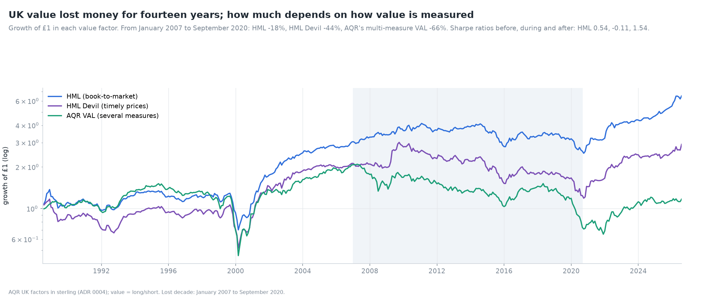

| Factor | Cumulative, 2007-2020 | A year | Sharpe before 2007 | Sharpe 2007-2020 | Sharpe after |
|---|---|---|---|---|---|
| HML | −18% | −1.4% | 0.54 | −0.11 | 1.54 |
| HML Devil | −44% | −4.1% | 0.36 | −0.27 | 1.17 |
| VAL | −66% | −7.5% | 0.45 | −0.56 | 0.68 |
| Exeter HML (to June 2016) | −40% | −5.2% | 0.55 | −0.57 | - |

*Table 2. The three UK value factors over the lost decade.*

The spread between definitions is itself a finding. HML updates its book-to-market sort once a
year, using prices six months old. Devil and VAL use current prices, so they hold more of the stocks
that have just fallen. In a decade when cheap stocks kept getting cheaper, the more up-to-date the
measure, the worse it did.

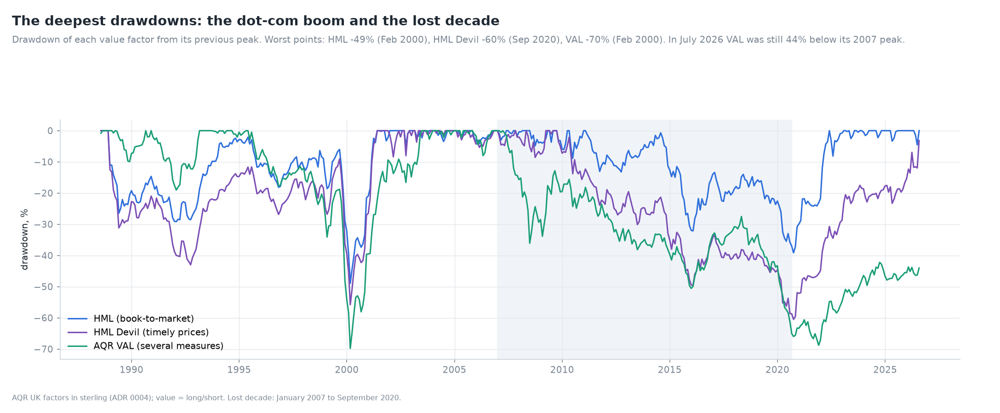

| Factor | Worst drawdown | Trough | Recovered |
|---|---|---|---|
| HML | −49% | February 2000 | May 2001 |
| HML (lost decade) | −39% | September 2020 | May 2022 |
| HML Devil | −60% | September 2020 | not by July 2026 |
| VAL | −70% | February 2000 | June 2003 |
| VAL (lost decade) | −69% | November 2021 | not by July 2026 |

*Table 3. The deepest drawdowns.*

The dot-com boom produced value's deepest drawdowns: sharper but much shorter. The lost decade was
a slow loss, not a crash.

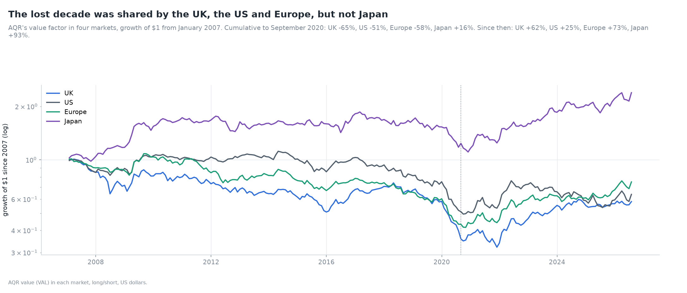

| Market | 2007 to September 2020 | Since |
|---|---|---|
| UK | −65% | +62% |
| US | −51% | +25% |
| Europe | −58% | +73% |
| Japan | +16% | +93% |

*Table 4. AQR value (VAL) in four markets, US dollars, long/short.*

The episode was not British. That matters for explanations: a story specific to the UK (Brexit,
the composition of the FTSE) cannot explain a loss shared with the US and Europe.

## 4. Was it unusual?

### 4.1 A break in the mean

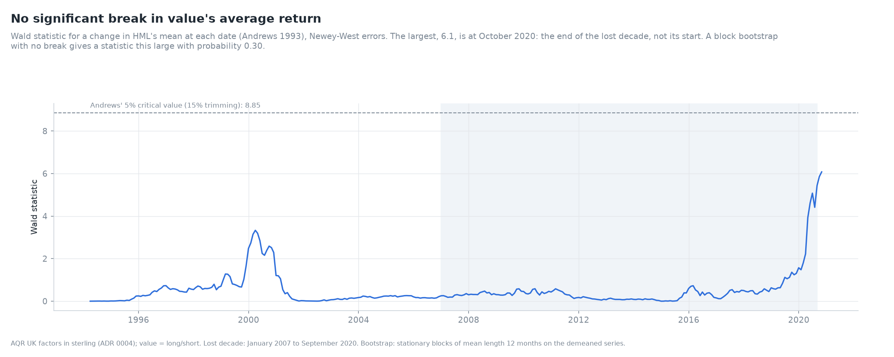

If the premium fell permanently, HML's mean should show a break. The sup-Wald test (Andrews 1993)
computes, for every date in the middle 70% of the sample, the squared Newey-West t-statistic of a
change in the mean at that date, and takes the largest. For HML the largest is 6.1, in October
2020, below the 5% critical value of 8.85. A block bootstrap of the demeaned series gives p = 0.30.
The statistic peaks at the end of the lost decade, where the strong recovery begins, rather than at
its start. The data cannot say that the premium changed.

### 4.2 The probability of such a loss

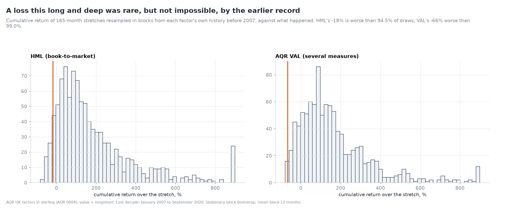

| Factor | Months | Loss | Probability from pre-2007 history |
|---|---|---|---|
| HML | 165 | −18% | 5.5% |
| VAL | 165 | −66% | 1.0% |

*Table 5. Probability of a 165-month loss at least this deep, block bootstrap (mean block 12
months) of the factor's own record before 2007.*

A 5% event is rare but not damning: across the many factors and markets that investors watch, a
few such episodes are expected. VAL's loss is rarer, closer to a 1-in-100 event, and it has not yet
recovered.

### 4.3 What an investor would have learned

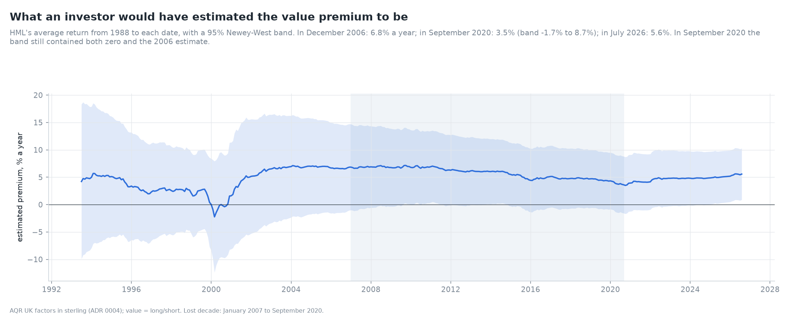

| Date | Estimated premium | 95% band |
|---|---|---|
| December 2006 | 6.8% | −1.0% to 14.7% |
| September 2020 | 3.5% | −1.7% to 8.7% |
| July 2026 | 5.6% | 0.9% to 10.3% |

*Table 6. HML's expanding mean from 1988, Newey-West band.*

The decade halved the estimate, but the band at its end still contained both zero and the 2006
estimate. Thirty years of data cannot pin down a premium with an 11% volatility. This is the same
point Fama and French (2021) make for the US.

## 5. What lines up with the loss

### 5.1 Other factors

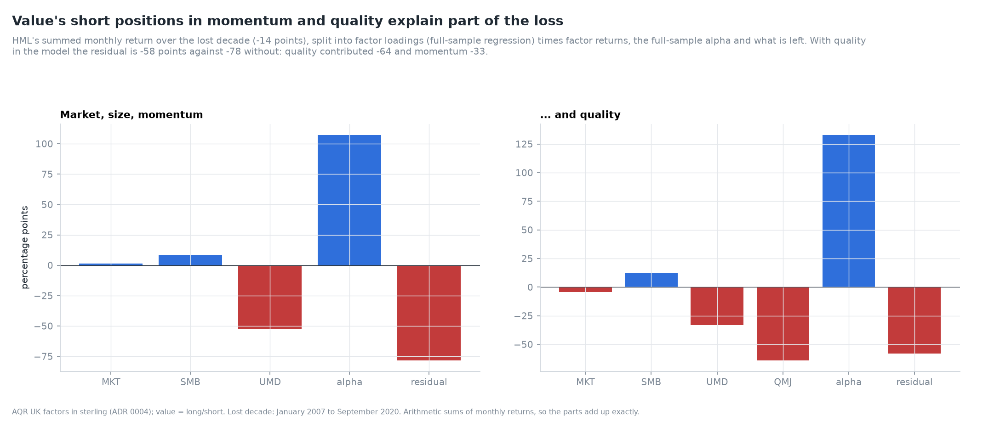

| Component | Market, size, momentum | ... and quality |
|---|---|---|
| Market | +1 | −4 |
| Size | +9 | +13 |
| Momentum | −52 | −33 |
| Quality | - | −64 |
| Alpha (expected) | +107 | +133 |
| Residual | −78 | −58 |
| Total | −14 | −14 |

*Table 7. HML's summed monthly return over the lost decade, in percentage points, split into
full-sample loadings × factor returns, the full-sample alpha and the residual.*

HML is negatively correlated with momentum (−0.31 before, during and after the decade) and short
quality. Momentum and quality both did well after 2007, which cost value about a third of its
expected alpha. Most of the shortfall, −58 points, is not explained by these exposures. The
correlation with momentum did not change, so the loss is not a new hedging relationship.

### 5.2 Gilt yields

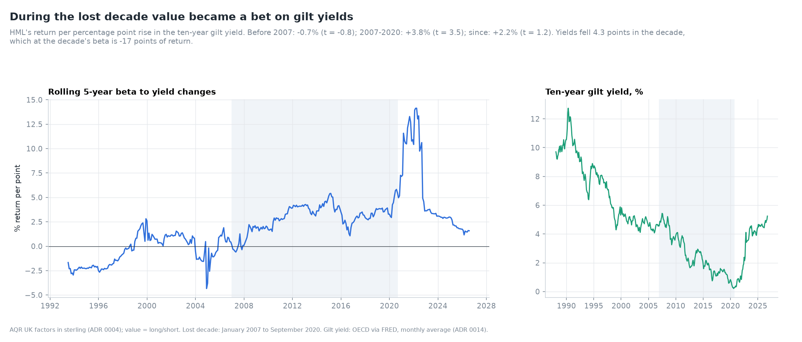

| Period | Return per point rise in the gilt yield | t |
|---|---|---|
| 1988-2006 | −0.7% | −0.8 |
| 2007-2020 | +3.8% | +3.5 |
| October 2020 onwards | +2.2% | +1.2 |

*Table 8. HML on the monthly change in the ten-year gilt yield.*

Before 2007, value had no relation to interest rates. During the decade it did: growth stocks, with
cash flows far in the future, gain most when long rates fall. Yields fell 4.3 points from 2007 to
2020, about 17 points of HML's return at the decade's sensitivity. They rose 4.7 points after 2020,
when value recovered. The rolling five-year beta peaked in 2021-2022. The relation is consistent
with the "value is short duration" view. But the beta itself changed: it was not present before
2007, so it is a description of the decade, not a structural explanation.

### 5.3 Which leg lost

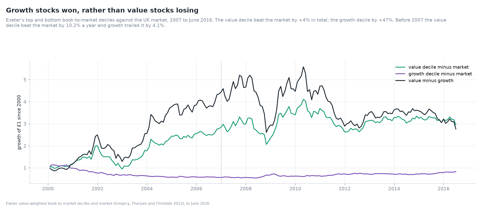

| Exeter deciles, excess over the market | Before 2007, a year | 2007 to June 2016, total |
|---|---|---|
| Value decile | +10.3% | +4% |
| Growth decile | −4.1% | +47% |
| Value minus growth | +14.4% | −38% |

*Table 9. The value and growth deciles against the UK market.*

The loss came from the growth side. The value decile kept pace with the market. The growth decile,
which had trailed the market by 4% a year for 25 years, beat it by 47% in under a decade. That is
the pattern the revaluation story predicts: growth stocks becoming more expensive relative to
value stocks. Without book values, the note cannot measure the revaluation directly.

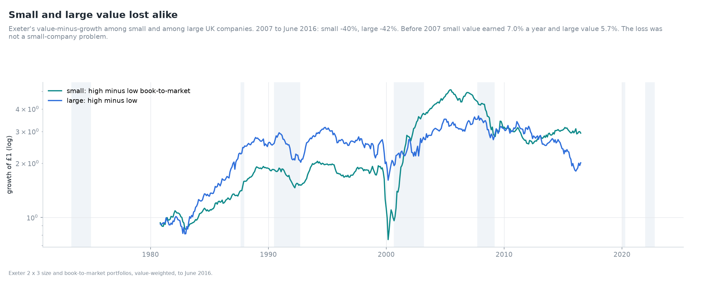

Small and large value lost alike: −40% and −42% from 2007 to June 2016, after earning 7.0% and
5.7% a year before.

### 5.4 Timely prices

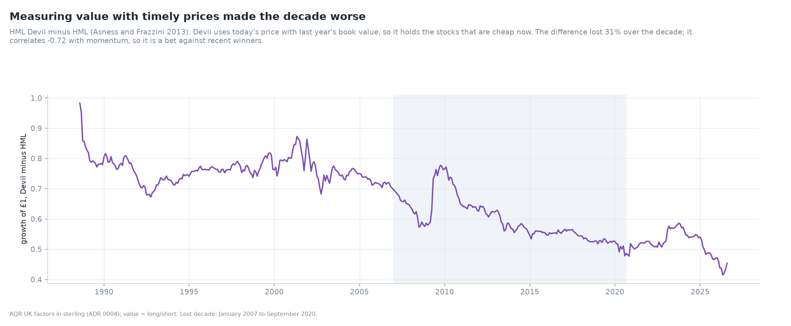

HML Devil minus HML is the return to updating the value sort with current prices. It lost 31%
over the decade and correlates −0.72 with momentum. Updating prices makes value buy recent losers.
In a decade when losers kept losing, that cost a third of the capital. Asness and Frazzini (2013)
find the Devil version better in the long run once momentum is held alongside it. On its own, in
this decade, it was worse.

## 6. Since 2020

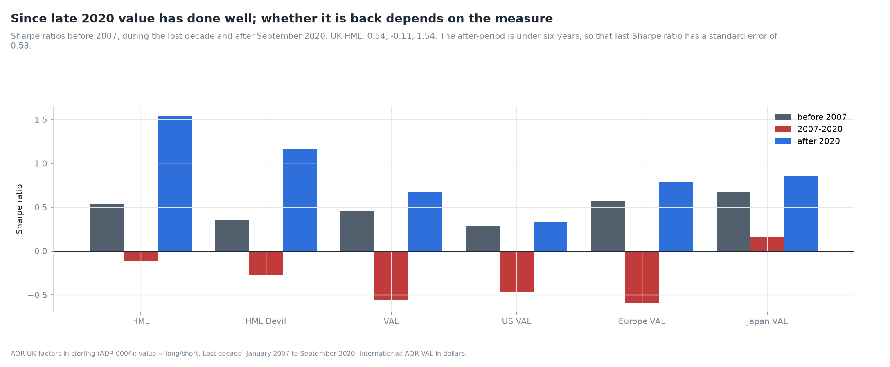

| | Before 2007 | 2007-2020 | After September 2020 |
|---|---|---|---|
| UK HML | 0.54 | −0.11 | 1.54 |
| UK HML Devil | 0.36 | −0.27 | 1.17 |
| UK VAL | 0.45 | −0.56 | 0.68 |
| US VAL | 0.29 | −0.46 | 0.33 |
| Europe VAL | 0.57 | −0.59 | 0.78 |
| Japan VAL | 0.67 | 0.15 | 0.85 |

*Table 10. Sharpe ratios by period.*

UK value's recovery has been strong: HML regained its peak by May 2022. The post-2020 sample is
short (Sharpe standard error 0.53), and VAL remains 44% below its 2007 peak. Whether the premium is
"back" depends on which measure one holds.

## 7. Validation

| Check | Reference | Result |
|---|---|---|
| Break test | planted break after month 300 | found 1 month off, Wald 15 |
| Attribution | parts sum to the total; loadings equal OLS | exact |
| Loss probability | lognormal returns, exact probability 0.0675 | 0.0645 (error 0.003) |
| Rate beta | planted 4% a point | 4.22% |

*Table 11. The four new checks. All 31 checks pass ([VALIDATION.md](../VALIDATION.md)).*

## 8. Limitations

* **No book values:** no revaluation or migration decomposition (ADR 0015).
* **The window is chosen after the fact.** The end date is a trough. Any statistic over a window
  ending at a trough looks worse than a random window.
* **Exeter data stops in June 2016**, so the leg and size results cover only two thirds of the
  decade.
* **The rate relation** uses the monthly-average OECD yield (ADR 0014) and one maturity.

## 9. What comes next

Day 6 studies quality and value traps: whether combining value with AQR's quality factor (from
1993) avoids the cheap stocks that deserve to be cheap.

## References

* Andrews, D. W. K. (1993). Tests for parameter instability and structural change with unknown
  change point. *Econometrica*, 61(4), 821-856.
* Arnott, R. D., Harvey, C. R., Kalesnik, V. and Linnainmaa, J. T. (2021). Reports of value's
  death may be greatly exaggerated. *Financial Analysts Journal*, 77(1), 44-67.
* Asness, C. and Frazzini, A. (2013). The devil in HML's details. *Journal of Portfolio
  Management*, 39(4), 49-68.
* Basu, S. (1977). Investment performance of common stocks in relation to their price-earnings
  ratios. *Journal of Finance*, 32(3), 663-682.
* Fama, E. F. and French, K. R. (1992). The cross-section of expected stock returns. *Journal of
  Finance*, 47(2), 427-465.
* Fama, E. F. and French, K. R. (2021). The value premium. *Review of Asset Pricing Studies*,
  11(1), 105-121.
* Graham, B. and Dodd, D. (1934). *Security Analysis*. McGraw-Hill.
* Gregory, A., Tharyan, R. and Christidis, A. (2013). Constructing and testing alternative
  versions of the Fama-French and Carhart models in the UK. *Journal of Business Finance and
  Accounting*, 40(1-2), 172-214.
* Lev, B. and Srivastava, A. (2022). Explaining the recent failure of value investing. *Critical
  Finance Review*, 11(2), 333-360.
